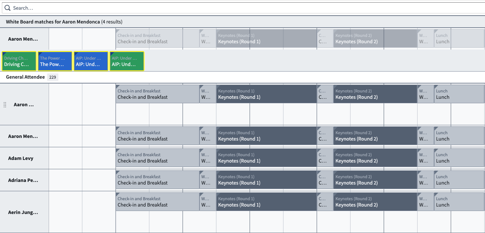
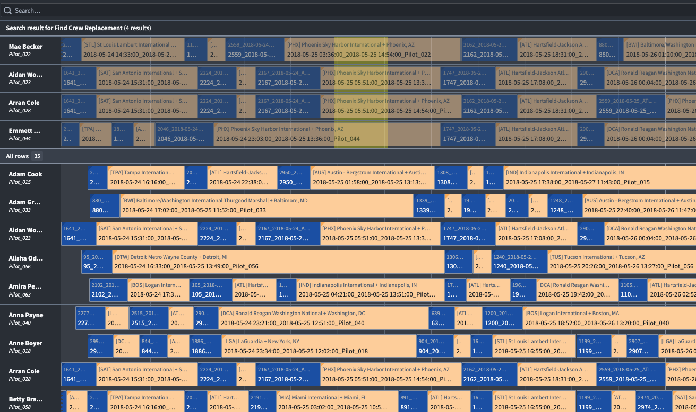
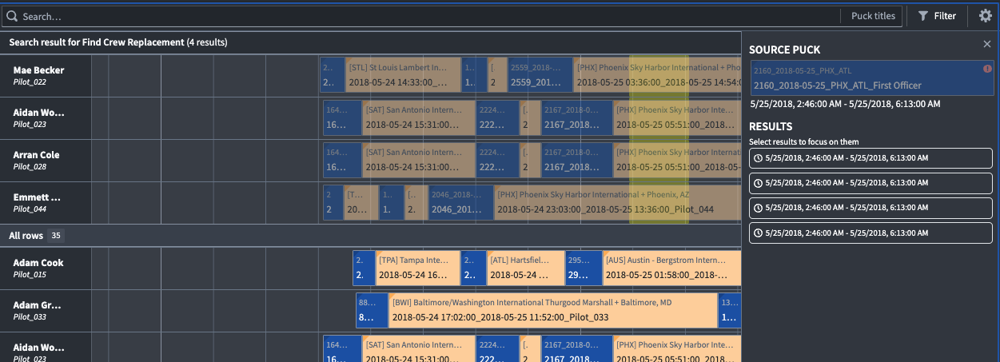

:::callout{theme="warning"}
注意：以下翻译的准确性尚未经过验证。这是使用 [AIP ↗](https://www.palantir.com/platforms/aip/) 从原始英文文本进行的机器翻译。
:::

# 搜索函数

搜索函数使用户能够快速找到并评估其调度工作流中出现的特定、独特问题的可能解决方案。

每个搜索函数都由一个TypeScript函数支持。灵活的界面允许搭建者编写能够返回puck、时间段或两者结合的函数。此外，搜索函数可以是基于行的或基于puck的。

对于基于行的搜索函数，用户必须右键单击空白区域，并传入行Object和时间作为函数输入。对于基于puck的搜索函数，用户必须右键单击一个puck以传入Object和时间作为函数输入。

下图显示了一个返回puck的搜索函数界面。



下图显示了一个返回时间段的搜索函数界面。



执行搜索函数后，将在调度甘特图中创建一个新的搜索组，结果以黄色高亮显示。通过选择组标题右侧的插入符号（**^**），可以折叠和展开搜索组。此外，用户可以通过选择**结果概览**选项来查看搜索结果的详细信息，以打开显示搜索函数输出的面板，如下图所示。



## 函数界面

以下类型表示从行或puck触发搜索函数时编写搜索函数所需的信息，包括有关搜索组的详细信息。

```typescript
type IPuckSearch = (puck: ObjectReference) => ISearchResult
type IRowSearch = (rowId: string, selectedTime: Timestamp) => ISearchResult

/*
   搜索函数可以返回时间段、冰球或两者。SLOT 和 PUCK 用作 IHighlight 中的类型。
*/

export enum HighlightType {
    SLOT = "SLOT", // 表示时间段
    PUCK = "PUCK", // 表示冰球
}

/*
   用于 IHighlight 中的函数，以返回一组时间段。
*/

export interface IDomain {
    start: Long; // 开始时间
    end: Long;   // 结束时间
}

/*
   用于确定运行搜索函数后在用户界面中突出显示的内容
*/

export interface IHighlight {
    type: string; // 可以是 SLOT 或 PUCK
    // 针对 "SLOT" 需要的属性
    domain?: IDomain; // 时间范围
    containerId?: string; // 容器 ID
    // 针对 "PUCK" 需要的属性
    schedulableObjectPrimaryKey?: string; // 可调度对象主键
    schedulableObjectTypeId?: string; // 可调度对象类型 ID
    // 可选
    comment?: string; // 备注
}

/*
   定义新创建的搜索组的标题和函数返回的行。
*/
export interface IRowGroup {
    title: string; // 搜索组的标题
    containerIds: string[]; // 容器 ID 列表
    highlights: IHighlight[]; // 突出显示的内容列表
}

/*
   函数的整体返回类型。
*/
export interface ISearchResult {
    rowGroup?: IRowGroup; // 行组信息
    sourcePuckIds?: string[]; // 来源冰球 ID 列表
    error?: string; // 错误信息
}
```
