:::callout{theme="warning"}
注意：以下翻译的准确性尚未经过验证。这是使用 [AIP ↗](https://www.palantir.com/platforms/aip/) 从原始英文文本进行的机器翻译。
:::

# 调度甘特图微件

调度甘特图是一个工作坊微件，用于呈现调度或资源分配工作流的交互式甘特图。在设置微件之前，请确保您已配置好[动态调度Ontology](Ontology%20%E5%8E%9F%E8%AF%AD%E5%92%8C%E6%95%B0%E6%8D%AE%E6%A8%A1%E5%9E%8B%E9%85%8D%E7%BD%AE.md)。

配置调度甘特图微件的模块构建者可以：

* 设置资源对象行的标题和副标题属性（包括图标和函数支持的属性）。
* 选择在右键菜单中出现的操作、事件和推荐。
* 选择界面选项（颜色）和交互（分配行为、捕捉行为）以供调度对象使用。

在下面的示例中，调度甘特图为飞行指派飞行员。

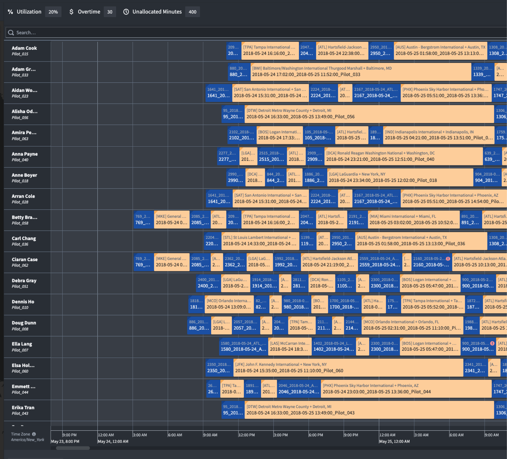

## 微件设计

下图提供了微件设计的概览。

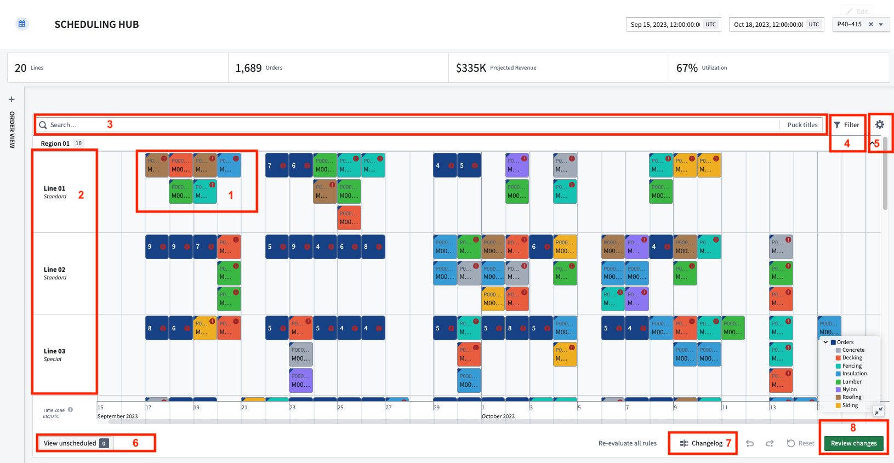

1. **调度对象（pucks）：** 每个调度对象在调度甘特图上呈现为一个 puck。用户可以通过拖放这些 puck 来更新对象的开始时间、结束时间和/或链接的资源对象。Pucks 具备两个额外的功能：

   * **调度对象详情：** 当光标悬停在 puck 上时显示为卡片。默认情况下，卡片将显示开始/结束时间、配置在调度对象类型上的任何规则的状态，以及一个指向对象视图的链接。构建者还可以添加他们希望显示的属性。

   * **右键菜单：** 当用户右键点击 puck 时触发。构建者可以配置操作、事件和推荐。

2. **资源对象行：** 每个资源对象在调度甘特图中呈现为一行。
   * **资源对象详情：** 当光标悬停在行上时显示为卡片。卡片显示对象标题、应用构建者选择的属性以及一个指向对象视图的链接。

3. **搜索栏：** 调度甘特图微件包含一个微件内的搜索栏。当用户输入搜索词时，结果将以黄色边框突出显示。按下 `Enter` 键将创建一个包含结果的新搜索组。

4. **违规规则筛选：** 违规规则筛选用于关注需要注意的调度方面。您可以打开/关闭要评估其调度的规则，并筛选出违反选定规则的对象。

5. **用户偏好：** 用户可以定义并保存他们的首选设置。可自定义选项包括：
   * **高度缩放级别：** 控制行和 pucks 的高度。
   * **时区：** 默认情况下，Foundry 中的所有时间戳都为 UTC。此功能将处理用户选择的时区偏移。
   * **折叠 pucks：** 微件将自动将重叠的 pucks 合并为一个 puck，以节省屏幕空间。此切换允许用户打开和关闭此功能。
   * **标记当前时间：** 当前时间将由一条红色垂直线表示。
   * **展开图例：** 确定图例默认是展开还是折叠。
   * **展开未调度：** 确定未调度的抽屉默认是展开还是折叠。
   * **展开所有嵌套的 pucks：** 确定嵌套的 pucks 默认是展开还是折叠。
   * **滚动到外部选择的 pucks：** 如果启用，当用户在微件外选择一个调度对象时，时间轴将滚动到选定对象的位置。
   * **保持行宽：** 用户可以通过拖动行边界来调整资源对象行的宽度。宽度偏好可以保存，以便在应用重新加载时宽度不重置为默认值。
   * **保持行/分组顺序：** 用户可以通过拖放手动重新排序资源对象行。顺序偏好可以保存，以便在应用重新加载时顺序不重置为默认值。

6. **未调度抽屉：** 如果调度对象没有开始/结束时间和链接的资源对象，则被视为未调度。如果这些属性中的任何一个或全部为空，调度对象的 pucks 将出现在未调度抽屉中。

7. **更改日志：** 更改日志跟踪用户对其调度所做的所有编辑。

8. **审查更改：** 生成一个弹出窗口，摘要所有在活动场景中进行的Ontology编辑和任何剩余的验证规则违规。确认以执行Ontology编辑。

## 微件设置

调度甘特图微件包括几个必填和非必填的配置设置。本节提供了概览，必填设置被特别标记为此。

### 时间轴

* **开始时间戳 \[必填]：** 时间轴的开始。

* **结束时间戳 \[必填]：** 时间轴的结束。

* **自定义显示范围：** 配置用户首次打开工作坊模块时时间轴中显示的时间段。除非另行指定，用户将能够滚动调度甘特图的全长。

* **自定义时间轴网格精度：** 选择一个时间单位用于甘特图网格线，将覆盖默认网格线。

* **禁用时间轴缩放和滚动：** 禁用用户使用时间轴滚动或缩放功能的能力。

### 输入数据（行）

* **资源对象集 \[必填]：** 在界面中呈现为调度甘特图微件的行。集内的每个对象将有自己的一行。

* **标题图标：** 选择一个图标出现在每行的标题属性旁。

* **副标题：** 选择资源对象集的一个或多个属性，这些属性将出现在对象标题下方。此外，为每个副标题选择一个图标，如下图所示。

   

* **按属性分组：** 选择一个固定资源对象集的属性，将固定资源（行）分为子组。定义的组可以通过图表中的切换打开或关闭。在下面的示例中，资源被分为“Garden City”，“Garza”和“Hoople”组。

   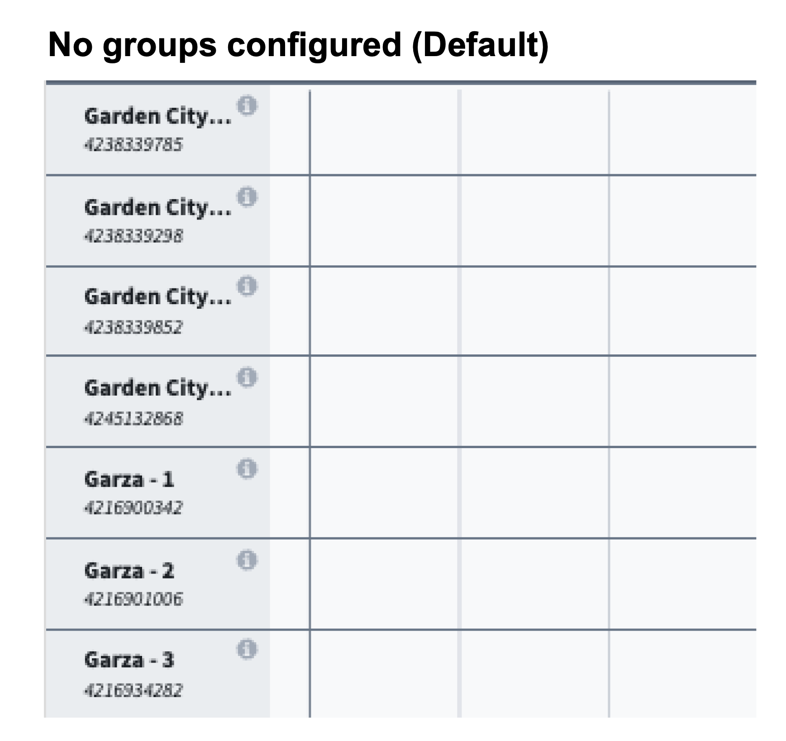

   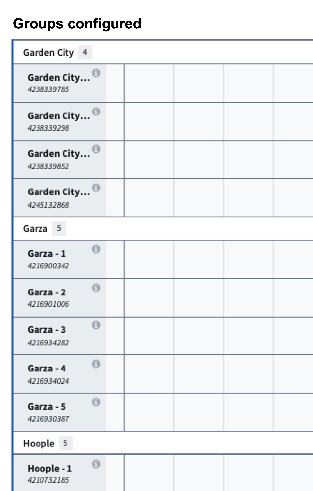

* **默认排序：** 允许应用一个或多个默认排序到图表中行的排序中。

* **右键菜单**
  * **操作配置：** 配置与资源对象类型相关的操作。这些操作可以是标准的Ontology创建、修改或删除操作，或自定义[FoO支持的操作](../../%E5%AE%9A%E4%B9%89%E6%9C%AC%E4%BD%93/%E5%87%BD%E6%95%B0/Functions%20on%20objects/%E6%A6%82%E8%BF%B0.md)。
  * **搜索函数：** 配置行级别推荐函数。当用户右键点击图表中没有安排的时间时，该函数被启动。光标的位置对应于一个特定的时间和资源对象，然后可以用作函数的输入。

* **行选择事件：** 配置工作坊事件，以在图表中选择行时触发。例如，使抽屉显示更详细的对象视图。

### 输入数据（Pucks）

* **界面**

  * **颜色配置：** 此选项允许您选择将在调度甘特图中用于所有pucks/调度对象的颜色。您可以选择 **静态** 或 **按分段**（条件格式）颜色选项。
    * **静态：** 当选择此选项时，所有pucks将为相同的颜色，使用下拉颜色选择器选择。静态颜色的pucks如下面的图像所示。

      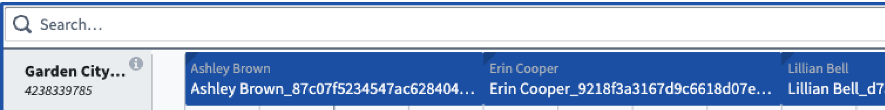

    * **按分段：** 可以在Ontology管理器中配置分段，通过将 `schedules:segment-by` 作为类型类应用于您选择的属性。使用本地Ontology管理器条件格式功能指定显示哪些颜色，否则甘特图将轮流显示一组默认颜色。当条件格式配置完成后，所选对象集的颜色将显示为左上角的三角形标志，如下面的图像所示。

      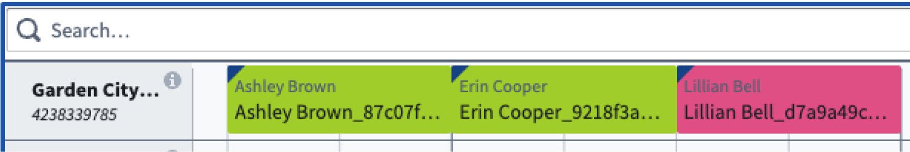

* **交互**

  * **启用交互：** 当关闭时，pucks 不能通过拖放移动，该设置作为“只读”选项。默认开启。

  * **分配行为：** 确定在调度甘特图中pucks的放置方式。共有五个预定义选项，包括：

    * **分配：** 在图表中任意拖放pucks。多个pucks可以在同一时间指派给同一资源。

      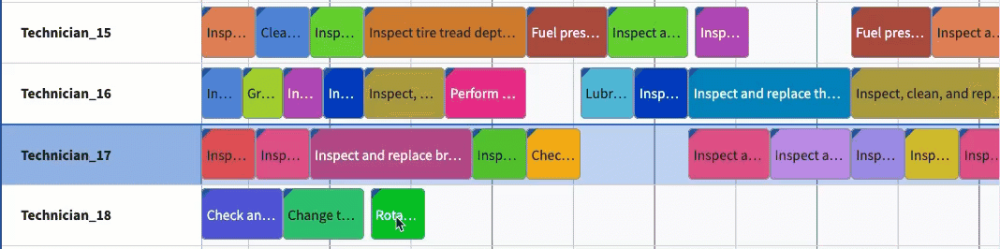

    * **分配无重叠：** 类似于**分配**，此选项确保相同对象类型的pucks不会重叠。当一个puck被放置在另一个puck上方时，现有的puck以及所有安排在后期的时间段将自动移动以防止重叠并保持顺序。

      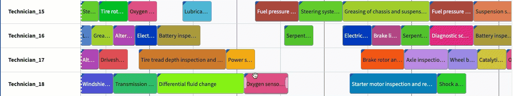

    * **交换：** 类似于**分配无重叠**，但当一个puck被放置在另一个puck上方时，pucks将互换位置。

      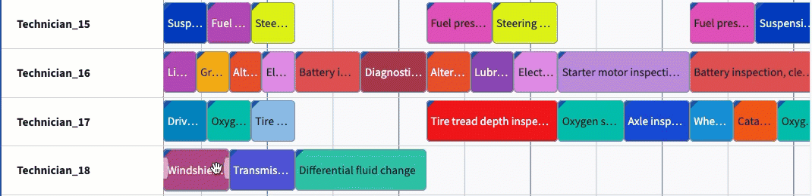

    * **与下游交换：** 类似于**简单交换**，该选项允许所选pucks互换位置。然而，在这种情况下，所有在交换后的pucks所指派的后续pucks也将跟随其前任者，从而有效地将整个序列下游移动。

      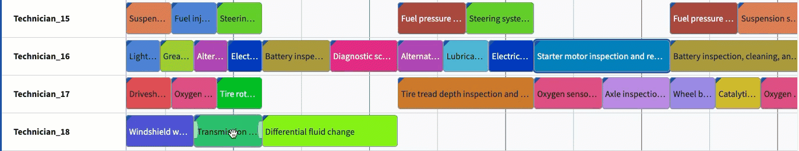

    * **捕捉到上一个：** Pucks将自动捕捉到给定行上最近现有puck的末端。

      

  * **捕捉行为：** 默认情况下，用户可以在调度甘特图微件上将对象指派到任意时间，精确到具体的分钟。捕捉行为允许构建者设置对象可以指派的定义间隔。一旦puck在图表中被放置到新位置，puck将捕捉到最近间隔的开头。

    例如，配置医生预约支持的调度的用户可能会确定所有指派（预约）需要在整点（:00）或半点（:30）开始。

    * **捕捉间隔大小** 应为确定每个间隔持续时间的整数。在下面的示例中，间隔设置为8小时。

      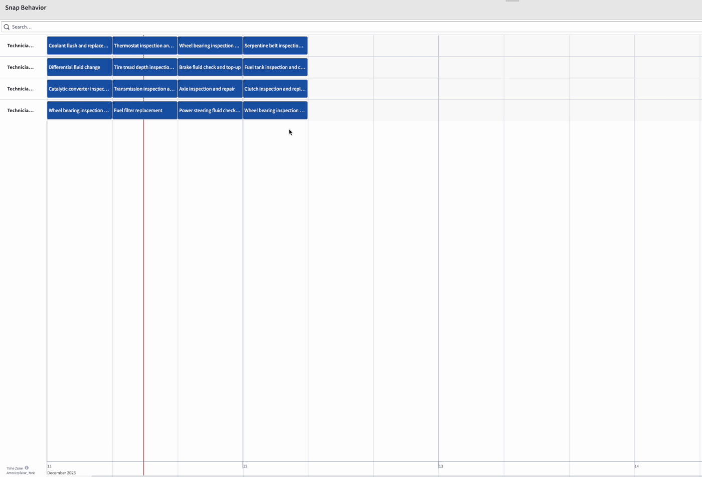

    * **开始时间戳** 选项指的是捕捉间隔的起始时间。默认情况下，捕捉间隔从调度甘特图微件的开始时间戳开始。当配置时，此变量将覆盖默认开始，并在配置的时间将puck捕捉到位。

  * **拖动光标至创建操作：** 启用跨界面拖动操作，以用于创建新的可调度对象类型的对象。用户通过在微件中按住 shift 并拖动光标来启动操作。

      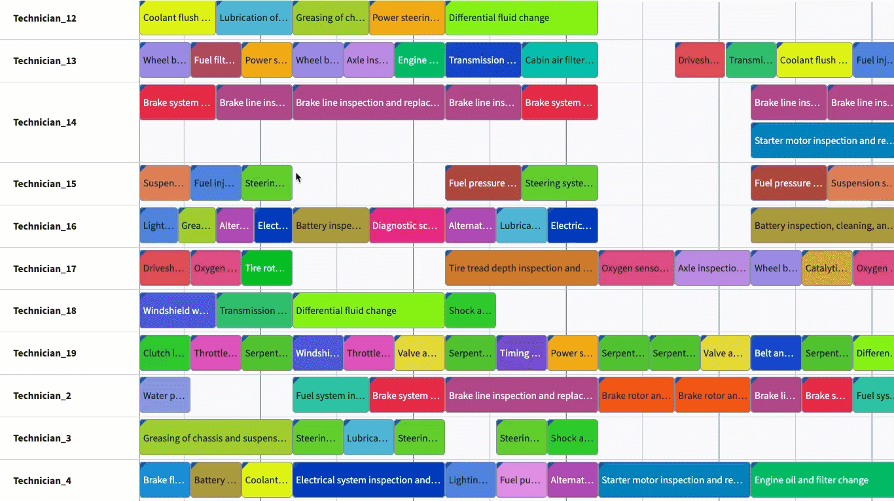

  * **自定义建议：** 为您的调度对象选择建议函数。当用户拿起一个puck时，函数结果将在图表上呈现为高亮区域，可用于指示用户可以/应该将pucks放置的位置。

  * **右键菜单：**
    * **操作配置：** 配置与调度对象类型相关的操作。这些可能是标准的Ontology创建、修改或删除操作，或自定义Function-on-Objects支持的操作。
      * **搜索函数：** 配置puck级别推荐函数。当用户右键点击puck时，该函数被启动。调度对象的开始/结束时间和对象本身可以用作函数的输入。
      * **事件：** 配置在微件中可以触发的标准工作坊事件的组合。

### 界面

**界面**部分包含以下配置选项：

* **显示光标时间标志：** 当打开时，将在时间轴上渲染一个带标志的垂直线，标志对应光标的位置。标志内的文本不可配置，始终包括时间、周数和星期几，如下图所示。

   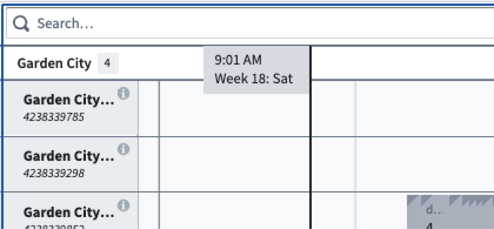

* **按可调度对象分割行：** 每个可调度对象在给定的固定资源上包含一个子行。可调度对象的顺序和标签在**可调度配置**设置中确定，并将在悬停于对象上时显示。此设置默认为关闭，仅适用于配置有多个调度对象的应用。

   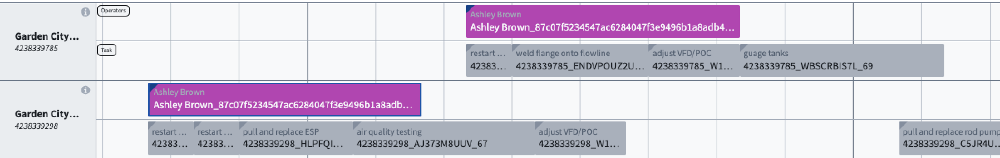

* **标准未分配 puck 大小：** 默认情况下，puck 的大小与时间持续时间成比例，如下图所示。

   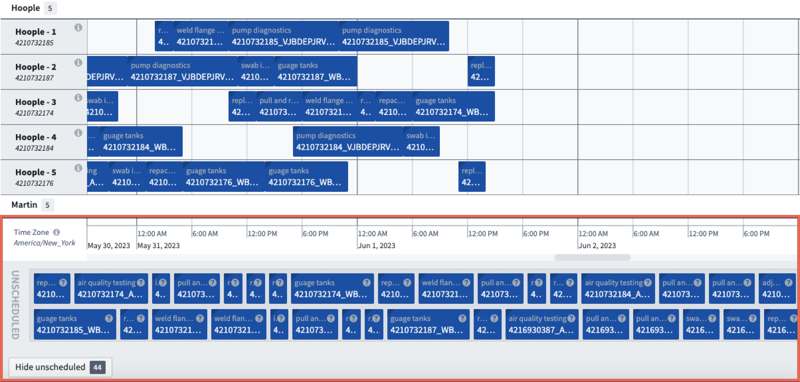

  当**标准未分配 puck 大小**被打开时，puck 大小在未分配区域中被标准化，如下图所示。

   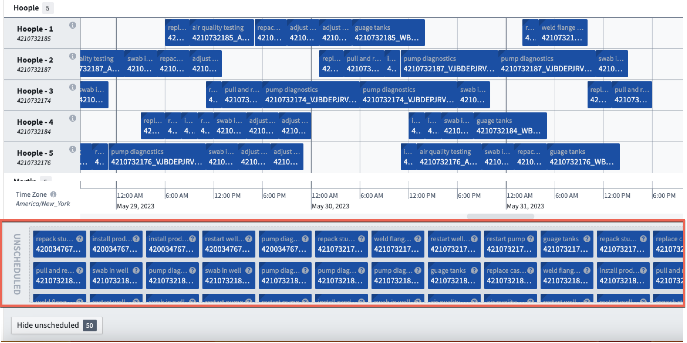

* **简化视图：** 当切换时，标题（包括搜索栏、验证规则筛选、用户偏好）和页脚（包括未调度抽屉、更改日志、审查按钮）将从视图中隐藏。模块构建者可以为只读工作流或禁用场景的工作流选择此选项。

### 输出

调度甘特图微件自动生成四个输出变量，可供其他工作坊微件使用，以增强您的应用。这些输出变量包括：

* **输出场景：** 一个场景变量，可在所有其他场景感知微件中使用。

* **选定对象：** 微件中选定对象的对象集。

* **搜索结果输出：** 最近搜索/推荐返回的对象的对象集。仅当函数返回对象时，此输出才会填充。

* **用户偏好：** 一个序列化字符串，可以与模块界面或状态保存一起使用，以保持保存的用户偏好。

您可以从微件框架右上角的**设置**齿轮配置微件的用户偏好设置。

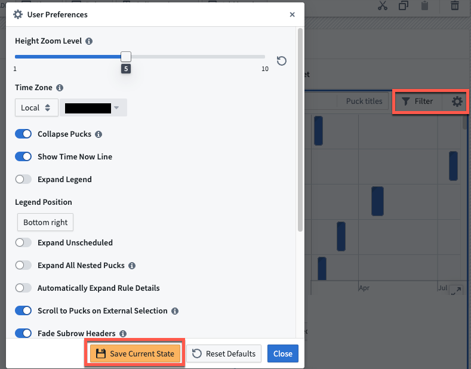

配置完成后，您可以将此配置设为所有用户的默认配置。为此，请导航到配置侧栏左侧的**用户偏好**部分，然后将变量内容（在窗口右侧）复制粘贴到**默认值**部分（在左侧）。

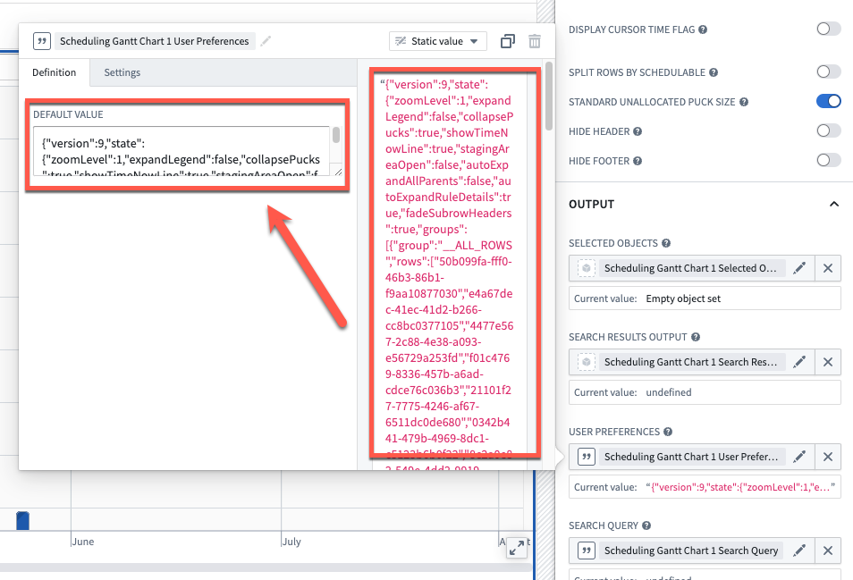
