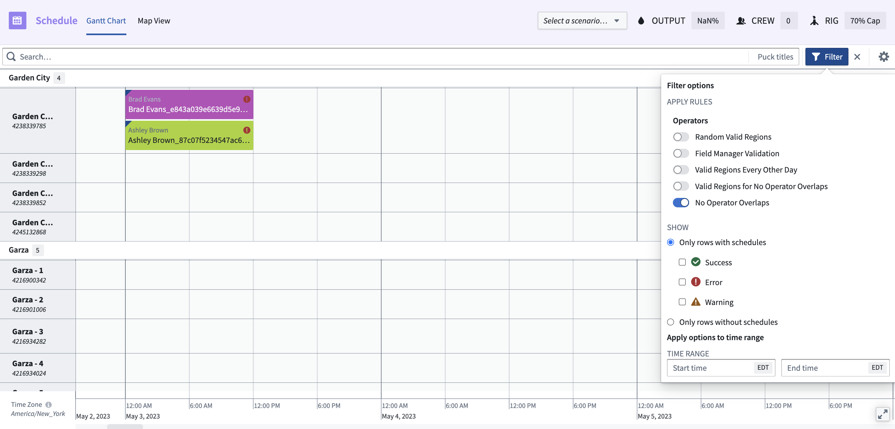
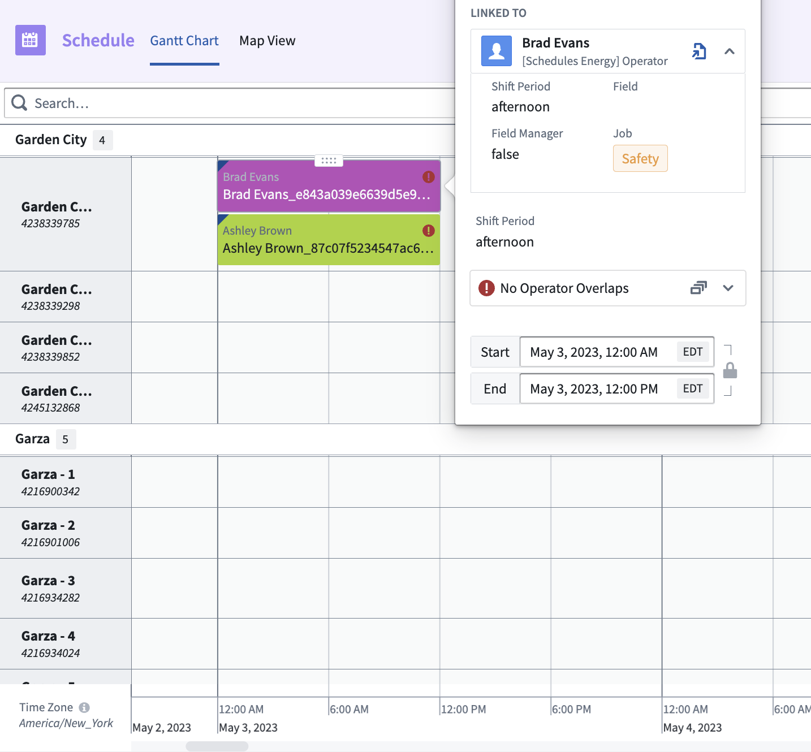
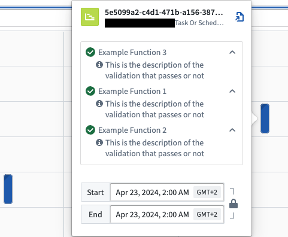
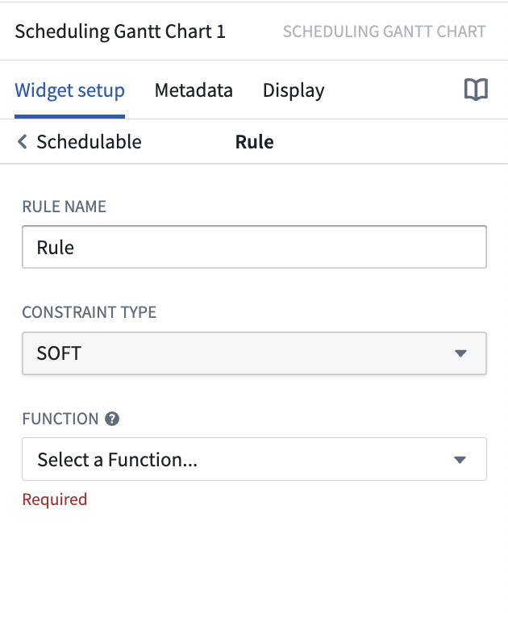

:::callout{theme="warning"}
注意：以下翻译的准确性尚未经过验证。这是使用 [AIP ↗](https://www.palantir.com/platforms/aip/) 从原始英文文本进行的机器翻译。
:::

# 验证规则

约束是任何调度工作流程中固有的一部分。从简单的时间限制到频繁变化的规则矩阵，规则的复杂性各不相同。验证规则允许您将这些约束编写成代码，从而使终端用户能够在了解定义您组织运营的限制和约束的情况下，搭建和修改计划。

每个验证规则都由一个 TypeScript 函数支持，该函数评估计划对象的当前状态是否符合函数逻辑中定义的某个条件。

用户将在 Workshop 的调度甘特图微件的前端看到验证规则的结果。初次加载时，所有规则都会根据当前的 Ontology 状态进行评估。每次对计划进行更改时，规则都会重新评估。此过程使用户了解他们的决策如何符合特定的约束和限制。

以下是调度甘特图微件中的调度约束示例。在第一张图像中，应用了规则 **No Operator Overlaps**，如切换开关所示。此选项确保仅显示遵循此规则的结果。接下来的图像展示了输出结果。在此示例中，两个行之间存在冲突，操作员 Brad Evans 和 Ashley Brown 发生了重叠。





## 编排

在 Workshop 的调度甘特图微件中，每次执行更改以验证计划时，都会调用验证规则。

```
1. 在场景上调用动作 "saveHandler"
2. 在更新的场景上调用验证规则
3. 在场景上调用动作 "saveHandler"
4. 在更新的场景上调用验证规则
等等...
n. 用户选择 "提交更改"，并将应用于场景的所有动作应用于本体
```



## 实现验证规则

规则直接在调度甘特图微件中配置，允许您在每个应用案例的基础上应用规则。要向调度甘特图微件添加规则：

1. 导航到相关对象类型的日程数据层。
2. 向下滚动到**规则**部分并选择**添加新项目**。
3. 在**规则名称**文本框中，提供将在调度甘特图中向最终用户显示的规则描述。
4. 从下拉菜单中选择**约束类型**。“HARD”将由一个带感叹号的红色圆圈表示。“SOFT”将由一个带感叹号的橙色三角形表示。
5. 从下拉菜单中选择**规则函数**。



### 函数界面

以下类型表示编写验证规则所需的信息，其中包括每个对象的规则状态。

```typescript
type IFoORule = (scheduleObjectPrimaryKeys: string[]) => Array<IRuleResult>

/*
   规则结果的解释如下：
   true - 规则验证为通过
   false - 规则验证为未通过
   undefined - 规则与给定的计划对象无关
*/

interface IRuleResult {
    result: boolean | undefined; // 规则验证结果，可以是 true, false 或 undefined
    scheduleObjectPrimaryKey: string; // 计划对象的主键
    details?: Array<IRuleResultDetails>; // 规则结果的详细信息
}

/*
   默认情况下，弹出卡片上的文本将显示在规则对象中配置的规则名称

   可选地，您可以基于规则评估结果显式定义自定义文本

   此外，您可以提供一组相关的 puckIds，以指引用户了解规则为什么通过或失败
*/

interface IRuleResultDetails {
    description: string; // 规则结果的描述文本
    relatedPuckIds: string[]; // 与规则结果相关的 puckId 列表，帮助用户了解规则通过或失败的原因
}
```

### 示例函数

以下是一个不包含验证核心逻辑的函数的基本示例：

```typescript
import { Function, Integer } from "@foundry/functions-api";
import { Objects, TaskOrSchedule, ObjectSet} from "@foundry/ontology-api";

// 有关类型定义，请查看我们的公共文档

interface IRuleResultDetails {
    description: string; // 描述
    relatedPuckIds: string[]; // 相关的Puck ID
}
interface IRuleResult {
    result: boolean | undefined; // 结果，可能是布尔值或未定义
    scheduleObjectPrimaryKey: string; // 日程对象的主键
    details?: Array<IRuleResultDetails>; // 详细信息，可选
}
type IFoORule = (scheduleObjectPrimaryKeys: string[]) => Array<IRuleResult> // 定义函数类型，接受日程对象主键数组，返回IRuleResult数组


export class MyFunctions {

    @Function()
    public async evaluateIfTaskOrScheduleIsValid(scheduleObjectPrimaryKeys: string[]): Promise<Array<IRuleResult>> {
        // 创建响应数据结构
        var arrayResponses : Array<IRuleResult> = [];

        scheduleObjectPrimaryKeys.forEach(pk => {
            // 获取每个日程对象的主键
            const currentSchedulePK = scheduleObjectPrimaryKeys[i];

            // 使用主键做一些操作；获取对象，验证某些内容，...

            // 构建响应
            const currentValidationDetails : Array<IRuleResultDetails> = [];
            currentValidationDetails.push(
                {
                    description: "这是验证通过与否的描述",
                    relatedPuckIds: []
                });

            const currentResponse : IRuleResult= {
                result: true, // 验证结果，这里假设为true
                scheduleObjectPrimaryKey: currentSchedulePK,
                details: currentValidationDetails, // 详细验证信息
            };
            arrayResponses.push(currentResponse); // 将当前响应推入响应数组
        });

        return arrayResponses; // 返回所有响应
    }
}

```

可以创建更复杂的验证规则。例如，规则可以检查以下内容：

* 日程是否按顺序排列（无间隙）
* 日程是否重叠
* 分配到某一日程的人员是否具备匹配的技能或认证
