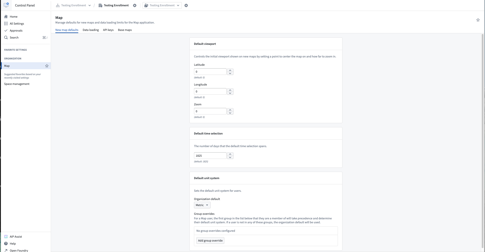

:::callout{theme="warning"}
注意：以下翻译的准确性尚未经过验证。这是使用 [AIP ↗](https://www.palantir.com/platforms/aip/) 从原始英文文本进行的机器翻译。
:::

# 控制面板

可以使用[控制面板](https://www.palantir.com/docs/foundry/administration/control-panel/)配置各种全局地图设置。要修改地图设置，您需要拥有`Map Admin`角色。

## 地图默认设置

* **默认视口**定义了创建新地图时用户将看到的初始视图，包括中心点（纬度和经度）和缩放级别。
* **默认时间选择**定义了用户选择时间范围时将显示的日期选项范围。
* **默认单位系统**设置所有用户和/或特定用户组使用的不同单位系统（指标、英制或航海）。用户可以在[地图设置](%E8%AE%BE%E7%BD%AE.md)中覆盖此默认设置。

## 配置数据加载

* \*\*时间序列轮询间隔：\*\*定义在["查看最新"模式](../Time/%E6%97%B6%E9%97%B4%E9%80%89%E6%8B%A9.md#view-the-latest-data)下，地图检查更新的时间序列数据的频率。
  * \*\*默认轮询间隔：\*\*设置新地图的默认轮询间隔（以秒为单位）。用户可以在地图内覆盖此设置。
  * \*\*允许的最小轮询间隔：\*\*设置允许的最小轮询间隔覆盖（以秒为单位）。防止用户为单个地图设置比此值更小的轮询间隔。
* \*\*Object搜索限制：\*\*控制用户可以从搜索对话框添加到地图的Object的最大数量。
* \*\*搜索周围限制：\*\*控制用户作为单次搜索周围结果添加到地图的Object的最大数量。

## API 密钥

### Mapbox：在地图上启用查找位置

[查找位置](../Interact%20with%20maps/%E5%AF%BC%E8%88%AA.md#find-locations)功能使用Mapbox的专有地理编码服务。要为您的组织启用此功能，您需要配置一个包含访问Mapbox地理编码API权限的组织特定Mapbox API密钥。

### Bing地图：启用Bing地图基础图层

要使用Bing地图基础图层，而不是默认的Mapbox基础图层，请输入Bing地图API密钥。
