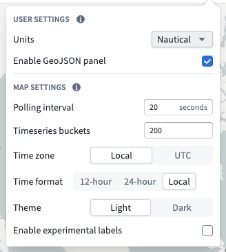
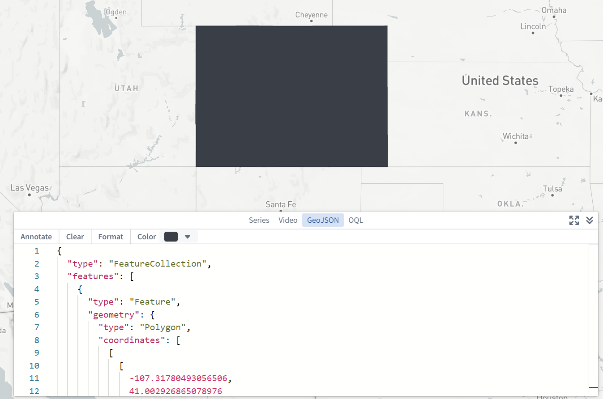

:::callout{theme="warning"}
注意：以下翻译的准确性尚未经过验证。这是使用 [AIP ↗](https://www.palantir.com/platforms/aip/) 从原始英文文本进行的机器翻译。
:::

# 设置

点击地图屏幕右上角的设置齿轮图标 () 打开设置菜单：

## 单位

您可以指定显示距离的单位。这是一个每用户的设置，并在您使用地图应用程序时为您应用。单位选项有：

* 公制
* 英制
* 航海单位

## 启用GeoJSON面板

您可以在屏幕右下角启用一个额外的GeoJSON面板，以便输入和编辑GeoJSON数据，并基于GeoJSON几何创建注释。这是一个每用户的设置，并在您使用地图应用程序时为您应用。

## 轮询间隔

您可以指定在["查看最新"模式](../Time/%E6%97%B6%E9%97%B4%E9%80%89%E6%8B%A9.md#view-the-latest-data)下加载新时间序列和时间序列属性值的频率。这是一个每地图的设置，适用于所有使用此特定已保存地图的用户。

## 时区

您可以指定显示地图的时区。这是一个每地图的设置，适用于所有使用此特定已保存地图的用户。时区选项有：

* 本地（将使用查看者计算机的时区）
* UTC

## 启用实验性标签

您可以启用一种实验性的方法来在地图上显示和定位[对象标签](../Visualize%20Ontology%20data/%E6%A6%82%E8%BF%B0.md#labels-and-tooltips)。此方法应用了一种定位算法，试图最大限度地减少标签相互重叠或遮挡对象的情况。然而，在某些情况下（例如大量标签），生成的标签定位可能会不理想，或者标签可能会以不理想或分散注意力的方式重新定位。这是一个每地图的设置，适用于所有使用此特定已保存地图的用户。
