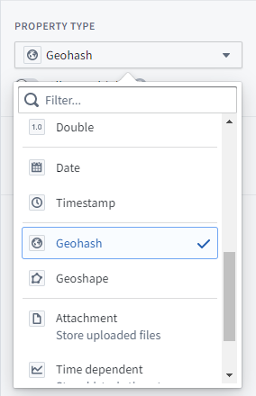
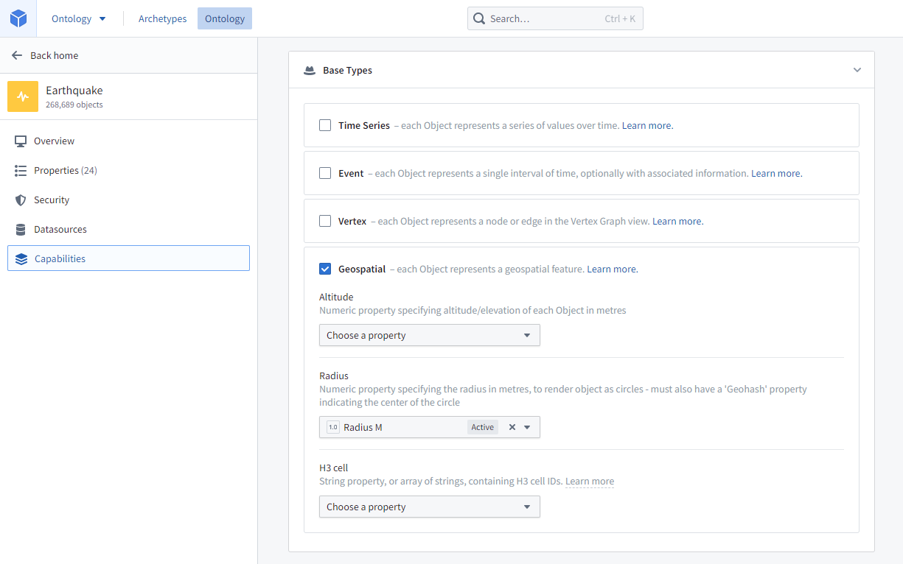
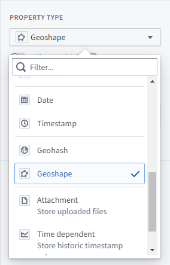
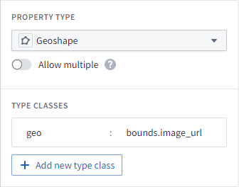
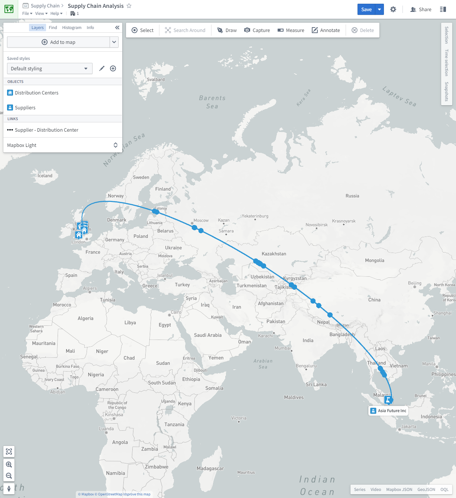
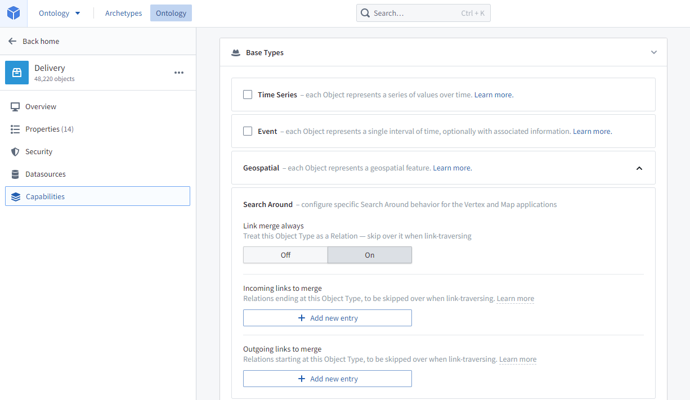
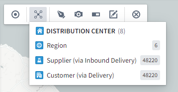

:::callout{theme="warning"}
注意：以下翻译的准确性尚未经过验证。这是使用 [AIP ↗](https://www.palantir.com/platforms/aip/) 从原始英文文本进行的机器翻译。
:::

# Ontology Object

Map应用程序支持附加了地理空间数据的Ontology对象。

## 配置地理空间对象

### 点

点几何可以使用`geohash`属性类型来指定。`geohash`属性的内容应为以下字符串之一：

* `[纬度],[经度]`：例如，`57.64911,10.40744`。坐标必须使用WGS 84 CRS（标准纬度和经度）。
* 一个[Geohash ↗](https://en.wikipedia.org/wiki/Geohash)：例如，`u4pruydqqvj`。Geohash将被转换为点，使用Geohash矩形的左下角。

具有`geohash`属性的Object被索引以进行地理空间搜索。



#### 圆形

可以通过在Object类型的**功能**选项卡中的**地理空间**部分选择**半径**属性来为Object类型指定圆形几何。半径属性可以是以米为单位的任何数值属性。



:::callout{theme="warning"}
圆形几何仅在地图上呈现，不会被索引用于搜索。如果您需要基于圆形几何进行地理空间搜索的Object，您需要使用[多边形](#polygons-and-lines)来近似圆形。
:::

### 多边形和线条

多边形和线条几何可以使用`geoshape`属性类型来指定。`geoshape`属性的内容必须是符合以下要求的GeoJSON几何字符串：

* 必须是GeoJSON LineString、Polygon、MultiLineString、MultiPolygon、MultiPoint或Point。然而，点几何不应使用`geoshape`属性类型；对于点几何，请使用[`geohash`属性类型](#points)。
* 不得是Feature、FeatureCollection或GeometryCollection。
* 必须符合[GeoJSON规范（RFC 7946）↗](https://tools.ietf.org/html/rfc7946)。
* 必须使用WGS 84坐标。
* 多边形和MultiPolygon必须根据GeoJSON规范有效。多边形和MultiPolygon必须闭合，外环使用右手/逆时针顺序，并且没有自相交。

以下是`geoshape`属性的有效GeoJSON示例：

```json
{ "type": "LineString", "coordinates": [ [100.0, 0.0], [101.0, 1.0] ] }

// 这是一个GeoJSON对象，表示一条线段
// "type"字段指定对象的类型，这里是"LineString"
// "coordinates"字段包含线段的坐标数组，每个坐标是一个经度和纬度的数组
```

具有 `geoshape` 属性的对象被索引用于地理空间搜索。



### H3 六边形

对象可以包含来自 [H3 地理空间索引系统 ↗](https://h3geo.org/docs/) 的 H3 单元格 ID 的字符串属性。这些属性将在地图上呈现为相关的六边形。

要指定字符串属性包含 H3 单元格 ID，请在对象类型的 **功能** 选项卡的地理空间部分下选择该属性为 **H3 单元格**。


:::callout{theme="warning"}
H3 六边形仅在地图上呈现，未被索引用于搜索。如果需要基于 H3 六边形进行地理空间搜索，需要将 H3 单元格 ID 转换为 GeoJSON 多边形，并如[上文](#polygons-and-lines)所述包含在 `geoshape` 属性中。
:::

### 地理校正图像

一个对象可以附加地理校正图像，例如卫星照片、航空影像或物理地图的扫描件。地理校正图像需要两个属性：

* 一个图像 URL `字符串` 属性，包含要渲染的图像的 URL。支持的图像文件扩展名包括 `.png`、`.jpg`、`.jpeg`、`.gif`、`.webp`、`.bmp`、`.ico` 和 `.svg`。图像 URL 属性的 ID 被用于配置图像边界属性。
* 一个图像边界 `geoshape` 属性，包含表示图像地理校正边界的四边形 GeoJSON 多边形。多边形必须按顺时针顺序指定其顶点，从左下角开始。
  * 图像边界属性必须具有类型类，指示图像 URL 属性的 ID，格式如下：
    * 类型：`geo`
    * 值：`bounds.<image URL property ID>` 其中 `<image URL property ID>` 是图像 URL 属性的 ID。
  * 例如，如果图像 URL 属性 ID 为 `image_url`，则类型类为：类型：`geo`，值：`bounds.image_url`



具有地理校正图像的对象被索引用于地理空间搜索，与所有 `geoshape` 属性一样。

### 来自媒体集的切片影像 \[测试版]

地理参考光栅影像也可以通过上传 GeoTIFF 影像（`.tiff`，`.tif`）到[媒体集](https://www.palantir.com/docs/foundry/data-integration/media-sets/#media-sets-beta)中，以切片形式显示。然后，具有[媒体引用属性](https://www.palantir.com/docs/foundry/data-integration/media-sets/#ontologize-media-using-media-references)的对象类型可以添加到地图中，并且只有当用户在地图上平移或缩放时，影像的可见部分才会被加载。

### 轨迹

对象可以具有表示对象随时间变化的纬度和经度的数值时间序列属性，允许用户查看对象随时间移动的路径以及其在任何时间点的位置。

要为对象类型配置轨迹，请在对象类型的 **功能** 选项卡的 **地理空间** 部分选择 **轨迹纬度** 和 **轨迹经度** 属性。这两个属性必须是表示对象随时间变化位置的数值时间序列属性。更多信息请参见[时间序列设置](https://www.palantir.com/docs/foundry/time-series/time-series-setup/)。


## 时间序列和时间序列属性

用户可以在地图中对具有时间序列数据和/或时间序列属性的地理空间对象进行时间和地理时间分析。

* 查看[时间序列概述](https://www.palantir.com/docs/foundry/time-series/time-series-overview/)以了解更多。
* 查看[时间序列设置](https://www.palantir.com/docs/foundry/time-series/time-series-setup/)以获取关于时间序列属性的更多信息。

## 事件

事件是发生在某个时间点或时间段的 Ontology 对象。可以通过在对象类型的 **功能** 选项卡的 **事件** 部分指定 **事件开始时间** 和 **事件结束时间** 时间戳属性来将对象类型配置为事件。


### 地图上的事件对象

如果将事件对象添加到地图中，可以将其配置为仅在当前时间显示（即，当所选时间戳在事件期间内时）。

### 链接到地图上对象的事件对象

如果地图上的对象链接到事件对象，则事件对象可以添加到 **系列** 面板中进行时间分析，并且当前事件计数指示器可以添加到对象标签中。例如，一个 `道路` 对象可以在地图上表示为线条，并且一个 `道路` 对象可能链接有 `交通事故` 事件；然后用户可以使用指示器查看每条道路在任何时间点的交通事件计数。

为实现这一点，事件对象类型必须在对象类型的 **功能** 选项卡的 **事件** 部分配置 **事件意图**，以指示事件的严重性。

## 搜索周围

搜索周围是基于链接的搜索，允许用户探索相关对象。

### 链接搜索周围

用户可以从任何地理空间对象搜索到与其链接的任何地理空间对象。更多信息请参见[创建链接类型](../../../%E5%AE%9A%E4%B9%89%E6%9C%AC%E4%BD%93/%E5%AF%B9%E8%B1%A1%E9%93%BE%E6%8E%A5%E7%B1%BB%E5%9E%8B/Link%20types/%E5%88%9B%E5%BB%BA%E9%93%BE%E6%8E%A5%E7%B1%BB%E5%9E%8B.md)。

### 合并链接搜索周围

地图应用程序可以运行两步搜索周围，其中一个地理空间对象通过中介对象（可以是非地理空间的）链接到另一个地理空间对象。

* 中介对象可能表示两个对象之间的关系。例如，一个 `工厂` 对象和一个 `供应商` 对象可能通过一个 `供应合同` 对象相关联；当运行搜索周围时，地图将显示从工厂到供应商的弧线，弧线代表供应合同。
* 中介对象也可能是两个对象都参与的事件。例如，一个 `客户` 对象可能通过一个 `交付` 事件链接到一个 `配送中心` 对象 - 在这种情况下，交付事件将显示为沿弧线移动的圆圈。圆圈的位置将根据事件的开始和结束时间以及当前选择的时间戳沿弧线进行插值。



有两种方法可以配置对象用于合并链接搜索周围：

* 将中介对象指定为链接合并对象，这意味着该对象类型本身永远不会出现在搜索周围列表中，但其传递链接会出现。
* 指定要合并的特定链接遍历。如果只有中介对象的某些关系应该合并链接，请使用此方法。

#### 将中介对象类型设置为始终链接合并

要将中介对象类型指定为始终链接合并，请在中介对象类型的 **功能** 选项卡的 **搜索周围** 部分启用 **始终链接合并**。这意味着对象类型本身永远不会出现在搜索周围列表中，但其传递链接会出现。



例如，如果中介对象类型是 `交付`，而任一侧的对象类型是 `配送中心` 和 `客户`，则当选择 `配送中心` 进行搜索周围时，`交付` 不会出现在列表中，但会出现 `客户（通过交付）`。参见下面的示例：



#### 设置特定的链接遍历以进行链接合并

要指定特定的链接遍历以进行链接合并，请在中介对象类型的 **功能** 选项卡的 **搜索周围** 部分指定要合并的 **传入链接** 和 **传出链接**。


例如，如果您希望能够从 `供应商` 对象类型通过 `交付` 对象类型执行搜索周围到 `配送中心` 对象类型，您将配置 `交付` 对象类型作为中介，选择 `交付 <-> 供应商` 链接为 **传入链接合并**，选择 `交付 <-> 配送中心` 链接为 **传出链接合并**。现在，当选择 `供应商` 进行搜索周围时，`配送中心（通过交付）` 将作为选项出现在列表中。

:::callout{theme="neutral"}
如果希望搜索周围列表中显示双向链接遍历（例如，既希望 `供应商` 有 `配送中心（通过交付）`，也希望 `配送中心` 有 `供应商（通过交付）`），则需要将这些链接配置为既是 **传入链接合并** 又是 **传出链接合并**。
:::

### 搜索周围函数

您可以通过编写搜索周围函数创建强大的搜索周围。请参见[搜索周围函数](%E5%9C%B0%E5%9B%BE%E6%90%9C%E7%B4%A2%E5%91%A8%E5%9B%B4%E5%87%BD%E6%95%B0.md)了解更多详细信息。

## 派生属性函数

[函数](../../../%E5%AE%9A%E4%B9%89%E6%9C%AC%E4%BD%93/%E5%87%BD%E6%95%B0/%E6%A6%82%E8%BF%B0.md)可用于在对象上创建**派生属性**。这些属性可以显示在**选择**面板中，并用于在地图上为对象着色。

任何接受对象数组并返回对象到原始类型的 `FunctionsMap` 的函数都可以用作**派生属性**。例如：

```typescript
import { Function, FunctionsMap, Double } from "@foundry/functions-api";
import { ExampleDataRoute } from "@foundry/ontology-api";

export class DerivedPropertyFunctions {
    @Function()
    public async flightCancellationPercentage(routes: ExampleDataRoute[]): Promise<FunctionsMap<ExampleDataRoute, Double>> {
        // 创建一个 FunctionsMap 对象用于存储每个航线的取消率
        const routeMap = new FunctionsMap<ExampleDataRoute, Double>();

        // 使用 Promise.all 并行获取所有航线的航班信息
        const allFlights = await Promise.all(routes.map(route => route.flights.allAsync()));

        // 遍历每个航线以计算取消率
        for (let i = 0; i < routes.length; i++) {
            const route = routes[i];
            const flights = allFlights[i];
            // 筛选出被取消的航班
            const cancelledFlights = flights.filter(flight => flight.cancelled);
            // 计算取消率
            const cancellationPercentage = (cancelledFlights.length / flights.length) * 100;
            // 将取消率存入 routeMap
            routeMap.set(route, cancellationPercentage);
        }

        // 返回包含每个航线取消率的映射
        return routeMap;
    }
}
```

这个代码定义了一个 `DerivedPropertyFunctions` 类，其中包含一个方法 `flightCancellationPercentage`，用于计算给定航线的航班取消率。使用了 TypeScript 装饰器 `@Function()` 来标记此方法，并返回一个 `FunctionsMap`，其中包含每条航线和相应的取消率。
