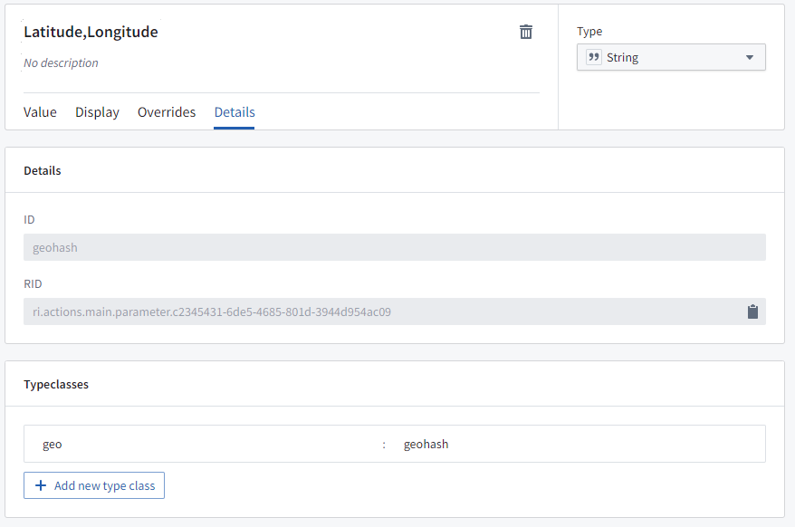
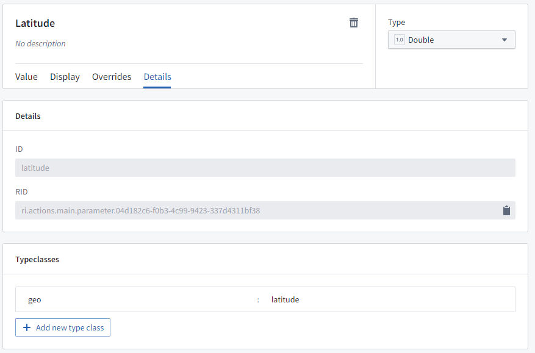
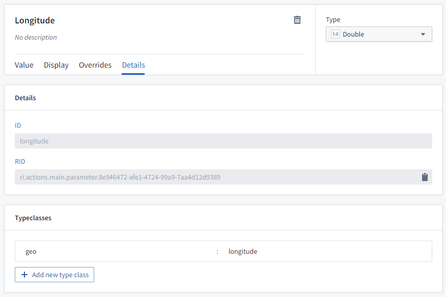
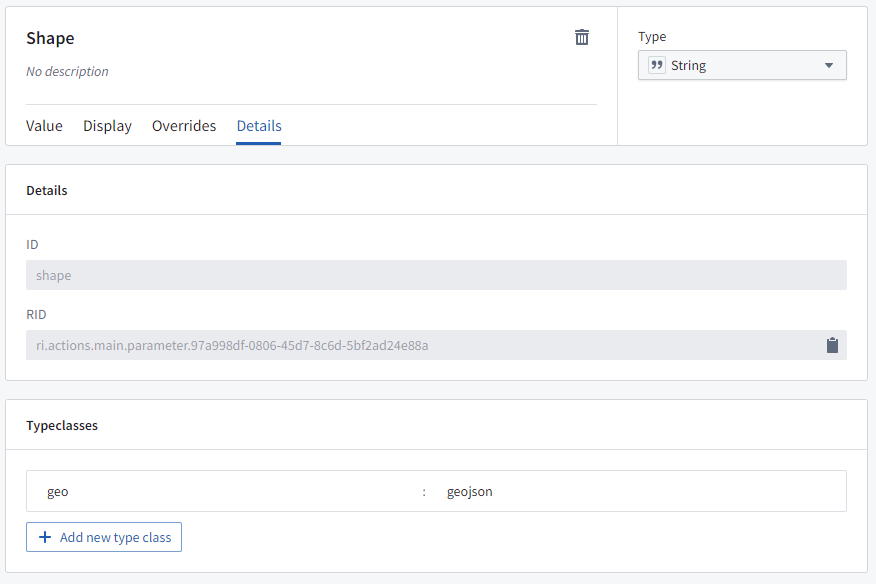
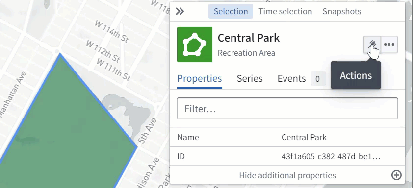
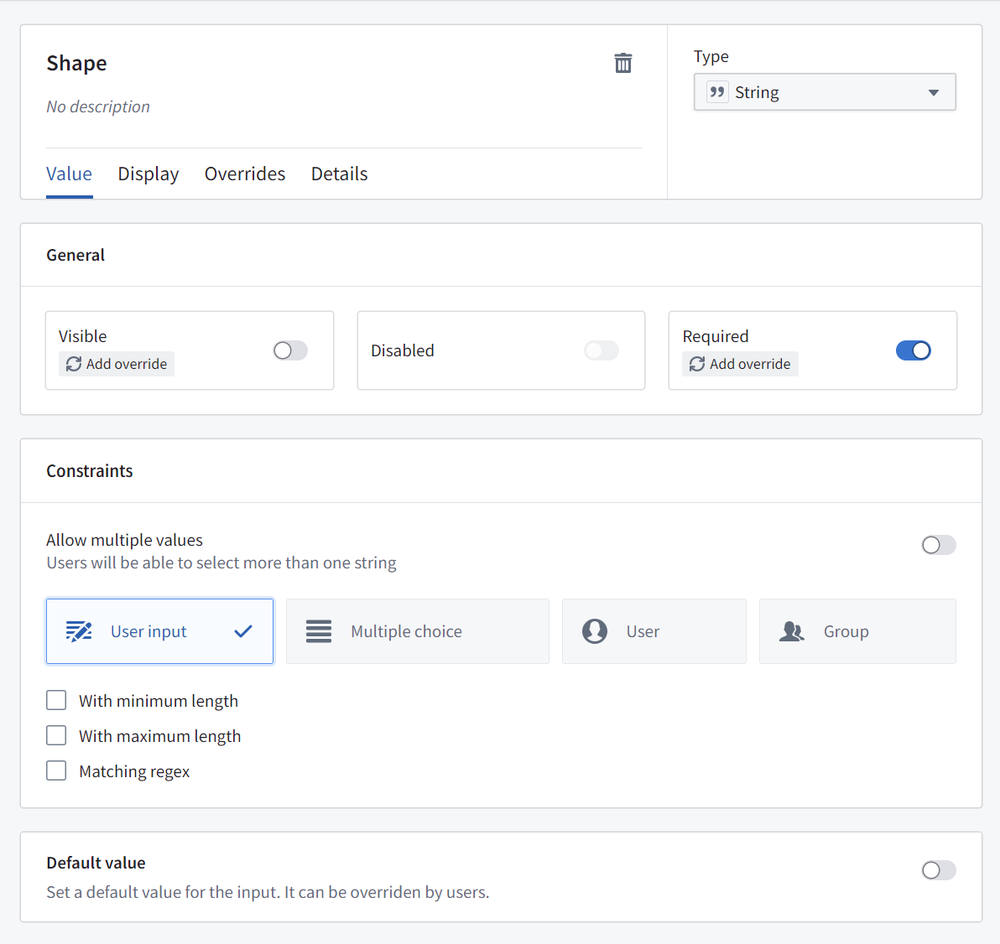
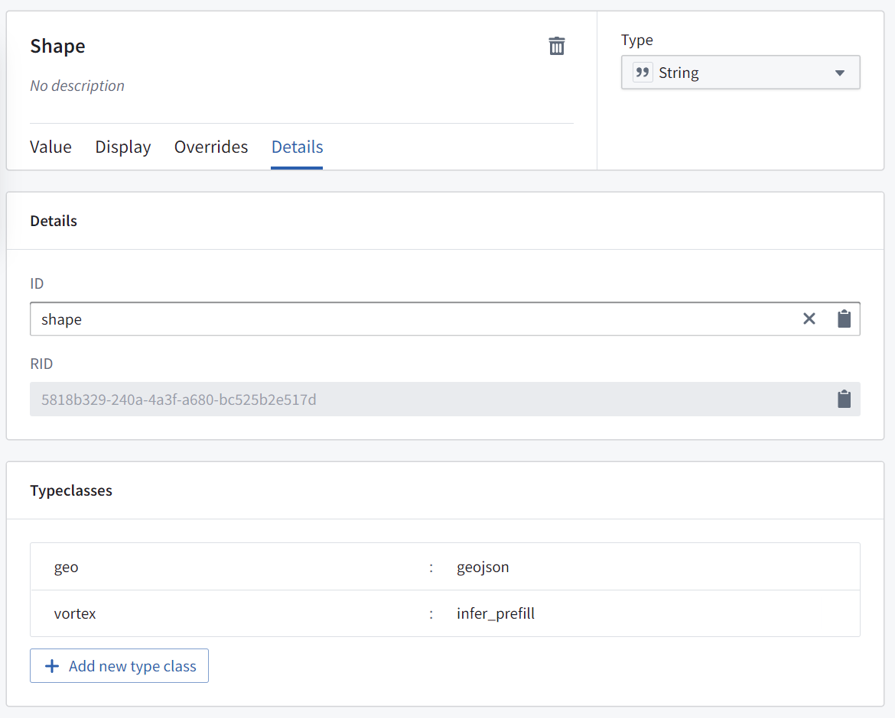

:::callout{theme="warning"}
注意：以下翻译的准确性尚未经过验证。这是使用 [AIP ↗](https://www.palantir.com/platforms/aip/) 从原始英文文本进行的机器翻译。
:::

# Ontology 操作

您可以在 Ontology 中配置[操作](../../../%E5%AE%9A%E4%B9%89%E6%9C%AC%E4%BD%93/%E5%8A%A8%E4%BD%9C%E7%B1%BB%E5%9E%8B/%E6%A6%82%E8%BF%B0.md)，以便用户可以在地图应用中应用于地理空间对象。例如，这些操作可能是基于选定的点、绘制的多边形或线条来创建或编辑对象。

## 点操作

当用户右键单击地图或点对象时，操作菜单将显示适用于地理空间点的所有 Ontology 操作。要定义适用于点的操作，需要具备以下之一：

* 一个`字符串`参数，类型类为：Kind: `geo` Value: `geohash`（数据将是`纬度，经度`的字符串），或

* 两个`Double`参数：
  * 一个传递纬度的，类型类为：Kind: `geo` Value: `latitude`，以及
  * 一个传递经度的，类型类为：Kind: `geo` Value: `longitude`。

## 形状操作

当用户选择一个多边形对象或在地图上绘制一个形状时，**操作**菜单将显示适用于地理空间形状的所有 Ontology 操作。要定义适用于形状的操作，该操作需要有一个`字符串`参数，类型类为：Kind: `geo` 和 Value: `geojson`，其中数据将是一个 GeoJSON 几何字符串。

## 使用操作编辑对象`geoshape`属性

操作可以被配置为允许用户编辑地图上对象的`geoshape`属性。用户可以选择对象，从**操作**菜单中选择相关操作，然后根据需要修改形状（例如，通过添加或移动点、缓冲或平移形状）。

要配置一个操作以允许用户编辑地图上对象的`geoshape`属性，为所需的对象类型创建一个“修改对象”操作，并具有满足以下要求的参数：

* 是一个`字符串`参数
* 映射到您希望更新的对象上的`geoshape`属性
* 默认值禁用
* 类型类为：Kind: `geo`, Value: `geojson`
* 类型类为：Kind: `geo`, Value: `prefill`

