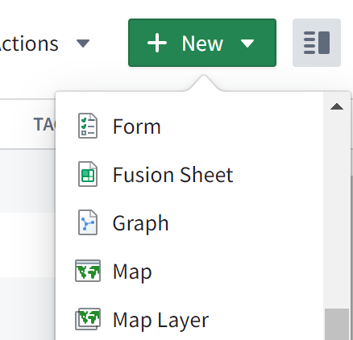
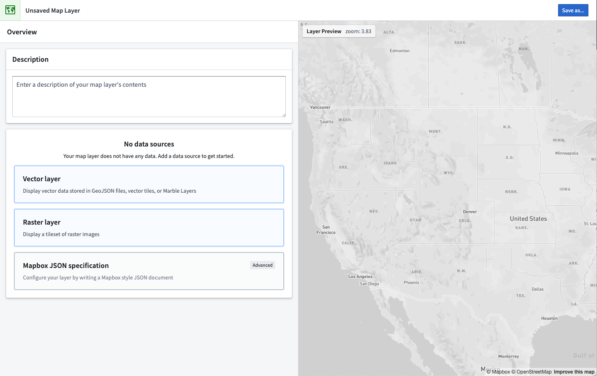
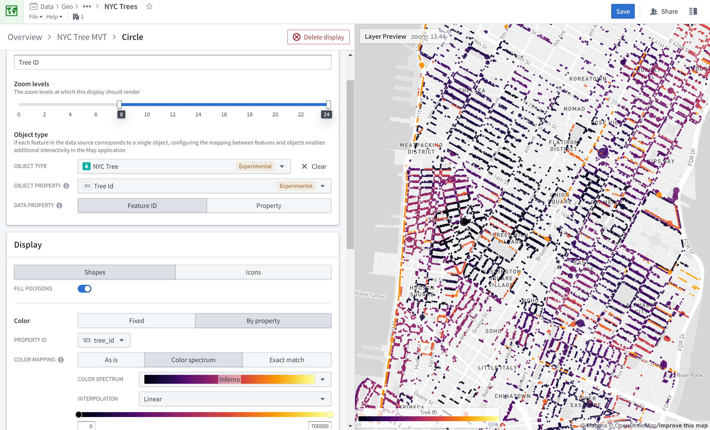
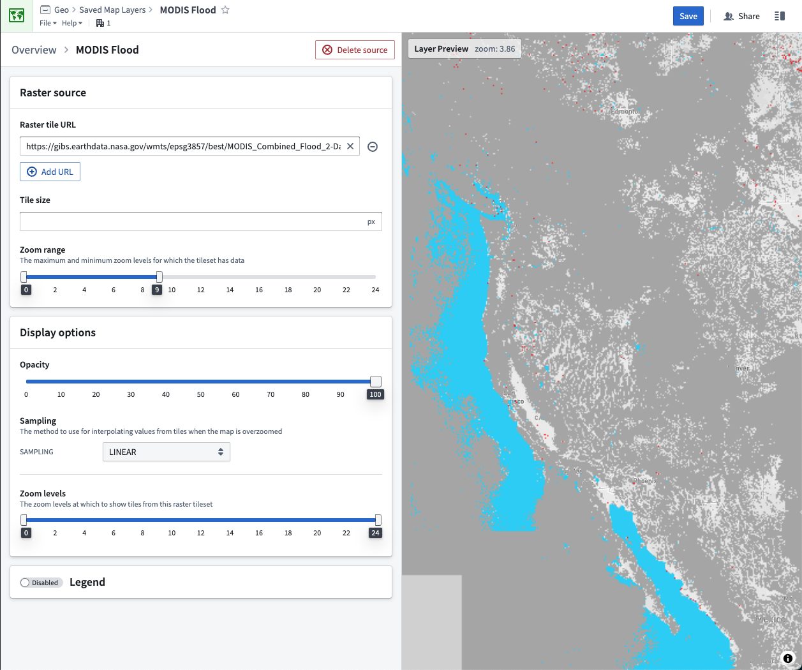
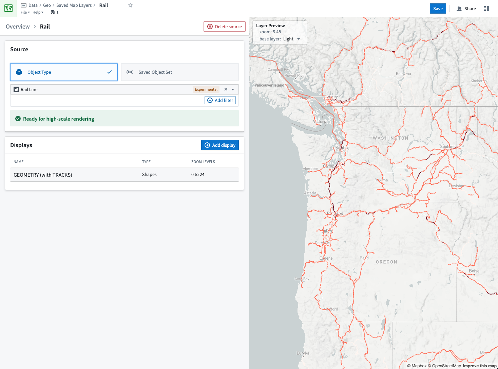
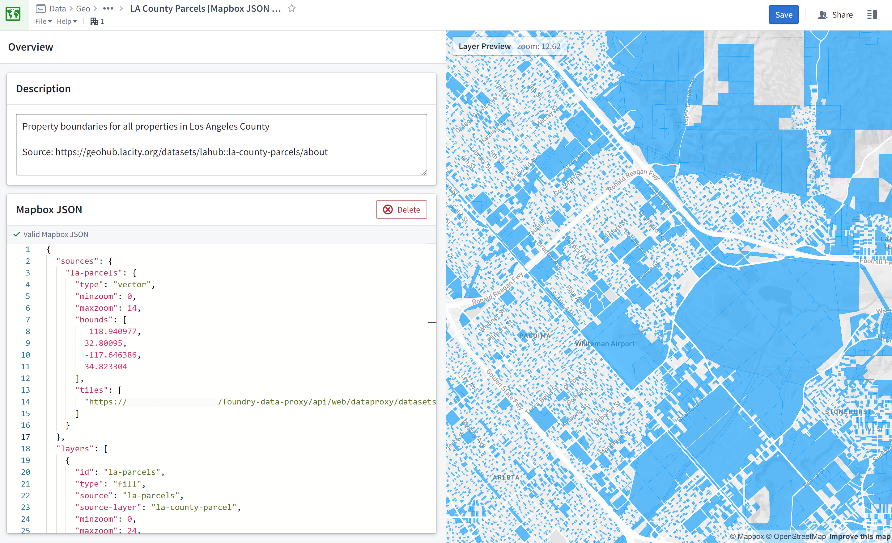

:::callout{theme="warning"}
注意：以下翻译的准确性尚未经过验证。这是使用 [AIP ↗](https://www.palantir.com/platforms/aip/) 从原始英文文本进行的机器翻译。
:::

# 地图图层编辑器

地图图层编辑器应用程序允许您创建、编辑和预览地图图层。地图图层包含地理空间数据，并定义数据的可视化方式。您可以在[地图应用程序](../Interact%20with%20maps/%E5%B0%86%E6%95%B0%E6%8D%AE%E6%B7%BB%E5%8A%A0%E5%88%B0%E5%9C%B0%E5%9B%BE.md#add-map-overlays)和[Workshop地图微件](https://www.palantir.com/docs/foundry/workshop/widgets-map/#saved)中使用地图图层。

地图图层编辑器提供了一个点击式用户界面，用于配置包含矢量或栅格数据的地图图层。如果您需要更多控制或想要使用更高级的映射功能，您可以选择编写[Mapbox GL JS 样式规范文档 ↗](https://docs.mapbox.com/mapbox-gl-js/style-spec/)。

## 创建新地图图层

在Foundry中，导航到您希望创建地图图层的文件夹，并从**新建**菜单中选择**地图图层**：

然后，添加数据源或选择编写Mapbox JSON文档以开始配置您的图层。

:::callout{theme="warning"}
我们建议仅在需要矢量或栅格图层不支持的功能时使用Mapbox JSON文档。
:::

您可以在右侧的**图层预览**面板中实时预览您的地图图层。

创建或修改地图图层后，务必单击**保存**以使图层在地图应用程序中可用。

## 矢量图层

矢量图层显示来自GeoJSON或矢量切片源的几何数据。有四种方式指定数据源：

* **GeoJSON 文件：** 选择一个[手动上传的](https://www.palantir.com/docs/foundry/projects/manually-upload-data/)GeoJSON文件。
* **数据集GeoJSON文件：** 选择一个数据集，然后选择该数据集中包含的GeoJSON文件。
* **GeoJSON URL：** 输入GeoJSON文件的URL。
* **MVT URL：** 输入矢量切片集的URL。

添加源后，您可以添加一个或多个显示以配置数据在地图上的可视化方式。

## 栅格图层

栅格图层显示来自栅格切片集的位图数据。通过指定切片集的URL来配置栅格数据源。

栅格图层的可用显示选项有：

* **不透明度：** 显示图层的不透明或透明程度。
* **采样：** 当地图放大以至于栅格图像必须放大时使用的插值方法。
  * **线性：** 使用最接近源像素的平均值进行插值，这可能导致在过度放大时出现模糊的外观。
  * **最近邻：** 通过选择最近的源像素进行插值，这在过度放大时会创建一个清晰但像素化的外观。
* **缩放级别：** 显示图层的最大和最小缩放级别。

## 对象图层

对象图层直接显示来自您的Ontology的数据。只有同步到OQL并具有geohash或geoshape属性类型的对象类型可以通过对象图层显示。

:::callout{theme="neutral"}
尽管对象图层需要OQL，但并非在所有实例中都可用。有关更多信息，请联系您的Palantir代表。
:::

对象图层提供两种方式指定您想要渲染的数据：

* **对象类型：** 选择一个对象类型并非必填定义筛选。所有匹配的对象将在您的地图图层中显示。
* **已保存的对象集：** 选择一个[从对象浏览器中保存的探索](../../%E5%AF%B9%E8%B1%A1%E6%B5%8F%E8%A7%88%E5%99%A8/Analyze%20and%20compare/%E4%BF%9D%E5%AD%98%E6%8E%A2%E7%B4%A2.md)。图层应用程序将显示您保存的探索中存在的所有对象。

对象图层显示的配置选项与矢量图层相同。

## Mapbox JSON 图层

对于Mapbox JSON图层，您可以在地图图层编辑器中编辑JSON文档。编辑器会验证JSON并突出显示任何错误。

JSON内容必须符合[Mapbox GL JS样式规范 ↗](https://docs.mapbox.com/mapbox-gl-js/style-spec/)，但仅支持`sources`和`layers`属性（两者都是必需的）。

