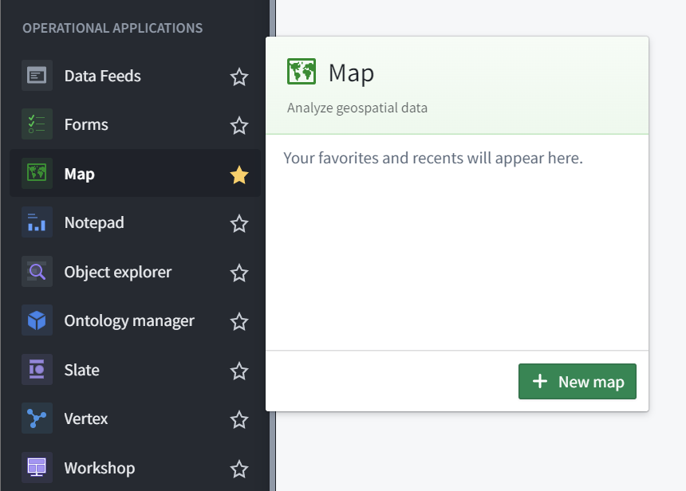
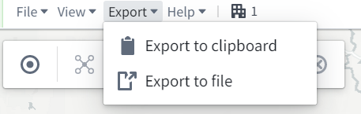

:::callout{theme="warning"}
注意：以下翻译的准确性尚未经过验证。这是使用 [AIP ↗](https://www.palantir.com/platforms/aip/) 从原始英文文本进行的机器翻译。
:::

# 创建、保存和导出地图

## 创建新地图

要创建地图，展开左侧的Foundry导航栏，然后点击应用程序部分的**查看全部**。您将在**运营应用程序**部分找到**地图**应用程序。

## 保存地图

要首次保存地图，请点击屏幕左上角的**另存为...**，然后选择一个位置以保存地图。

要随后保存地图，请点击屏幕左上角的**保存**。地图不会自动保存。

## 导出地图

地图可以作为图像导出，既可以导出到剪贴板，也可以下载为PNG文件。要导出地图，请使用**导出**下拉菜单：

* ***导出到剪贴板：*** 将地图复制到剪贴板，作为图像粘贴到包括Foundry Notepad在内的其他应用程序中。
* ***导出到文件：*** 下载地图为PNG图像文件。

