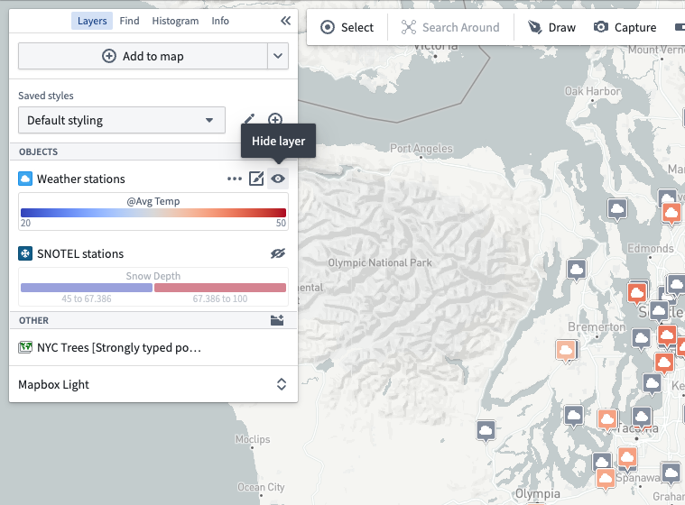
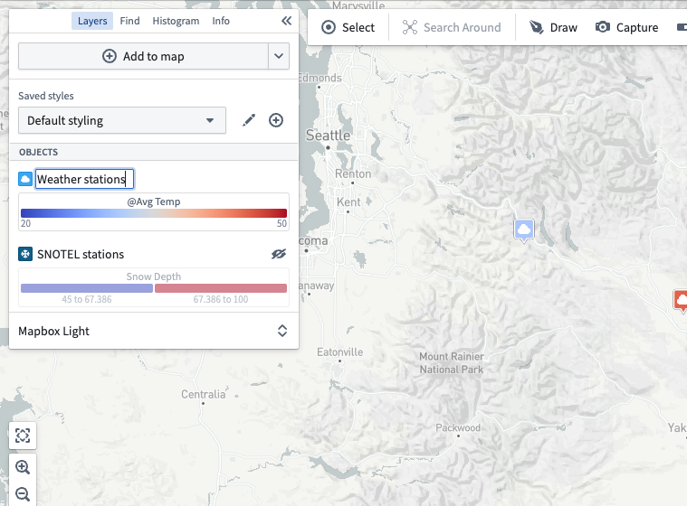
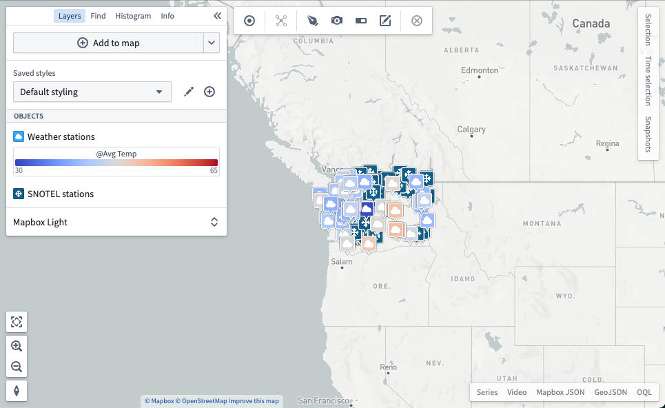
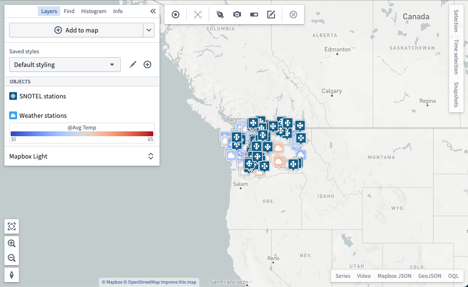
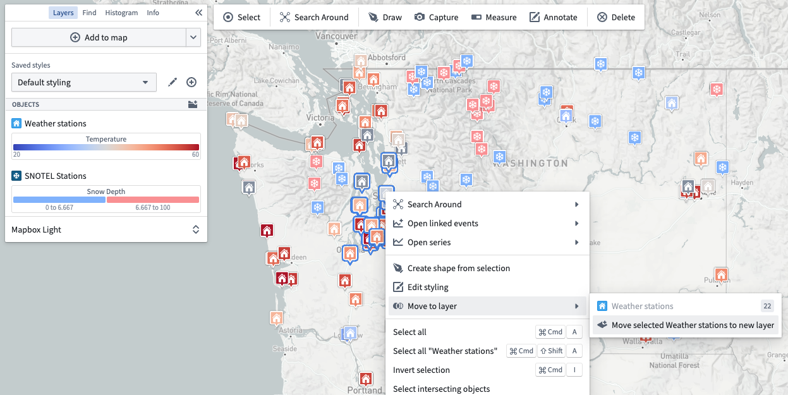
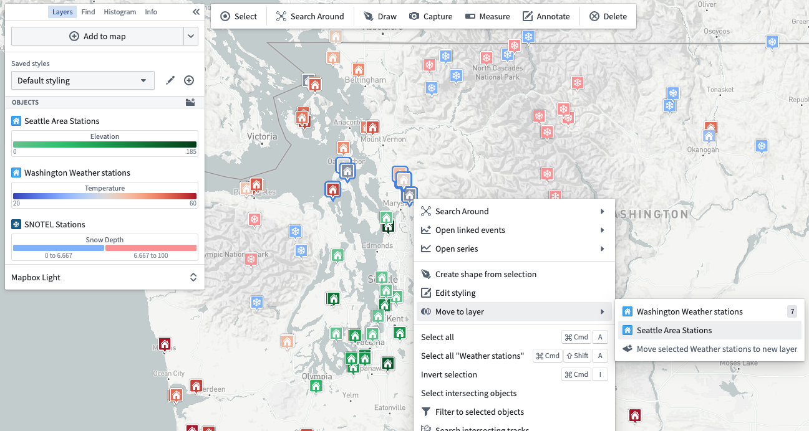

:::callout{theme="warning"}
注意：以下翻译的准确性尚未经过验证。这是使用 [AIP ↗](https://www.palantir.com/platforms/aip/) 从原始英文文本进行的机器翻译。
:::

# 图层管理

地图上的所有数据都被分组到不同的[图层类型](../%E6%A0%B8%E5%BF%83%E6%A6%82%E5%BF%B5.md)中，可以在**图层**面板中进行管理。

## 切换图层可见性

通过使用可见性切换来显示或隐藏图层的内容：

## 重命名图层

通过点击当前名称来编辑图层的名称。

## 重新排序图层

通过拖动图层图标来更改图层的顺序。重新排序图层可以改变地图的渲染效果，因为在图层列表中出现较高的图层会渲染在列表中较低的图层之上。

## 移动对象到新的或现有的图层

对象可以分布在多个图层中，只要内容都是相同的Object类型。在将选定集移动到新图层后，每个集中的Object可以进行不同的样式设置，如下图所示。

