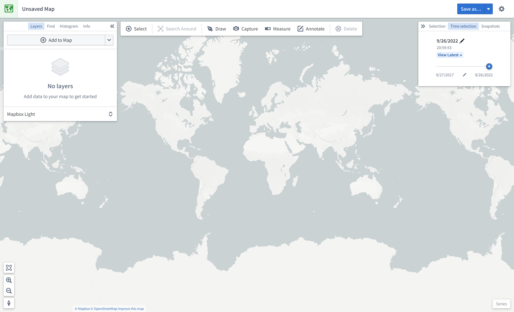

:::callout{theme="warning"}
注意：以下翻译的准确性尚未经过验证。这是使用 [AIP ↗](https://www.palantir.com/platforms/aip/) 从原始英文文本进行的机器翻译。
:::

# 地图界面概述

本页面描述了地图应用界面的元素，如下所示：

## 面板

界面的左侧包含以下面板：

* **图层：** 添加、管理和样式化 Object 和叠加图层；设置基础图层。
* **查找：** 查找 Object 和位置；导航到特定的地理坐标。
* **直方图：** 基于属性和时间序列值分析和筛选 Object。
* **信息：** 显示地图的总体摘要。

界面的右侧包含以下面板：

* **选择：** 分析选定项目的详细信息并进行操作。
* **时间选择：** 设置时间范围和当前时间戳以应用于地图和时间序列视图。
* **快照：** 查看捕获的快照并使用快照跳转到捕获的地图状态。

在界面的右下角，**系列**面板支持时间序列和事件数据的时间分析。

## 工具栏

界面的顶部是一个具有以下功能的工具栏：

* **选择：** 选择地图上的所有项目，反选，或选择与绘制形状相交的项目。
* **搜索周围：** 探索 Object 关系。
* **绘制：** 在地图上绘制并与形状交互，包括多边形、圆形、矩形、线条、点。
* **捕获：** 捕获当前地图状态的截图。
* **测量：** 测量地图上的物理距离。
* **注释：** 向地图添加文本或多边形注释。
* **删除：** 从地图中移除项目。
