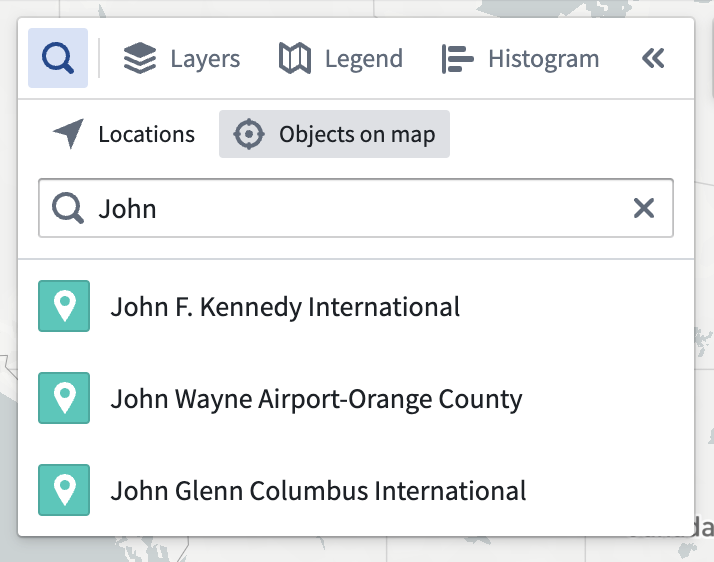
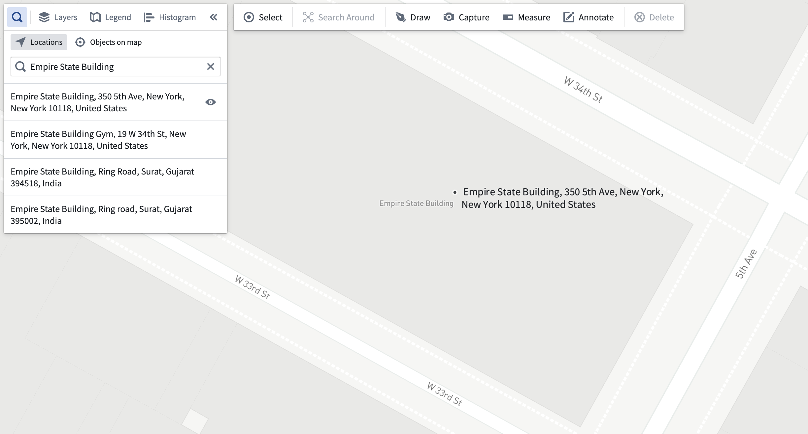
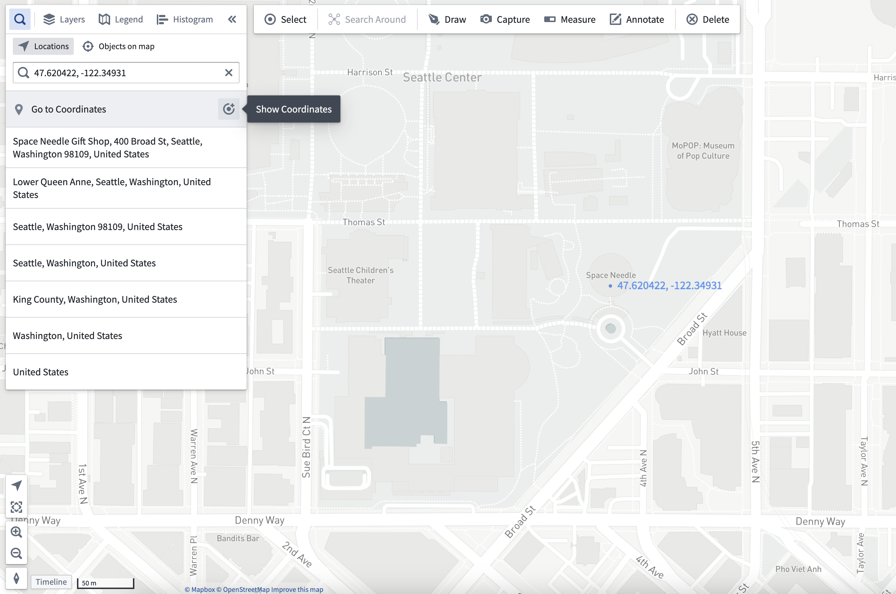

:::callout{theme="warning"}
注意：以下翻译的准确性尚未经过验证。这是使用 [AIP ↗](https://www.palantir.com/platforms/aip/) 从原始英文文本进行的机器翻译。
:::

# 导航

地图应用程序允许您平移、缩放、旋转或倾斜地图，以便于查看和分析。您还可以使用快捷键快速居中地图，或使用**查找**面板在地图上定位Objects、位置和坐标。

## 基本地图控件

* 要平移，请点击并拖动地图视口，或使用键盘上的箭头键。
* 要缩放，请使用以下方法之一：
  * 左下角的**放大**和**缩小**按钮
  * 鼠标滚轮
  * 键盘上的\*\*+**和**-\*\*键
* 要旋转和倾斜地图，请按住Ctrl（Windows）或Cmd（macOS）同时点击并拖动。

## 将地图居中于项目

按下键盘上的**0**键，将地图导航以显示您选择的Objects。如果您没有选择任何Objects，**0**将导航地图以便显示地图上的所有Objects。

## 使用查找面板

**查找**面板允许您导航到已添加到地图上的Objects，以及位置和坐标。

### 在地图上查找Objects

选择**地图上的Objects**标签，输入搜索查询以通过标题或属性值查找Objects。选择一个结果将导航地图到该Object。

### 查找位置

:::callout{theme="neutral" title="需要API密钥"}
您的组织必须在[控制面板中配置一个Mapbox API密钥](../Configuration/%E6%8E%A7%E5%88%B6%E9%9D%A2%E6%9D%BF.md#api-keys)以启用此功能。
:::

选择**位置**标签并输入查询以通过地址或名称查找位置。选择一个结果将导航地图到该位置并显示带有位置地址的标记。您可以通过点击结果列表中地址旁边的**眼睛**图标来隐藏标记。

### 导航到坐标

无论选择**地图上的Objects**还是**位置**标签，您都可以在搜索输入中输入坐标，并通过选择结果将地图导航到这些坐标。使用**显示坐标**按钮将在您指定的坐标处添加文本注释。

