:::callout{theme="warning"}
注意：以下翻译的准确性尚未经过验证。这是使用 [AIP ↗](https://www.palantir.com/platforms/aip/) 从原始英文文本进行的机器翻译。
:::

# 将数据添加到地图

通过将数据添加到地图来开始您的地理空间分析。您可以从 Foundry 平台向地图添加两种地理空间数据：Ontology 对象和地图叠加层。

在 **图层** 面板中，单击 **+ 添加到地图**，通过搜索对话框将这些数据添加到地图中。

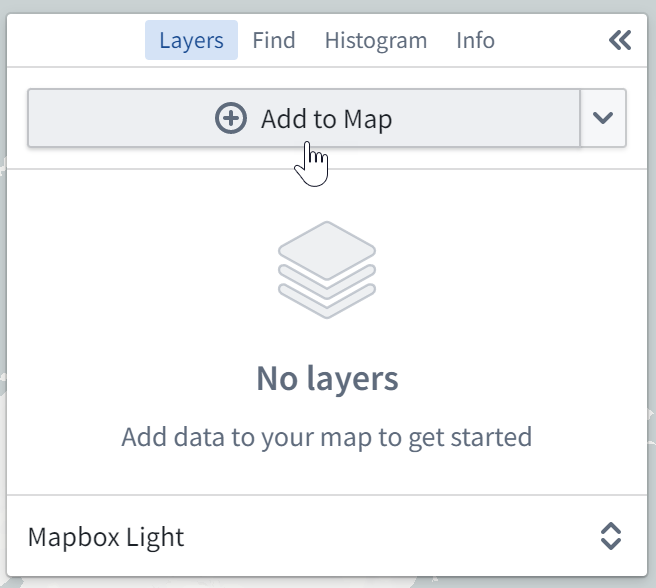

## 添加 Ontology 对象

在搜索对话框中，**对象** 标签允许您将[具有地理空间数据的 Ontology 对象](../Integrate%20data%20for%20the%20map/Ontology%20Object.md)添加到地图中。

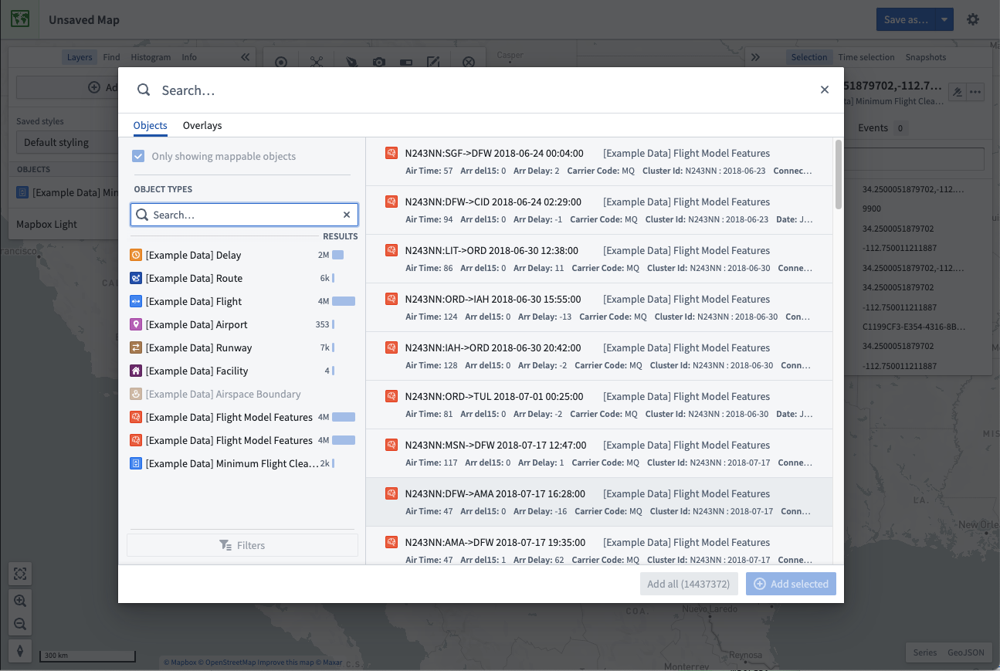

在对话框中，您可以通过在顶部的主要 **搜索...** 字段中输入问题来搜索对象，或使用左侧的筛选面板对搜索的对象进行筛选。

### 筛选对象

选择一个对象类型来筛选结果，以仅包含该类型的对象。选择对象类型后，您可以使用 **筛选** 选项进一步优化搜索：

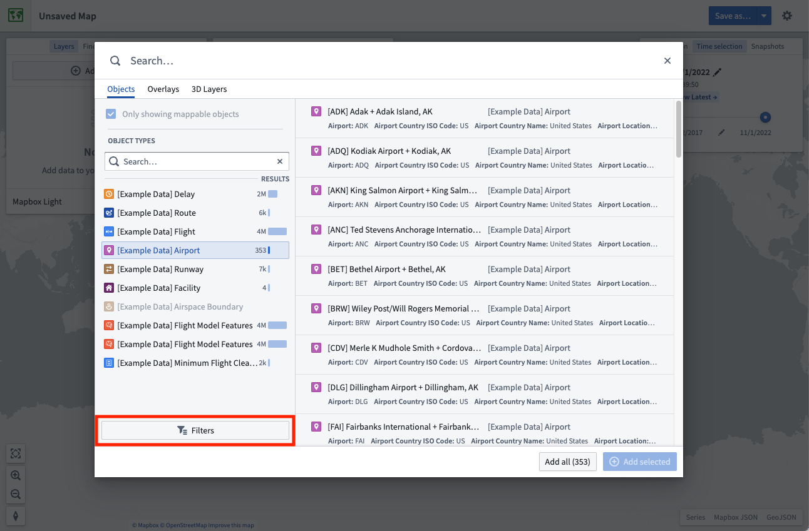

一些最常用的属性会自动出现在筛选区域中，允许您通过选择感兴趣的属性值来缩小对象结果范围。

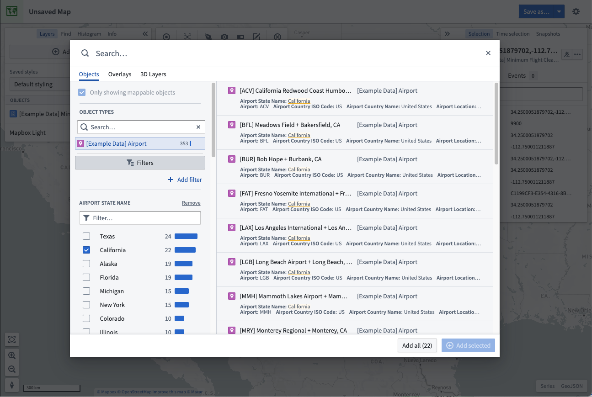

您可以通过选择 **+ 添加筛选** 并添加所需属性来按对象类型上的任何属性进行筛选。选择 **返回** 以使您选择的属性出现在筛选区域中。

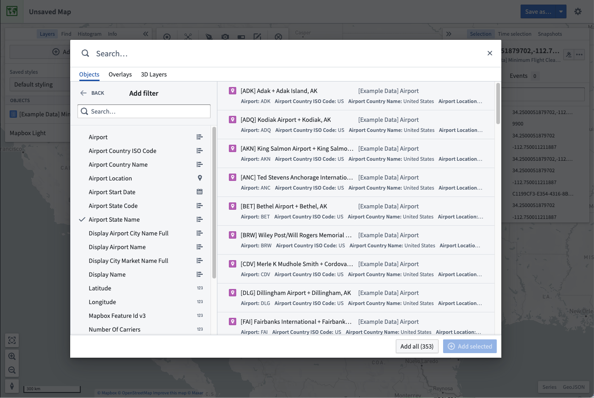

### 选择并添加结果

在结果表中选择一个对象。要切换选择任何对象，请按住 `Cmd` (macOS) 或 `Ctrl` (Windows) 键，或另外使用 `Shift` 键选择一系列对象。使用 **+ 添加已选择** 将选定的对象添加到地图中，或使用 **添加全部** 将所有符合搜索条件的对象添加到地图中。

地图限制您可以从搜索对话框添加的对象数量。默认情况下，您可以添加 1000 个对象。当达到此限制时，**添加全部** 选项将被禁用，您需要[筛选您的结果](#filter-objects)以减少对象数量，然后选项会重新启用。

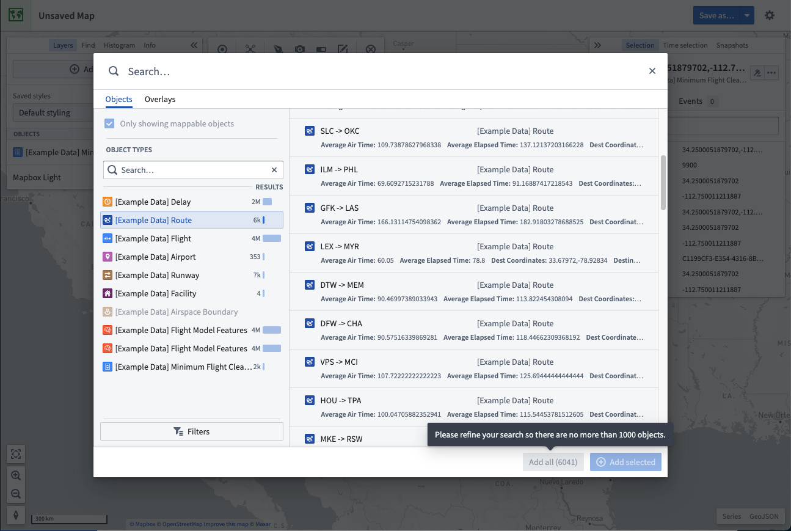

## 地理空间搜索对象

您可以在特定的地理空间感兴趣区域内搜索对象。在 **添加到地图** 下拉菜单中，选择 **搜索与形状相交的对象...**：

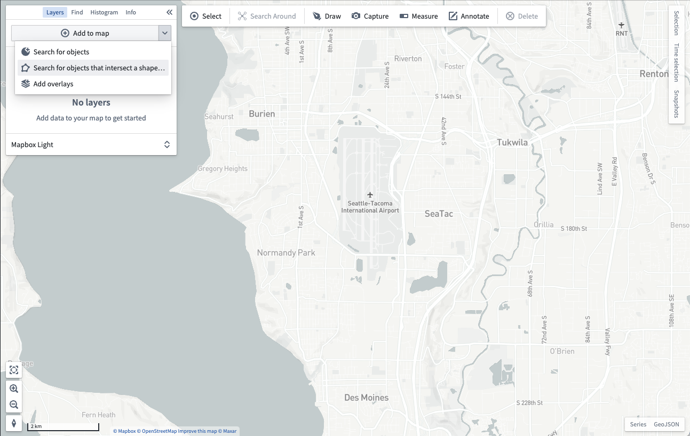

然后您将被提示在要搜索的地理空间区域周围绘制一个[形状](%E5%BD%A2%E7%8A%B6.md)：

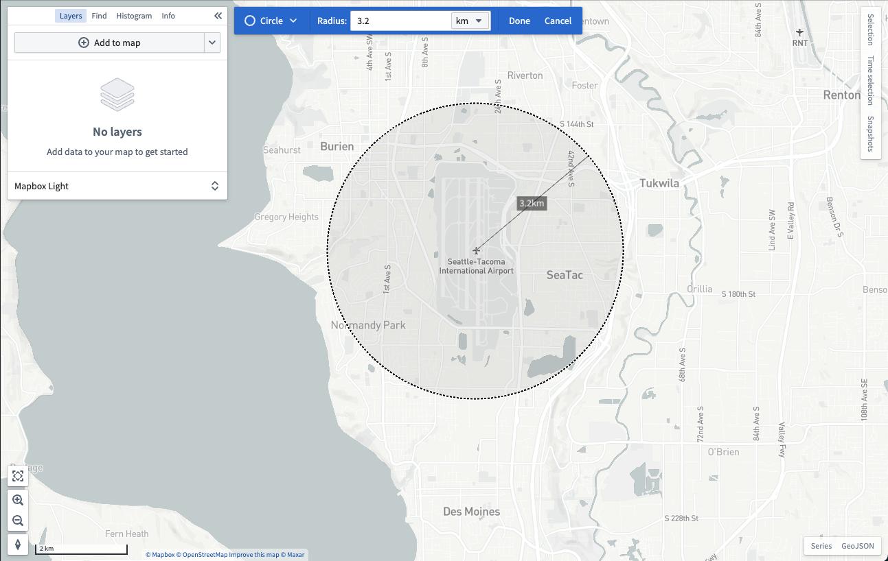

完成绘制形状后，对象搜索对话框将打开，并仅显示包含与您绘制的形状相交的地理空间数据的对象：

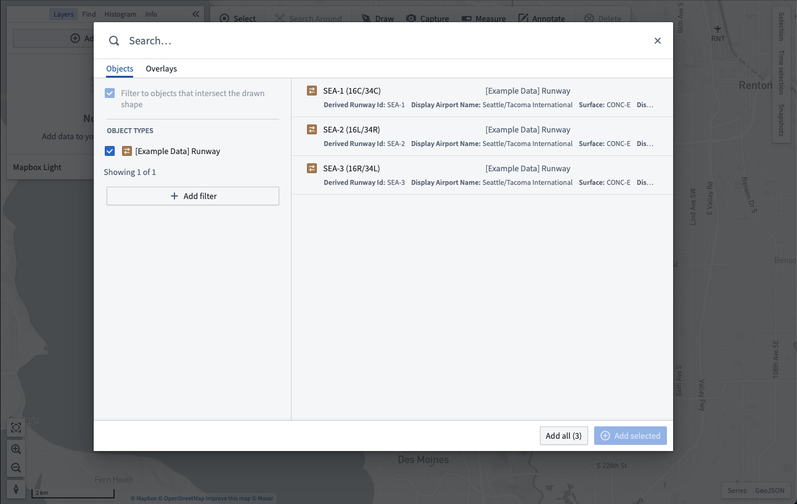

## 添加地图叠加层

搜索对话框的 **叠加层** 标签允许您添加在 [地图图层编辑器](../Integrate%20data%20for%20the%20map/%E5%9C%B0%E5%9B%BE%E5%9B%BE%E5%B1%82%E7%BC%96%E8%BE%91%E5%99%A8.md)中创建的图层。这些图层包含可在地图间重复使用的地理空间数据集的预配置视图。

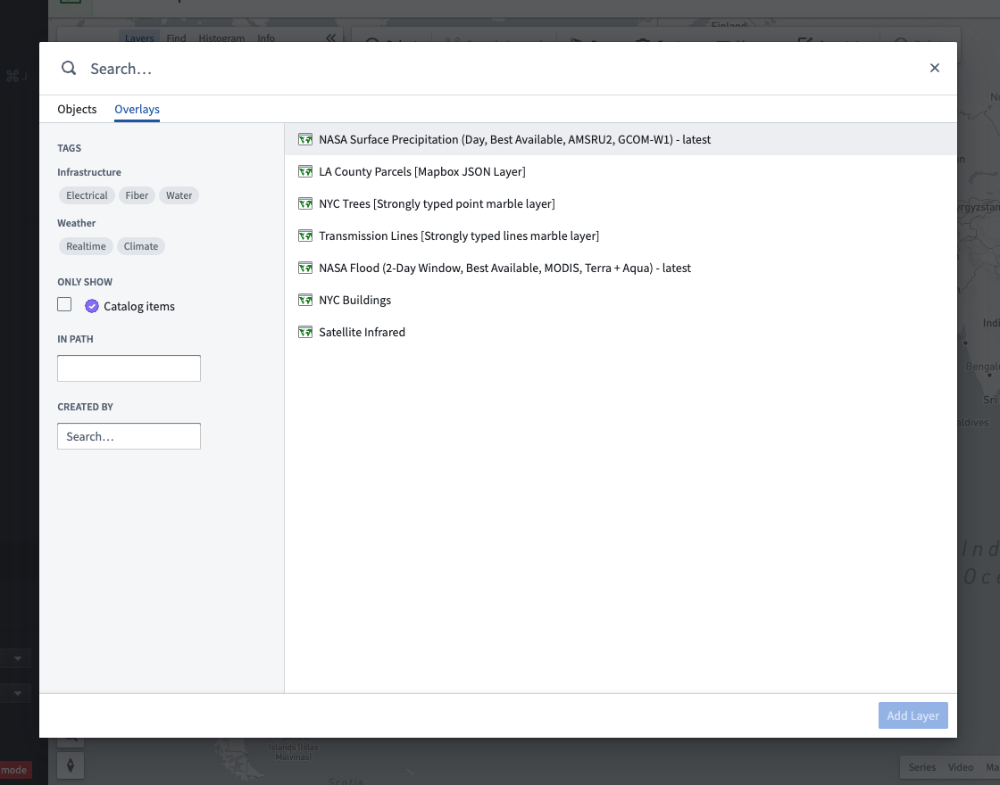

对话框提供了多种方式来帮助您找到图层：

* 在顶部的 **搜索...** 字段中输入文本以通过名称查找图层。
* 使用侧边栏的 **标签** 部分将图层结果缩小到特定主题。
* 勾选 **目录项目** 以仅显示已添加到[项目目录](https://www.palantir.com/docs/foundry/projects/use-project-navigation-panel/#project-catalog)的精选图层。
* 在 **路径中** 输入中输入文件夹的路径以查找特定文件夹或项目中的图层。
* 通过在 **创建者** 中选择用户，查找由特定用户创建的图层。

选择一个图层。按住 `Cmd` (macOS) 或 `Ctrl` (Windows) 键以切换选择一个图层，或使用 Shift 键选择一系列图层。使用 **添加图层** 将选定的图层添加到地图中。

## 周围搜索

从已经在地图上的对象开始，您可以遍历 Ontology 关系，并通过 **周围搜索** 将相关对象添加到地图中。首先，在地图上选择一些对象，然后点击 **周围搜索**：

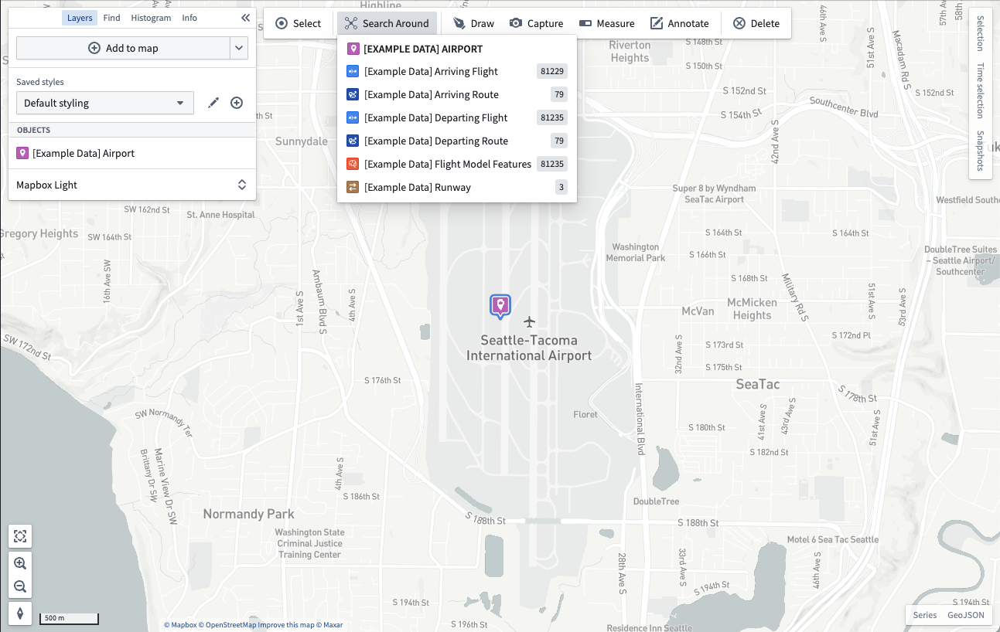

从相关对象列表中选择要添加到地图中的对象。如果相关对象显示为点，地图将呈现相关对象之间的视觉链接：

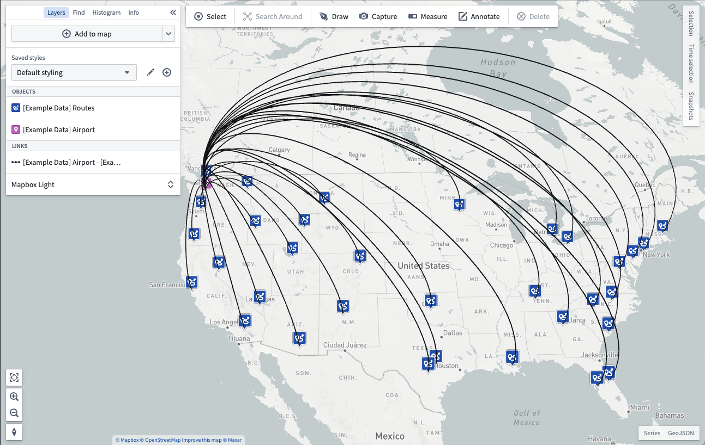
