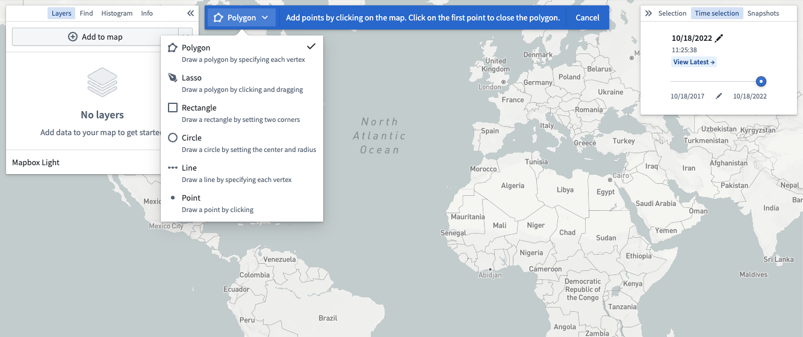
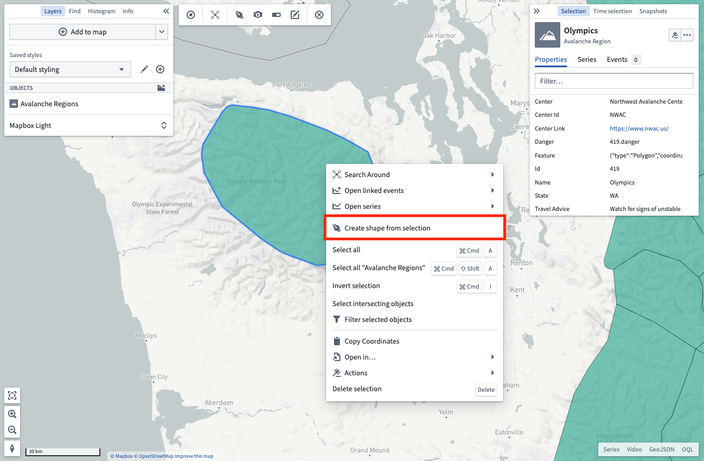
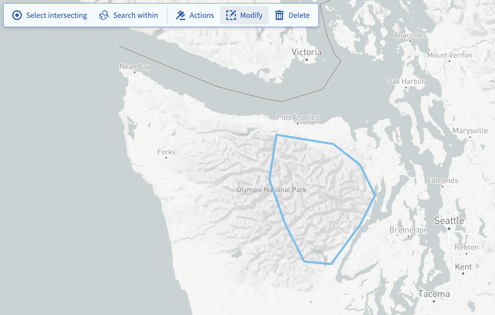

:::callout{theme="warning"}
注意：以下翻译的准确性尚未经过验证。这是使用 [AIP ↗](https://www.palantir.com/platforms/aip/) 从原始英文文本进行的机器翻译。
:::

# 形状

使用形状在地图上选择地理空间区域，以搜索Object、选择地图上已有的Object、执行操作或创建注释。

## 创建形状

对形状的所有操作都需要一个活动形状。可以通过以下方式之一创建形状：

* 使用[绘图工具](#drawing)自行构建形状。
* 使用当前选择的Object和注释创建覆盖[与您选择相同的地理空间区域](#from-selection)的形状。

### 绘制形状

在工具栏中点击**绘制**或在键盘上按下**d**键以手动在地图上绘制形状。

通过点击当前绘图模式可以访问的下拉菜单，从可用模式中选择：

### 从选择中创建

您也可以从地图上的活动选择中创建形状。右键点击任何选定的Object并使用**从选择中创建形状**菜单条目。

## 修改形状

您可以使用形状工具栏中的**修改**按钮编辑地图上的活动形状。

有多种修改工具可用：

* \*\*编辑点：\*\*允许您拖动单个顶点以修改多边形、线或点。
* \*\*缓冲区：\*\*允许输入特定距离以增加或减少形状的边界。
* \*\*平移：\*\*通过拖动移动整个形状。
* \*\*替换：\*\*丢弃当前绘制的形状并打开绘图工具以绘制新形状。

完成修改后，使用**完成**按钮返回形状工具栏。

## 使用活动形状执行操作

使用活动形状，利用**形状**工具栏执行各种操作：

* \*\*选择相交：\*\*选择地图上可见层中与当前形状相交的每个Object。
* \*\*内部搜索：\*\*打开添加Object面板并筛选结果，仅包括具有与当前形状相交的地理空间数据的Object。请注意，只有具有[`geohash`或`geoshape`属性](../Integrate%20data%20for%20the%20map/Ontology%20Object.md#configure-geospatial-objects)的Object可以被搜索。
* \*\*操作：\*\*显示每个可用的Ontology操作，这些操作会使用形状。有关配置地理空间操作的更多信息，请阅读[操作](%E6%93%8D%E4%BD%9C.md)。请注意，只有在Ontology中配置了地理空间操作时，操作按钮才会出现。
* \*\*注释：\*\*从当前形状创建一个[注释](%E6%B3%A8%E9%87%8A.md)。

任何成功的形状操作都会清除活动形状。

## 测量

在绘制线或多边形时，您可以通过选择形状绘图工具栏上的齿轮图标来配置形状上显示的测量。您可以在[**设置**中指定测量单位](../Configuration/%E8%AE%BE%E7%BD%AE.md#units)。

[官方图片已失效：形状测量](https://www.palantir.com/docs/resources/foundry/map/shape-measurements.png)

* \*\*在地图上显示测量：\*\*启用地图上形状的测量显示。
* **多边形测量**
  * \*\*周长：\*\*配置多边形周长的测量显示方式。选择不显示、显示每个周长段的长度，或显示整个周长的总长度。
  * \*\*面积：\*\*启用多边形的总面积显示。
* **线测量**
  * \*\*长度：\*\*配置线的测量显示方式。选择不显示、显示每个线段的长度，或显示整条线的总长度。

> 配图缺失说明：本页有 1 个官方图片地址在抓取及重试时失效（返回 HTML 错误页）。下列地址保留用于溯源，未替换成其他版本的图片。

- 官方图片已失效：<https://www.palantir.com/docs/resources/foundry/map/shape-measurements.png>
