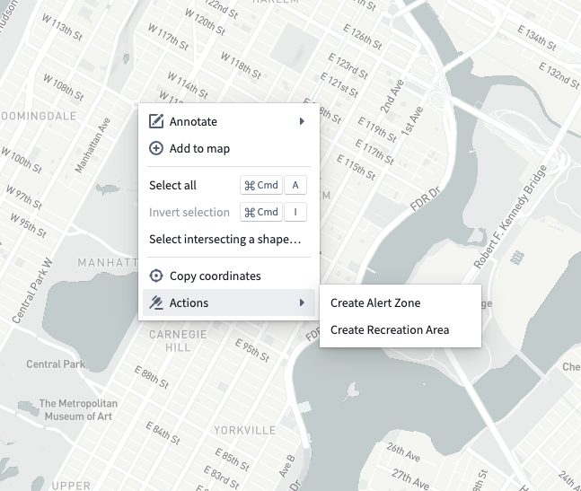
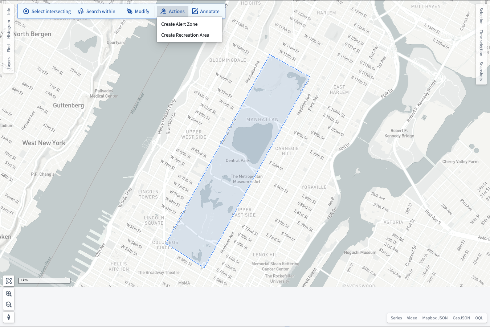
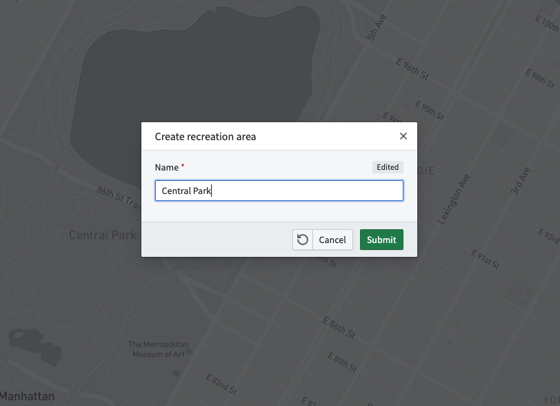
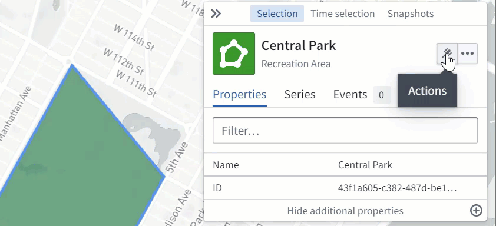

:::callout{theme="warning"}
注意：以下翻译的准确性尚未经过验证。这是使用 [AIP ↗](https://www.palantir.com/platforms/aip/) 从原始英文文本进行的机器翻译。
:::

# 操作

在Map应用程序中使用[操作](../Integrate%20data%20for%20the%20map/Ontology%20%E6%93%8D%E4%BD%9C.md)以基于在地图上绘制的点、多边形或线条创建或编辑Objects。

## 对形状和点的操作

当您右键单击地图时，菜单中的**操作**条目显示所有适用于地理空间点的操作，如下所示。

在您[绘制形状](%E5%BD%A2%E7%8A%B6.md)后，工具栏中的**操作**按钮显示所有适用于您绘制的多边形、线条或点的操作：

从这些菜单中选择一个操作后，可能需要您提供其他参数。在这种情况下，Map会显示一个对话框供您输入其他参数：

如果没有其他参数，或者在您提交对话框中的表单后，Map应用程序将执行该操作，并将操作创建的任何地理空间Objects添加到您的地图中。

## 对Ontology Objects的操作

使用**选择**面板中的**操作**按钮对您选择的Object执行地理空间操作。在选择操作后，系统会提示您编辑或创建一个形状，具体取决于操作中指定的配置。

当您在形状绘制或编辑工具上点击**完成**时，可能需要您提供其他参数。在这种情况下，Map会显示一个对话框供您输入其他参数：

如果没有其他参数，或者在您提交对话框中的表单后，Map应用程序将执行该操作，并更新您的地图以反映由操作创建或修改的任何Objects。
