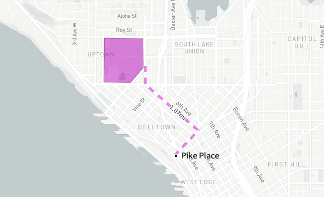
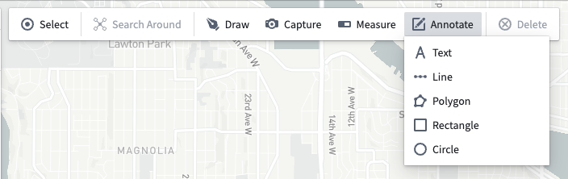
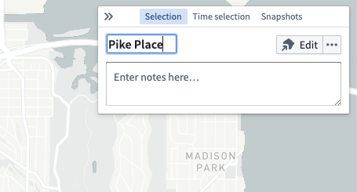
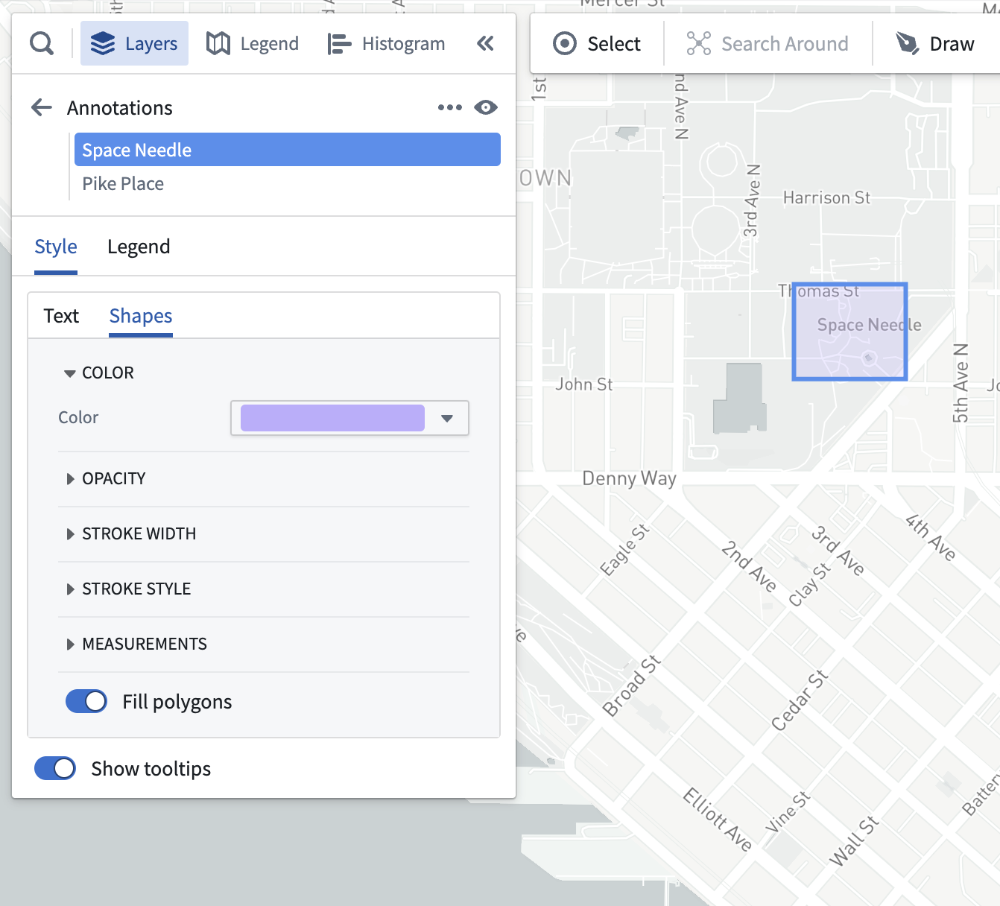

:::callout{theme="warning"}
注意：以下翻译的准确性尚未经过验证。这是使用 [AIP ↗](https://www.palantir.com/platforms/aip/) 从原始英文文本进行的机器翻译。
:::

# 注释

使用**注释**来突出显示地图上特定区域并添加上下文信息。

## 创建注释

通过在工具栏中选择**注释**并选择以下方法之一来创建注释：

* **文本：** 在特定位置添加文本。
* **线条：** 通过指定所有点添加一条线。
* **多边形：** 通过指定所有点添加一个多边形。
* **矩形：** 通过指定两个角落创建矩形注释。
* **圆形：** 通过指定中心和半径创建圆形注释。

选择要创建的注释类型后，[绘图工具](%E5%BD%A2%E7%8A%B6.md#draw-a-shape)将打开，并提供使用特定绘图模式创建新注释的说明。您的地图将根据注释类型将其分组到不同的图层中。

## 编辑注释

选择一个注释，然后使用**选择**面板编辑其标题并添加任何备注。对于文本注释，标题和备注将显示在地图上以及悬停时显示的工具提示中。对于多边形和线条注释，标题和备注仅显示在工具提示中。

通过使用**编辑**按钮调整注释的位置。

## 注释样式

您可以通过在**图层**面板中编辑注释样式来修改注释的外观。

注释样式选项包括：

* **文本**
  * **文本颜色：** 设置注释文本的颜色。
  * **文本大小：** 设置注释文本的像素大小。
  * **文本值：** 配置地图上显示的文本值是否包括注释的备注以及标题。
  * **文本轮廓颜色：** 设置文本后面显示的轮廓颜色。
  * **显示位置点：** 启用时，显示一个圆形标记指示添加注释的具体位置。
  * **显示工具提示：** 启用时，当用户悬停在注释上时，会显示包含注释标题和备注的工具提示。
* **形状**
  * **颜色：** 设置多边形和线条的颜色。
  * **不透明度：** 设置多边形和线条的不透明度。
  * **描边宽度：** 设置线条和禁用**填充多边形**时的多边形轮廓的宽度。
  * **描边样式：** 设置绘制线条时使用的虚线图案。
  * **测量：** 控制地图上显示的测量值。多边形可以显示面积和周长测量值，线条可以显示长度测量值。
  * **填充多边形：** 启用时，多边形使用最小描边并填充指定颜色的内部。禁用时，只描绘多边形的轮廓。
  * **显示工具提示：** 启用时，当用户悬停在注释上时，会显示包含注释标题和备注的工具提示。
