:::callout{theme="warning"}
注意：以下翻译的准确性尚未经过验证。这是使用 [AIP ↗](https://www.palantir.com/platforms/aip/) 从原始英文文本进行的机器翻译。
:::

# 直方图

**直方图**面板允许在地图上选择和筛选对象数据。面板的第一个部分**对象类型**显示地图上按对象类型分类的对象数量。在下方，每个属性类型有一个部分，涵盖地图上存在的所有对象类型。面板顶部的筛选框允许您筛选匹配名称的属性结果。

## 使用直方图

展开直方图部分以显示给定属性的每个不同值的行，默认情况下限制为按值计数排序的前五个。点击**显示更多**以显示接下来的五行。

点击**值**标题可以切换排序方法为**值**（升序）或**值**（降序）。点击**计数**标题可以切换排序方法为**计数**（降序）、**计数**（升序）、**选择的计数**（降序）或**选择的计数**（升序）。

| 值                                                                      | 计数                                                     | 选择的计数                                                              |
|------------------------------------------------------------------------|-----------------------------------------------------------|-----------------------------------------------------------------------------|
| 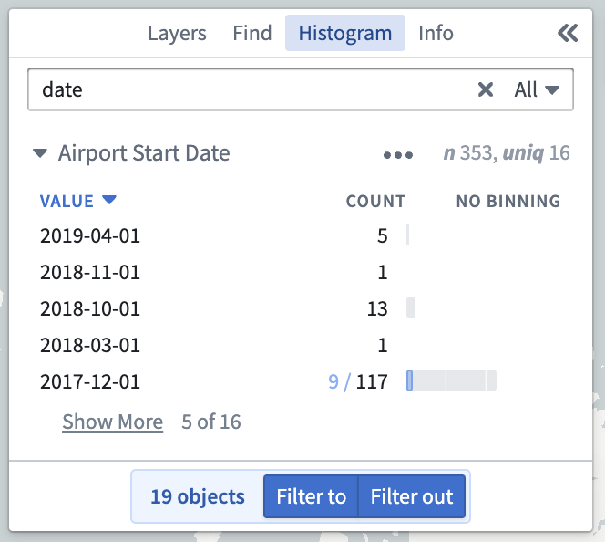               | 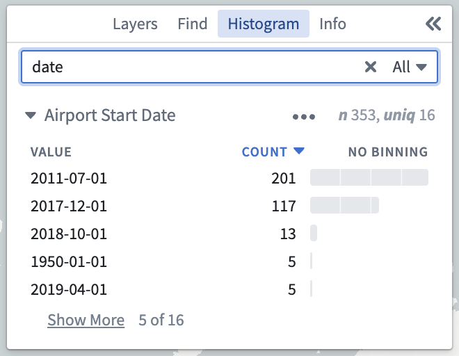         | 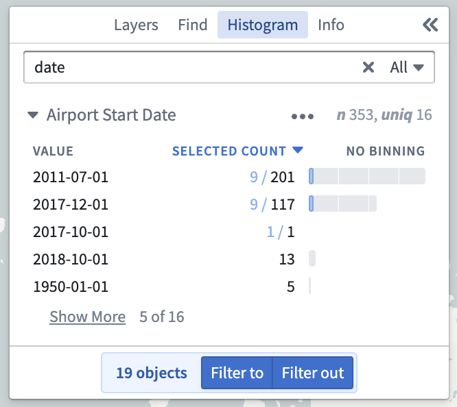           |

对于日期和数值属性，可以使用额外选项来控制**分箱**。

对于日期属性，通过点击此标题可以在**年**、**年和月**、**季度**、**月**和**日**之间切换分箱方法。点击示例图像以展开它。

| 年                                                              | 年和月                                                               | 季度                                                               | 月                                                                       | 日                                                                   |
|-----------------------------------------------------------------|------------------------------------------------------------------------|-----------------------------------------------------------------------|---------------------------------------------------------------------------|-----------------------------------------------------------------------|
| 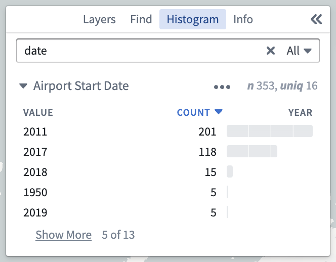         | 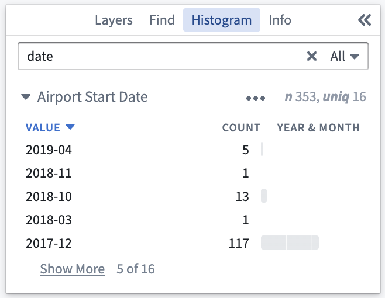     | 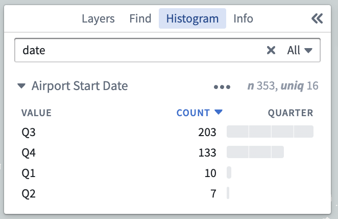          | 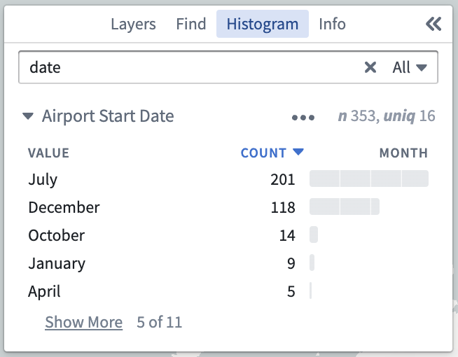             | 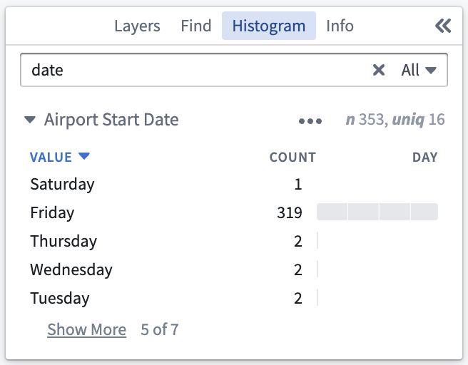           |

对于数值属性，通过点击此标题可以在**无分箱**、**等大小**（将自动将数值分组为等大小的箱）和**对数**（按数量级分组数值）之间切换分箱方法。

| 无分箱                                                   | 等大小                                                                           | 对数                                                                           |
|----------------------------------------------------------|-----------------------------------------------------------------------------------|---------------------------------------------------------------------------------------|
| 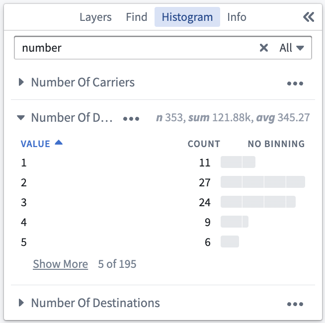        | 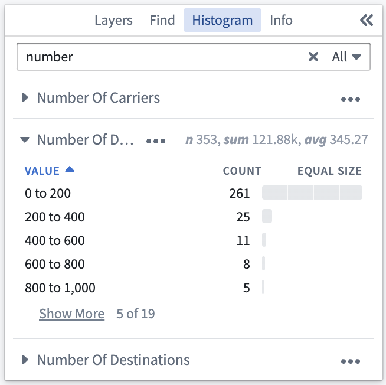              | 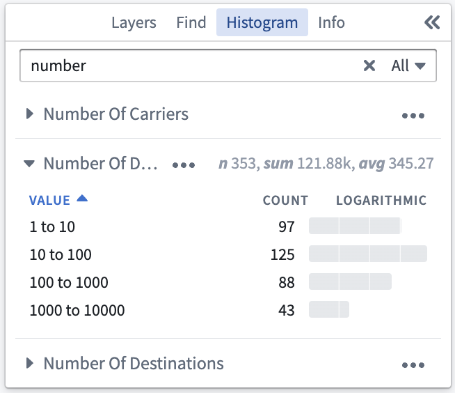                  |

## 选择

点击**直方图**面板中的一行将选择所有匹配的对象。在选择第二行时按住Shift键将选择一系列行。在Windows系统中按住Ctrl键或在Mac系统中按住Cmd键将把该行添加到现有选择中。这使您可以跨直方图的多个部分选择行。

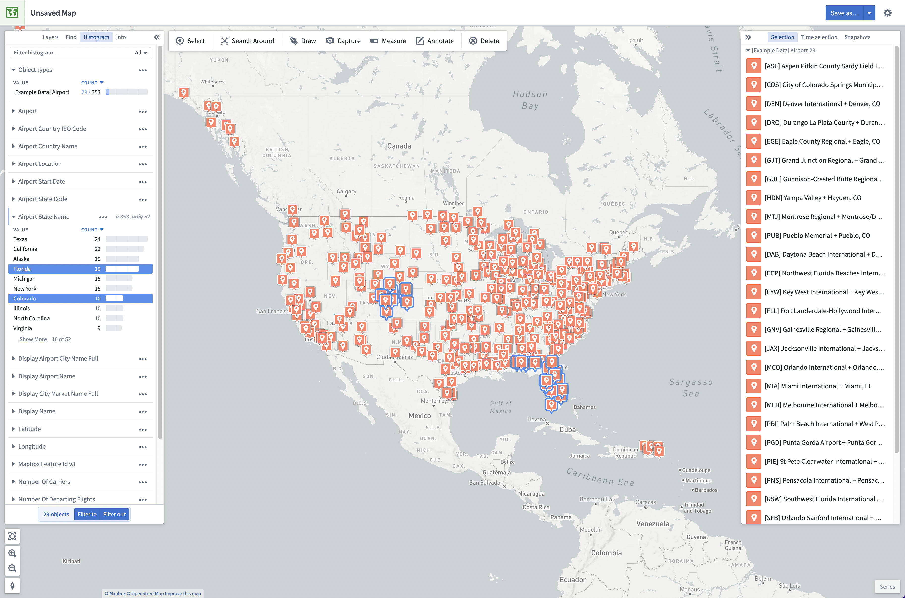

## 筛选

当直方图行被选中时，您可以使用**筛选到**或**筛选出**按钮创建筛选。筛选会暂时降低不匹配筛选条件的对象的不透明度。这些对象将变得不可交互，并且不会在直方图统计中贡献。当存在时，筛选在主应用程序工具栏上方的条中可见。可以使用筛选上的**x**按钮移除筛选，或者使用**清除筛选**按钮移除所有筛选。筛选不会与您的地图一起保存。

选择**筛选到**将筛选您的地图以仅匹配所选行的对象。

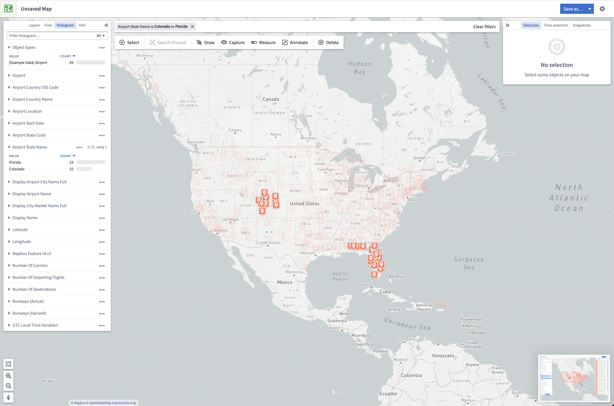

选择**筛选出**将筛选您的地图以仅显示不匹配所选行的对象。

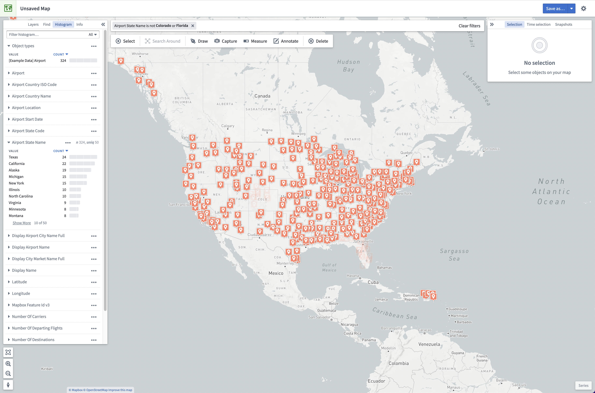

除了**筛选到**和**筛选出**按钮之外，您还可以通过双击单个直方图行来筛选。要筛选到所有当前选定的对象，您可以从地图上的右键菜单中使用**筛选到选定对象**菜单项。
