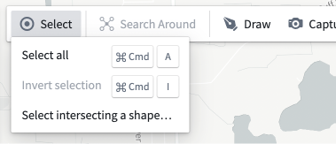
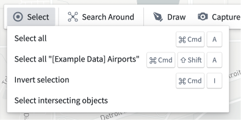
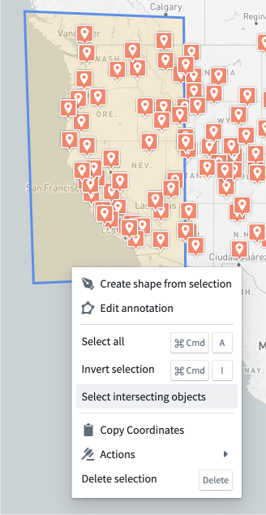
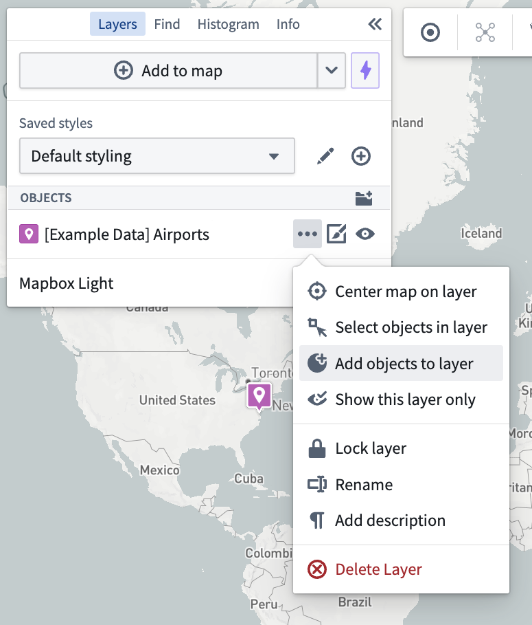
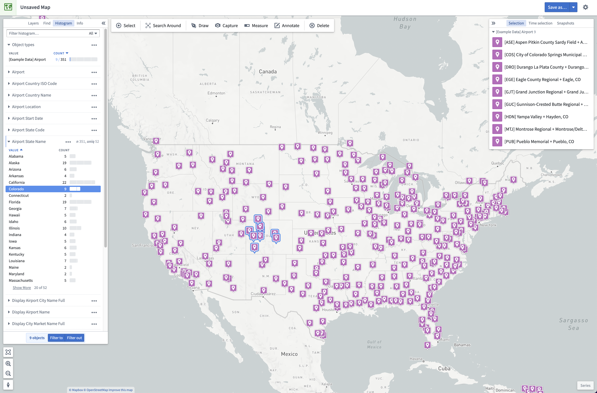
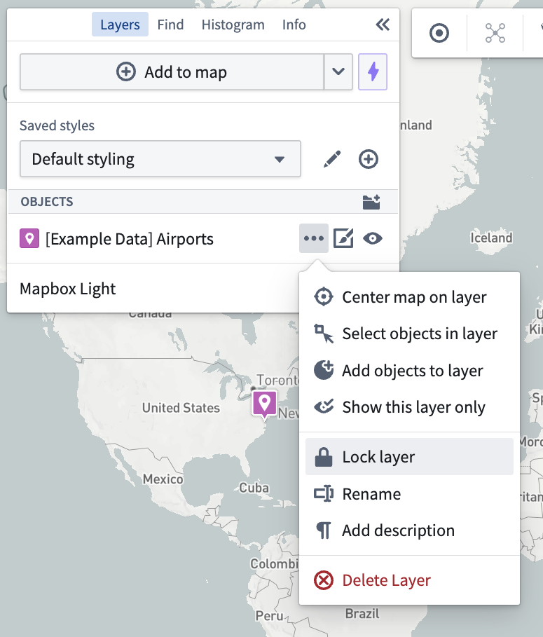
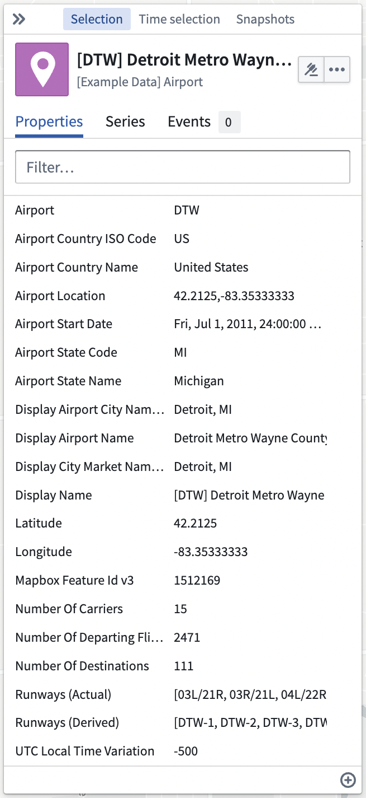
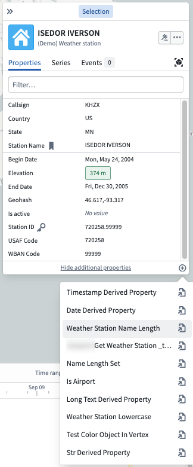
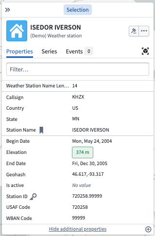
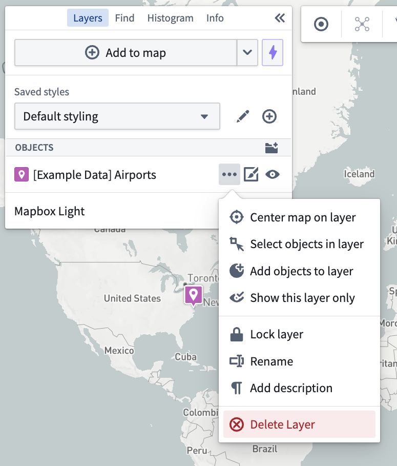

:::callout{theme="warning"}
注意：以下翻译的准确性尚未经过验证。这是使用 [AIP ↗](https://www.palantir.com/platforms/aip/) 从原始英文文本进行的机器翻译。
:::

# 选择

Map应用程序提供了多种方法以选择Object和注释。

## 在地图上选择项目

* **选择项目：** 点击一个Object或注释以选择它。如果光标下有多个项目，所有项目都会被选择。
* **将项目添加到现有选择：** 在点击时按住Ctrl（Windows）或Cmd（macOS）以将光标下的项目添加到选择中。
* **选择矩形区域中的所有项目：** 在点击并拖动光标时按住Shift，以选择矩形区域中的所有项目。
* **清除选择：** 点击地图上的空白区域。

在**选择**工具栏菜单中提供了其他选择选项。这些选项包括：

* **全选：** 选择地图上的所有项目。
  * 也可以通过Ctrl+A（Windows）或Cmd+A（macOS）键盘快捷键使用。
* **选择所有“类型”的项目：** 选择与当前选定Object的Object类型匹配的所有项目。
  * 仅在存在包含单一Object类型的现有选择时可用。
* **反转选择：** 将选择切换为当前未选中的所有项目。
  * 也可以通过Ctrl+I（Windows）或Cmd+I（macOS）键盘快捷键使用。
* **选择相交的Object：** 选择与当前选定项目相交的所有Object。
  * 仅在存在现有选择时可用。
* **选择与形状相交的项目…：** 允许您绘制一个形状并选择与其相交的所有Object。
  * 仅在没有现有选择时可用。

这些功能也可以在右键菜单中使用。

| **选择**菜单                                               | 带有现有选择的**选择**菜单                                                            | 形状的右键菜单                                                                |
|------------------------------------------------------------|----------------------------------------------------------------------------------------|--------------------------------------------------------------------------------|
|        |          |       |

您可以使用**图层操作**菜单中的**选择图层中的Object**菜单项来选择给定图层中的所有Object。

## 使用直方图选择项目

点击**直方图**面板中的一行以选择所有匹配的Object。在选择第二行时按住Shift以选择范围内的行。按住Ctrl（Windows）或Cmd（macOS）将会把该行添加到现有选择中。您可以在[直方图和筛选文档](%E7%9B%B4%E6%96%B9%E5%9B%BE.md)中找到更多详细信息。

## 在地图上锁定Object

通过选择**图层**面板中“Objects”部分下的\*\*…\*\*选项来锁定图层中的Object：

这将锁定图层的Object，使其在地图上不可选择。Object仍然可以从左侧的**图层**、**查找**和**直方图**面板中选择，但您不能通过光标、选择快捷键或相交形状在地图上与它们交互。您仍然可以通过\*\*…\*\*菜单按钮编辑图层的样式。

要解锁图层中的Object，请在**图层**面板中选择图层旁边的锁定图标或通过\*\*…\*\*下拉菜单访问。

## 选择面板

如果选择了多个Object，**选择**面板将列出这些Object。在此列表中，您可以点击单个Object以将选择范围缩小到该Object。选中单个Object后，右侧的**选择**面板将显示该Object的详细信息。

如果Object具有操作，可以通过点击图标访问。这些操作包括将地图居中于Object上、从地图中删除Object以及在其他应用程序中打开Object，均可通过\*\*...\*\*菜单获得。

此面板有三个选项卡。

* **属性**选项卡将显示Object的属性。如果有任何[派生属性函数](../Integrate%20data%20for%20the%20map/Ontology%20Object.md#derived-property-functions)，可以通过点击右下角的来选择。选择派生属性函数将把派生属性值添加到属性列表中。
* **系列**选项卡将显示与Object链接的任何系列。
* **事件**选项卡将显示在当前选定时间窗口中与Object链接的任何事件。

| 添加派生属性函数                                                                                          | 显示派生属性函数值                                                                        |
|-----------------------------------------------------------------------------------------------------------|--------------------------------------------------------------------------------------------|
|  |  |

## 从地图中移除项目

要从地图中移除选定的Object和注释，请执行以下操作之一：

* 点击工具栏中的**删除**
* 在右键菜单中选择**删除选择**条目
* 按下键盘上的删除键。

将会出现一个通知，确认删除的项目数量，并提供一个**撤销**选项以恢复此操作。

要移除单个图层中的所有Object，请使用**图层操作**菜单中的**删除图层**项。

