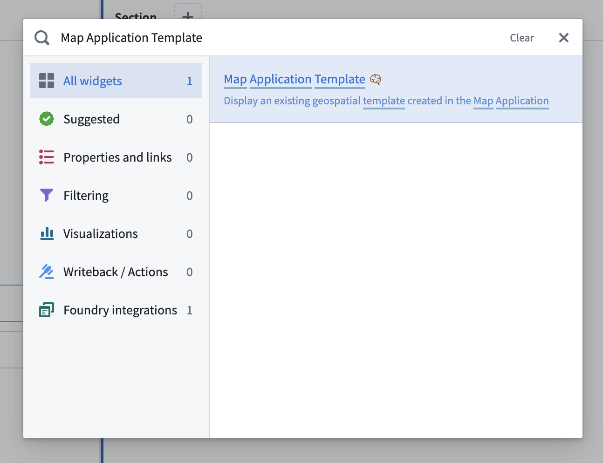

:::callout{theme="warning"}
注意：以下翻译的准确性尚未经过验证。这是使用 [AIP ↗](https://www.palantir.com/platforms/aip/) 从原始英文文本进行的机器翻译。
:::

# 在 Workshop 模块中嵌入地图模板

[地图模板](%E5%9C%B0%E5%9B%BE%E6%A8%A1%E6%9D%BF.md)可以嵌入到 Workshop 模块中。它们的参数值可以直接从 Workshop 变量中传递。

将地图模板嵌入 Workshop 模块中有三个步骤：

1. [在 Workshop 中添加地图应用模板微件](#add-a-map-application-template-widget-in-workshop)
2. [选择资源](#choose-a-resource)
3. [配置微件](#configure-the-widget)

## 在 Workshop 中添加地图应用模板微件

在 Workshop 模块中选择一个部分，点击 **+** 图标或 **+ 添加微件** 打开微件菜单，然后搜索 **地图应用模板** 微件。

## 选择资源

在微件编辑器中，点击 **选择** 查看兼容资源列表，并选择您想要嵌入的地图模板资源。

## 配置微件

对于 **地图应用模板** 微件，核心配置选项如下：

* **输入**
  * **资源：** 选择要嵌入的地图模板资源。以非必填提供 **覆盖地图 RID**。如果定义了此项，则会显示此地图，而不是使用模板及其参数生成的默认地图行为。这允许例如从保存在对象属性中的 RID 加载现有地图。
  * **参数：** 使用 Workshop 变量为模板参数提供值。
  * **刷新键：** 每当此变量的值更改时，微件将执行地图的完整重新加载。
  * **从场景加载数据：** 使用场景而不是基础Ontology加载给定资源。
  * **应用场景后重新生成地图：** 设置时，每次场景修改后地图将刷新。
* **交互**
  * **选定对象：** 输出当前选定对象的对象集。此对象集可用于当前模块中的下游微件。
  * **选定对象更改时：** 配置 Workshop 事件以在地图上的选定对象更改时触发（例如，触发器可以打开一个抽屉式导航，显示选定对象的更详细视图）。
  * **选定操作应用时：** 配置 Workshop 事件以在任何操作在微件内成功应用时触发。
  * **绘制形状：** 输出用户绘制的形状的 GeoJSON 几何集合。
  * **绘制形状时：** 配置 Workshop 事件以在地图中绘制形状时触发。
  * **地图上所有可见对象：** 输出当前地图中可见对象的对象集。
  * **可用操作：** 控制可从微件提交的操作。选择 **某些** 选项以手动指定可用操作，并使用操作配置利用模块变量作为默认参数值。
  * **缩放到对象集：** 将地图中心定位到给定对象集的内容。
* **能力**
  * **筛选渲染对象：** 设置后，允许用户通过 **对象集筛选** 变量筛选地图上显示的对象。
  * **启用地理空间对象搜索：** 允许用户使用绘制形状搜索Ontology。
  * **启用过渡到完整地图应用：** 允许用户从微件打开地图应用，使用他们的当前状态。
  * **启用图像导出到剪贴板：** 允许用户将地图的图像导出到他们的剪贴板。
  * **保存设置：** 启用以允许用户保存当前地图。
    * 当嵌入的资源是地图模板时，保存将创建一个新的地图资源。
      * 此地图将使用 **默认资源名称** 指定的名称，并放置在 **默认文件夹** 指定的文件夹中。如果启用了 **显示资源对话框**，将提示用户选择资源名称和位置，并在资源对话框中显示配置的名称和文件夹作为起始点。
      * 如果地图成功创建，则将在 **创建新地图时** 定义的事件和/或Ontology操作将被触发。如果您希望使用创建的地图 RID 作为操作参数的输入，请在参数输入选择器中使用特殊的 **已保存地图 RID** 选项。注意，所有必需参数必须配置为定义的默认值，因为不会向用户显示操作表单。
    * 当嵌入的资源是地图时，保存将仅更新嵌入的地图资源，而不是创建新资源。
* **时间配置**
  * **选定时间：** 使用 Workshop 类型为 `Timestamp` 或 `Date` 的变量控制选定时间。
  * **时间窗口：** 使用两个 Workshop 类型为 `Timestamp` 或 `Date` 的变量控制时间窗口。
* **界面**
  * **工具栏：** 显示工具栏。
  * **图例和搜索面板：** 在左侧显示图层和搜索面板。
    * **启用最小图例：** 显示一个尺寸较小且尽可能放置在右下角的图例。
    * **基础图层选择器：** 让用户通过 **图例和搜索面板** 下的按钮选择其他基础图层。
    * **直方图：** 显示直方图，让用户通过对象类型或属性筛选地图。
  * **对象选择面板：** 在右侧显示当前选定的对象。
  * **时间配置面板：** 在右侧显示时间滑块。
  * **序列面板：** 在底部显示序列面板。
  * **输入不完整消息：** 当由于缺少必需输入地图模板无法运行时，此消息将在对话框中显示给用户。

:::callout{theme="neutral"}
以前，模板输入是通过一个包含地图模板中定义的所有必需对象类型的输入对象集变量提供的。现在不建议这样做，因为它只适用于没有非对象参数且每个对象类型只有一个对象参数的模板。如果您仍希望使用此功能，请选择 **使用传统输入对象集** 复选框并提供一个对象集变量。
:::
