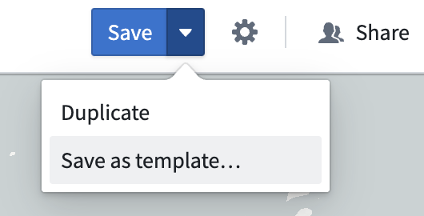
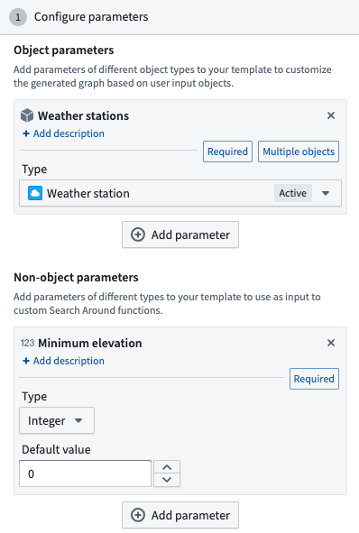
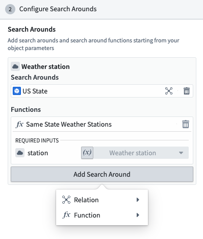

:::callout{theme="warning"}
注意：以下翻译的准确性尚未经过验证。这是使用 [AIP ↗](https://www.palantir.com/platforms/aip/) 从原始英文文本进行的机器翻译。
:::

# 地图模板

地图模板是生成完整地图的强大工具，包含用户地理空间分析任务可能需要的所有数据。

地图模板可用于生成新地图，也可以通过 [微件](%E5%9C%A8%20Workshop%20%E6%A8%A1%E5%9D%97%E4%B8%AD%E5%B5%8C%E5%85%A5%E5%9C%B0%E5%9B%BE%E6%A8%A1%E6%9D%BF.md) 嵌入到 Workshop 模块中。

## 创建地图模板

首先，创建一个标准地图作为您希望生成地图的示例。然后，点击**保存**旁边的向下箭头，然后点击**另存为模板...**。

## 配置地图模板

### 参数

地图模板允许您配置两种参数，可以用来配置以下 **Search Arounds**：

* **Object 参数：** 定义将用于生成结果地图的对象类型。
* **非对象参数：** 定义原始数据类型的附加输入。例如，`字符串`、`浮点数`、`双精度`、`整数`、`长整数`、`布尔值`、`日期`或`时间戳`输入。

### Search Arounds

接下来，您可以**配置与模板关联的 Search Arounds**。每个对象参数可以与 Search Arounds 关联，可以是使用 Ontology 链接的简单 Search Arounds 或 Search Around 函数。

Search Around 函数的任何非对象参数都可以映射到一个值，该值可以是常量或参数。要将函数输入映射到参数，请点击输入框左侧的**参数**按钮，并从下拉菜单中选择一个参数。

### 图层

对象图层可以配置为：

* **常量**：图层及其中的所有对象将按原样包含在模板中
* **样式**：此图层中的当前对象将被忽略，但所有图层样式将包含在模板中。如果此类型的对象随后添加到地图中，例如，通过模板 SearchArounds，或由用户添加，它们将以这种方式进行样式化。
* 或者，可以通过点击图层上的 **X** 来删除图层，以便它不包含在模板中。

覆盖图层可以包含在模板中或删除。

### 系列

如果您的地图上固定了系列，您可以选择在结果模板中包含或删除它们。

### 界面

生成地图的界面可以通过以下方式进行配置：

* **Workshop 模块**：允许用户看到返回所选 Workshop 模块的链接。
* **系列面板**：在创建新的模板地图时默认打开**系列面板**。
* **视口设置（飞向地图上的对象）**：自动将地图居中于地图上存在的对象。

## 使用地图模板

模板打开后，系统将提示您提供模板参数的值。

对象或对象集也可以使用 URL 查询参数预加载到模板中：

* **单个对象：** 使用 `objectRids` 查询参数 `objectRids=<object_rid>`
* **多个对象：** 使用 `objectRids` 查询参数，并用逗号分隔对象 RID `objectRids=<first_object_rid>,<second_object_rid>`
* **对象集：** 使用 `objectSetRid` 查询参数 `objectSetRid=<object_set_rid>`

要与给定参数值交互，请点击顶部工具栏中的 **参数**。这将允许您选择用作给定对象参数值的所有对象，或更改参数值以重新生成地图。

:::callout{theme="neutral"}
模板也可以通过 [相应的微件](%E5%9C%A8%20Workshop%20%E6%A8%A1%E5%9D%97%E4%B8%AD%E5%B5%8C%E5%85%A5%E5%9C%B0%E5%9B%BE%E6%A8%A1%E6%9D%BF.md) 嵌入到 Workshop 中。
:::
