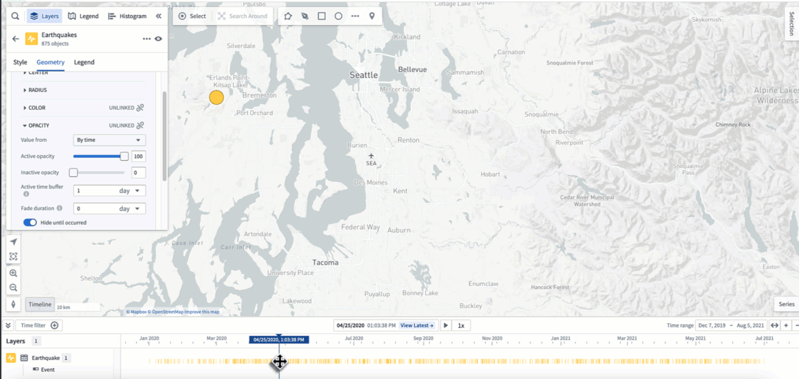
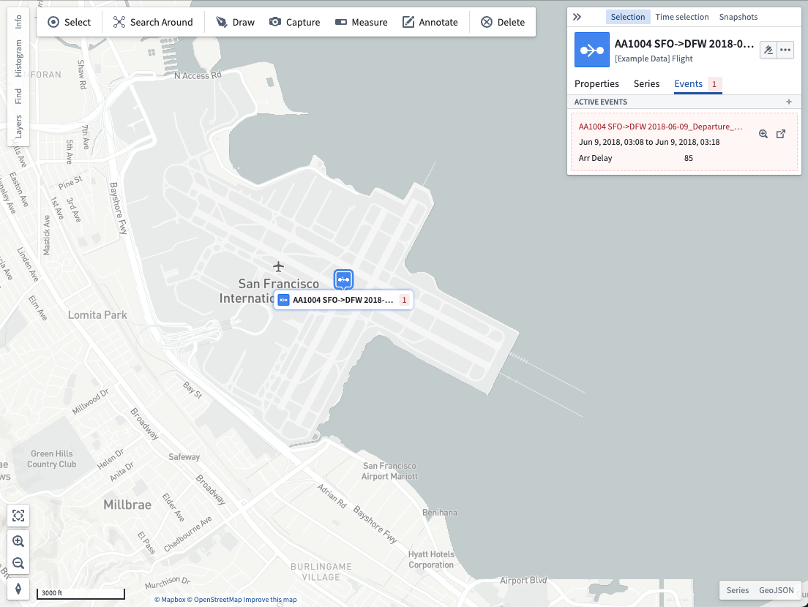
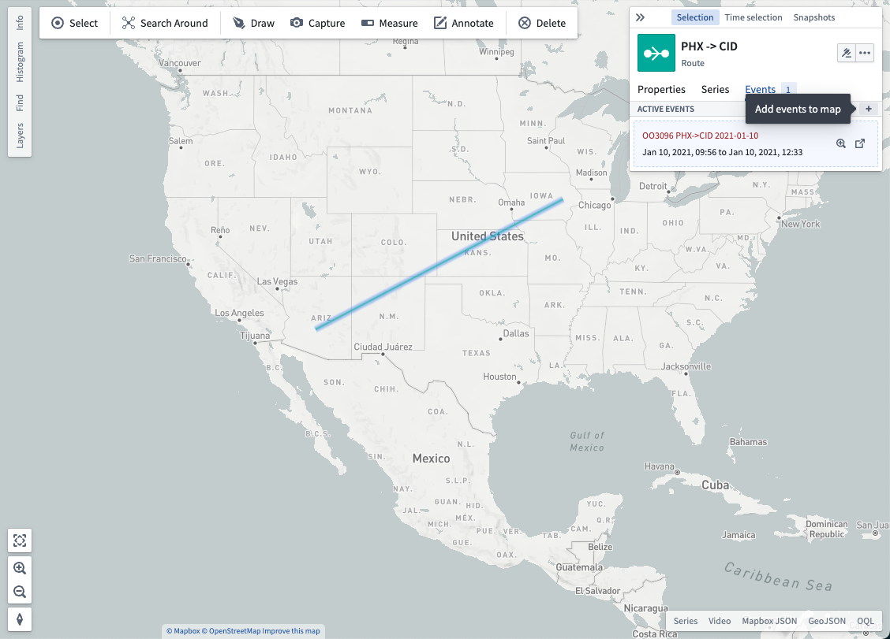
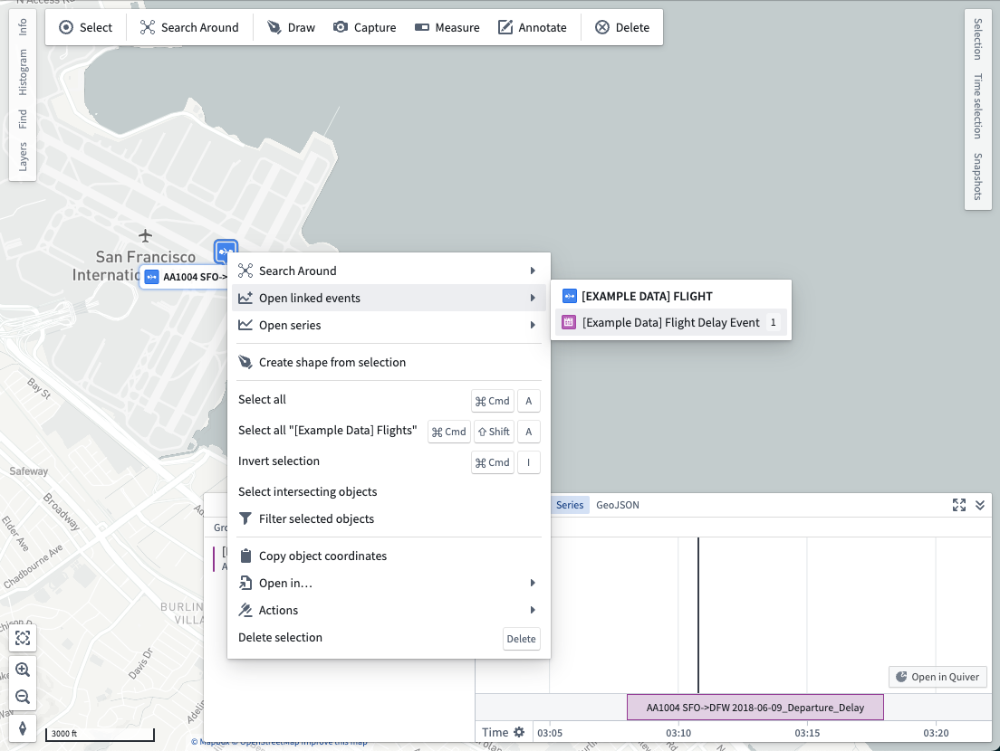
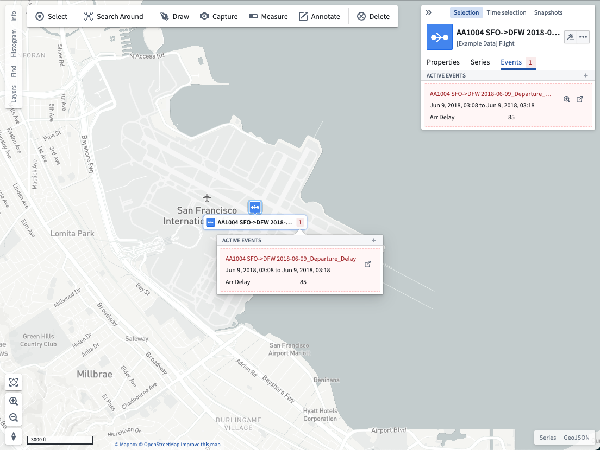

:::callout{theme="warning"}
注意：以下翻译的准确性尚未经过验证。这是使用 [AIP ↗](https://www.palantir.com/platforms/aip/) 从原始英文文本进行的机器翻译。
:::

# 事件

事件是包含关于特定时间点或时间段的时间信息的[Object类型](../../../%E5%AE%9A%E4%B9%89%E6%9C%AC%E4%BD%93/%E5%AF%B9%E8%B1%A1%E9%93%BE%E6%8E%A5%E7%B1%BB%E5%9E%8B/Object%20types/%E6%A6%82%E8%A7%88.md)；最常见的是，事件Object具有标记时间段起始和结束的时间戳属性。[了解更多关于在Ontology中配置事件的信息。](../Integrate%20data%20for%20the%20map/Ontology%20Object.md#events)

一旦您有了事件Object，您可以通过在地图上动态地与它们交互，使用它们进行样式设计、探索与地图上Object相关联的事件，以及在系列面板中查看事件时间段。

## 使用事件进行样式设计

当地图上的Object被配置为事件时，您可以对其进行样式设计，以便仅在当前[时间选择](%E6%97%B6%E9%97%B4%E9%80%89%E6%8B%A9.md)与事件的时间段重叠时才显示Object。使用此功能使您的地图随时间响应，并仅显示当前相关的事件Object。阅读更多关于[使用事件进行样式设计](../Visualize%20Ontology%20data/%E6%A6%82%E8%BF%B0.md#opacity-styling)的信息。

## 与Object相关联的事件

如果地图上的Object与事件Object相关联，您可以通过选择该Object并打开**事件**标签来查看这些关联的事件。如果当前选择的时间位于事件的开始和结束时间之间，则该事件将出现在**活动事件**部分；否则，该事件被视为非活动状态，可以通过使用**显示非活动事件**选项来显示。

当关联事件属于[地理空间Object类型](../Integrate%20data%20for%20the%20map/Ontology%20Object.md#configure-geospatial-objects)时，单击 **+** 将其添加到您的地图中：

每个事件都有相应的操作可供执行：

* 使用图标将选定的时间窗口设置为与事件的时间端点匹配。
* 使用图标在Object Explorer中打开事件。

### 在系列面板上显示

右键单击一个Object并选择**打开关联事件**以打开并将关联事件添加到系列面板。在系列面板上有事件时，您可以在重要时间段的背景下分析时间序列数据，并调整时间选择以使地图反映感兴趣的时间。

### 在标签中显示计数

如果您为一个图层启用了标签，则每个Object的标签中还会显示活动事件的计数。将鼠标悬停在活动事件计数上以查看活动事件：

