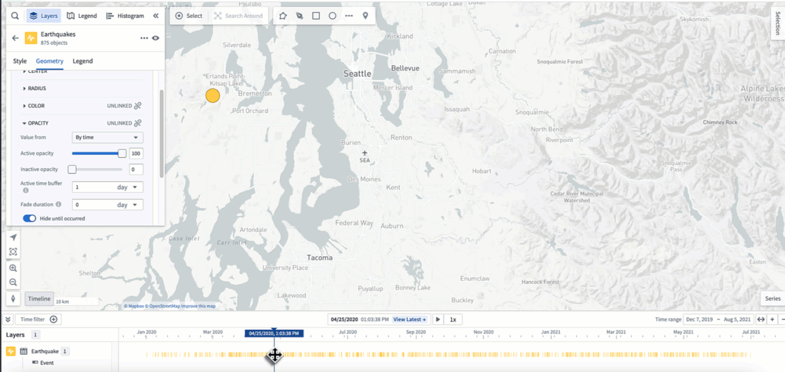
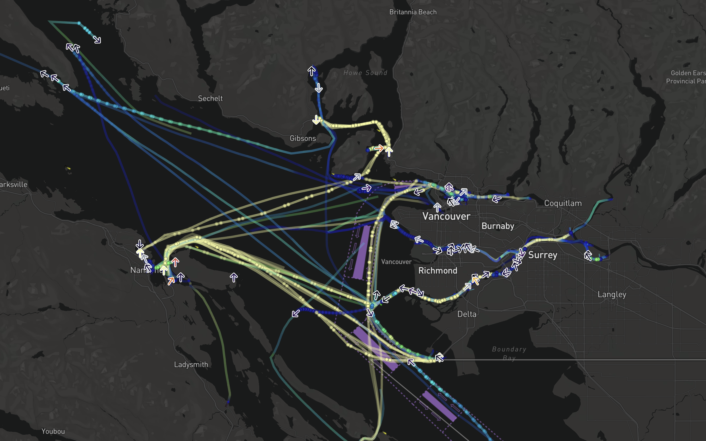

:::callout{theme="warning"}
注意：以下翻译的准确性尚未经过验证。这是使用 [AIP ↗](https://www.palantir.com/platforms/aip/) 从原始英文文本进行的机器翻译。
:::

# 地图中的时间和时间数据

地图具有一系列用于可视化和处理随时间变化数据的功能。时间数据有多种形式，每种形式都可以以不同的方式使用和可视化。地图应用程序中显示的所有时间数据都遵循当前[选择的时间](%E6%97%B6%E9%97%B4%E9%80%89%E6%8B%A9.md)，以帮助您了解数据随时间的变化并检查过去的特定时间。

## 时间序列

[时间序列](%E6%97%B6%E9%97%B4%E5%BA%8F%E5%88%97.md)是随时间变化的测量值。您可以在Ontology中将时间序列值配置为[时间序列属性](https://www.palantir.com/docs/foundry/time-series/time-series-setup/)。使用时间序列在地图上[样式化Objects](../Visualize%20Ontology%20data/%E6%A6%82%E8%BF%B0.md#value-based-styling)，并在[序列面板](%E6%97%B6%E9%97%B4%E5%BA%8F%E5%88%97.md#explore-related-time-series)中查看它们。

## 事件

[事件](%E4%BA%8B%E4%BB%B6.md)是与特定时间或时间范围关联的具有附加元数据的Objects。事件可以被用于[控制Objects的不透明度](../Visualize%20Ontology%20data/%E6%A6%82%E8%BF%B0.md#opacity-styling)在您的地图上，并在[时间轴](%E6%97%B6%E9%97%B4%E8%BD%B4.md#style-the-timeline)中可视化。

## 轨迹

使用[轨迹](../Integrate%20data%20for%20the%20map/Ontology%20Object.md#tracks)来表示位置随时间变化的Objects。[轨迹样式选项](../Visualize%20Ontology%20data/%E8%BD%A8%E8%BF%B9%E5%87%A0%E4%BD%95.md)允许您自定义Objects随时间变化的位置的可视化方式。
