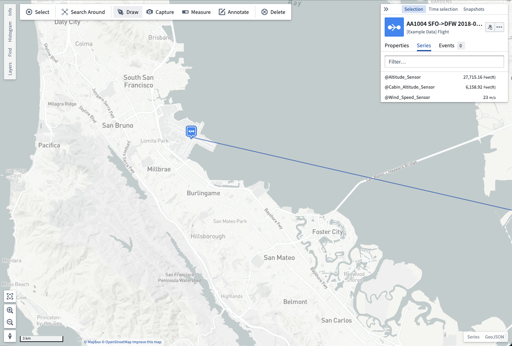
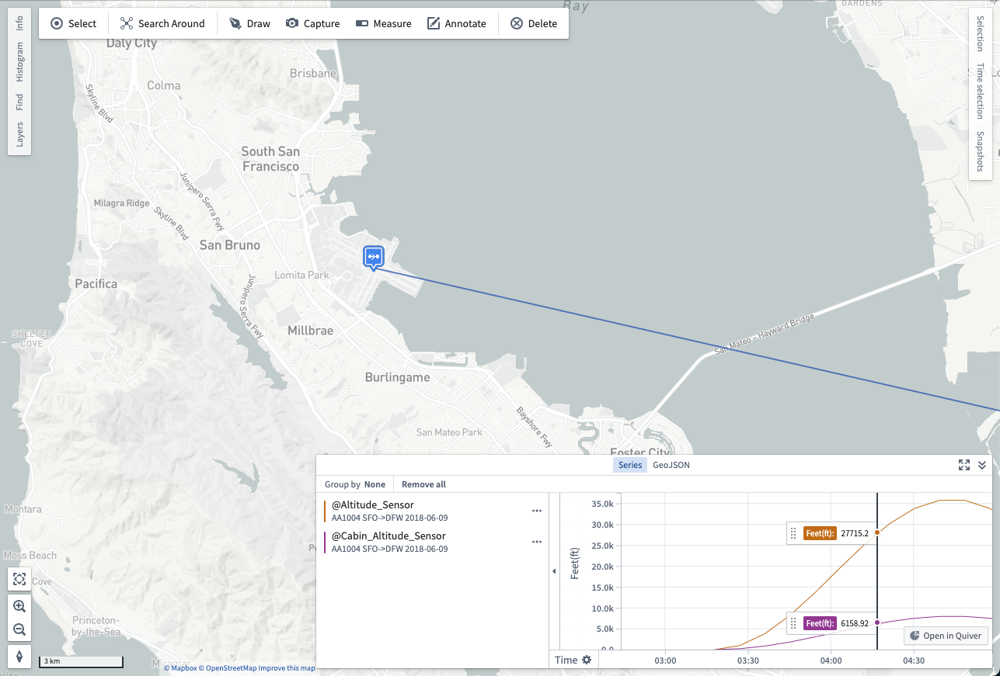
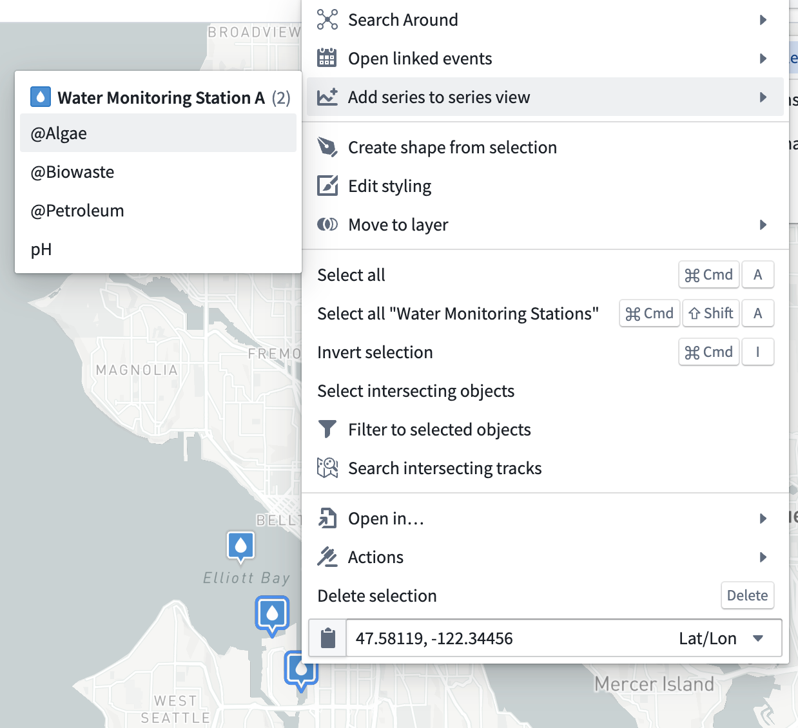

:::callout{theme="warning"}
注意：以下翻译的准确性尚未经过验证。这是使用 [AIP ↗](https://www.palantir.com/platforms/aip/) 从原始英文文本进行的机器翻译。
:::

# 时间序列

[时间序列](https://www.palantir.com/docs/foundry/time-series/time-series-overview/)是随时间变化的测量值。您可以在Ontology中将时间序列值配置为[时间序列属性](https://www.palantir.com/docs/foundry/time-series/time-series-setup/)。地图包含一些功能，帮助您查看和分析与地理空间Object相关联的时间序列数据。

## 探索相关时间序列

在地图上选择一个具有关联时间序列数据的Object。您可以在选择面板的**序列**选项卡中看到任何相关的时间序列。显示在序列旁边的值反映了当前[选定时间](%E6%97%B6%E9%97%B4%E9%80%89%E6%8B%A9.md)的序列值。

选择当鼠标悬停在序列行上时出现的\*\*…\*\*以打开一个菜单，其中包含与特定选定时间序列相关的其他操作：

* **固定序列：** 固定时间序列有两个效果：
  * 固定的时间序列将出现在序列列表的顶部。
  * 固定的时间序列将出现在地图上显示的标签中。有关标签的更多信息，请参阅[可视化Objects概述](../Visualize%20Ontology%20data/%E6%A6%82%E8%BF%B0.md#labels-and-tooltips)。
* **在序列视图中打开：** 当您将时间序列添加到序列视图中时，该序列随时间的可视化将出现在地图的底部。您可以使用序列视图通过点击您希望查看的时间点来移动时间，或者通过拖动序列面板底部的时间轴来滚动可视化的时间范围。
  

您还可以通过右键点击一个Object并从**打开序列**菜单中选择一个序列，在序列视图中打开时间序列：

## 使用时间序列进行样式设置

当地图上的Objects具有关联的时间序列数据时，您可以根据关联的时间序列为Objects着色。使用此功能使您的地图对当前[时间选择](%E6%97%B6%E9%97%B4%E9%80%89%E6%8B%A9.md)做出响应，并帮助您理解数据随时间的变化。阅读更多关于使用时间序列进行[基于值的样式设置](../Visualize%20Ontology%20data/%E6%A6%82%E8%BF%B0.md#value-based-styling)的信息。
