:::callout{theme="warning"}
注意：以下翻译的准确性尚未经过验证。这是使用 [AIP ↗](https://www.palantir.com/platforms/aip/) 从原始英文文本进行的机器翻译。
:::

# 时间轴

时间轴可以被用于在检查对象的时间属性，并以特定事件在给定的时间范围内进行筛选。

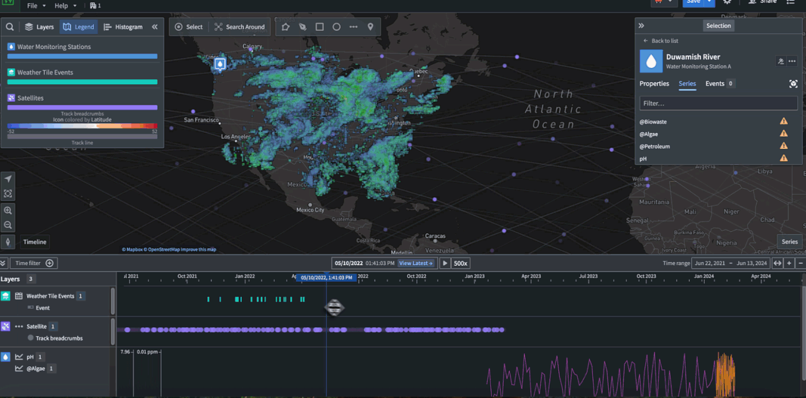

## 查看时间事件

界面左下角的 **时间轴** 按钮可以用于显示或隐藏时间轴。

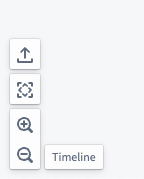

如果时间轴上没有可见内容，**缩放以适应** 按钮可以帮助在时间轴的 **时间范围** 内在地图上显示时间事件。

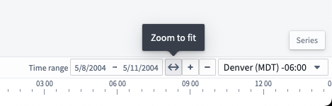

可见时，时间轴将显示对象的时间属性的线条和对象属性中时间范围的条形图。

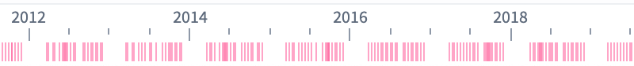
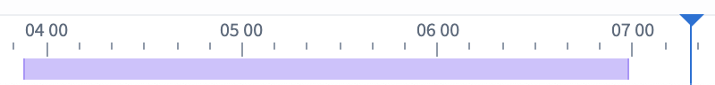

## 筛选时间事件

可以通过按住Shift并在时间轴上左键拖动来创建一个时间筛选窗口，或者使用时间轴控制栏中的 **时间筛选** 按钮在地图上筛选事件。

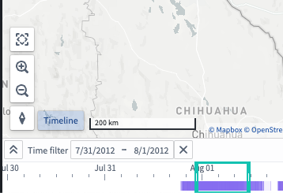

应用程序顶部也提供了 **时间筛选**。地图上符合筛选条件的节点是完全不透明的，而不符合时间筛选条件的节点则淡出。

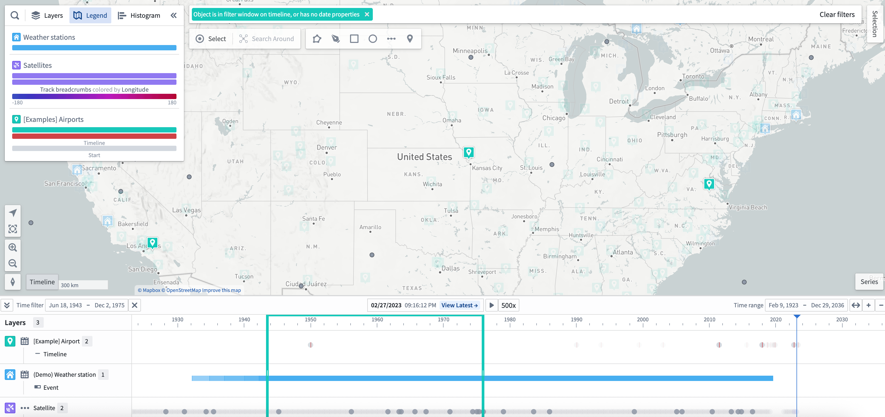

## 更改光标位置

可以通过双击时间轴、拖动光标到新位置，或使用控制栏中间的输入来更改时间轴上的光标位置。

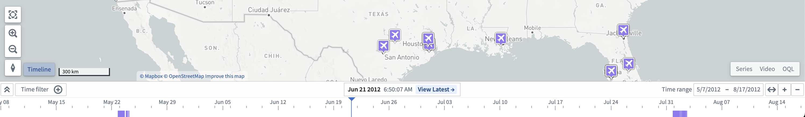

要获得光标的更具体日期，可以点击光标表单输入特定的日期和时间。

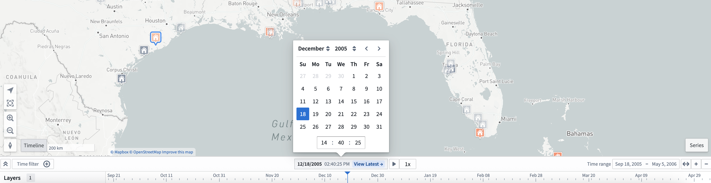

## 展开时间轴

要在其自己的时间轴行上显示每种对象类型，请点击时间轴控制栏中的“展开”按钮 ()。

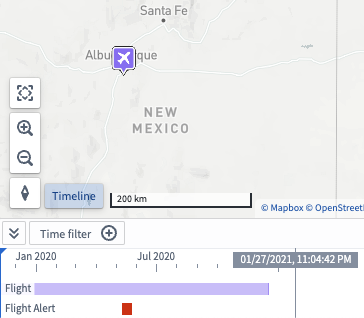

## 设置时间轴样式

要更改对象在时间轴上的显示方式，请从 **图层** 面板中添加一个时间轴样式器。

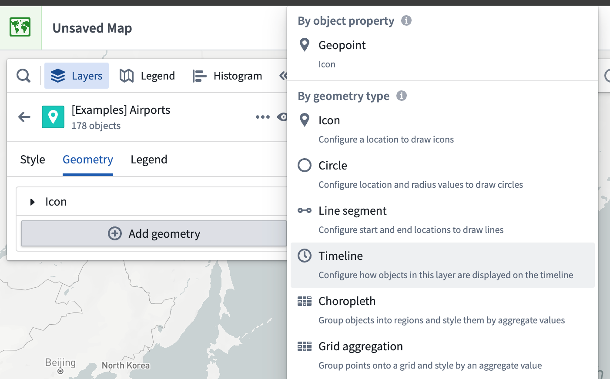

一旦添加了时间轴样式器，样式菜单中将出现一个 **时间轴** 部分。您可以更改在时间轴上绘制所选形状时使用的属性；选择使用两个时间属性的形状的 **起始属性** 和 **结束属性** 下拉菜单，或选择使用单个属性的形状的 **时间属性**。

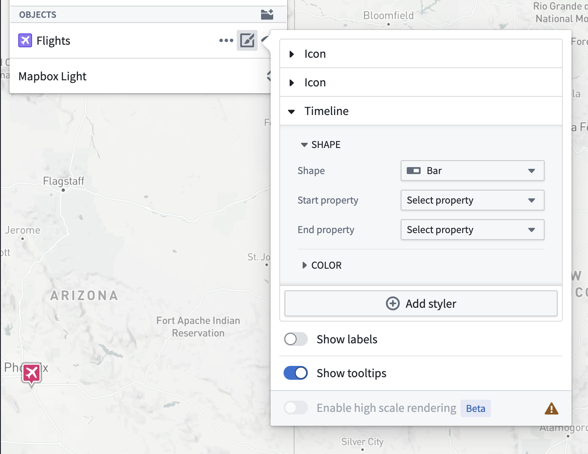

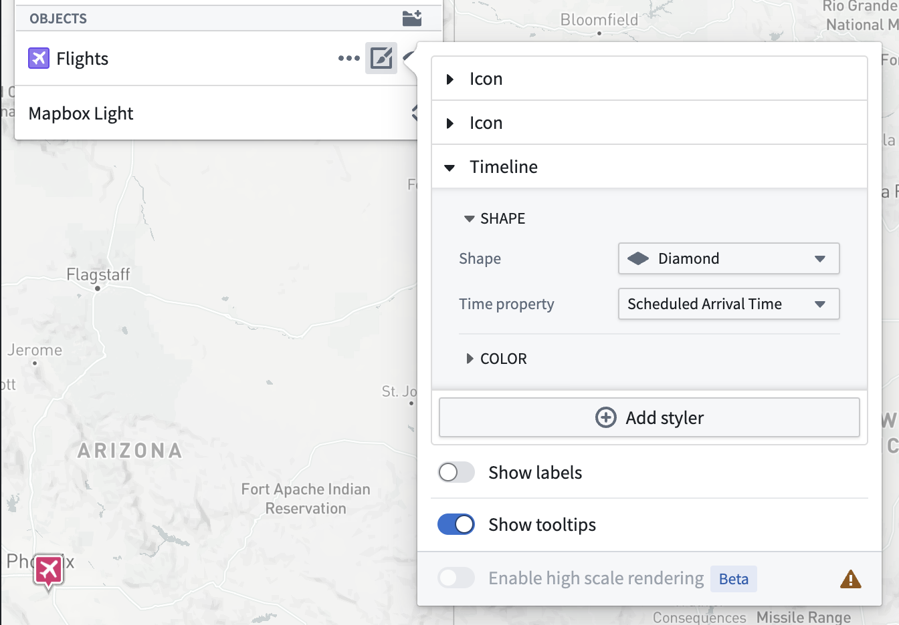

在时间轴样式配置中选择的形状将出现在时间轴中对象类型的每个实例中。例如，下图显示了用于表示时间轴上 `Flights` 对象类型的菱形形状。

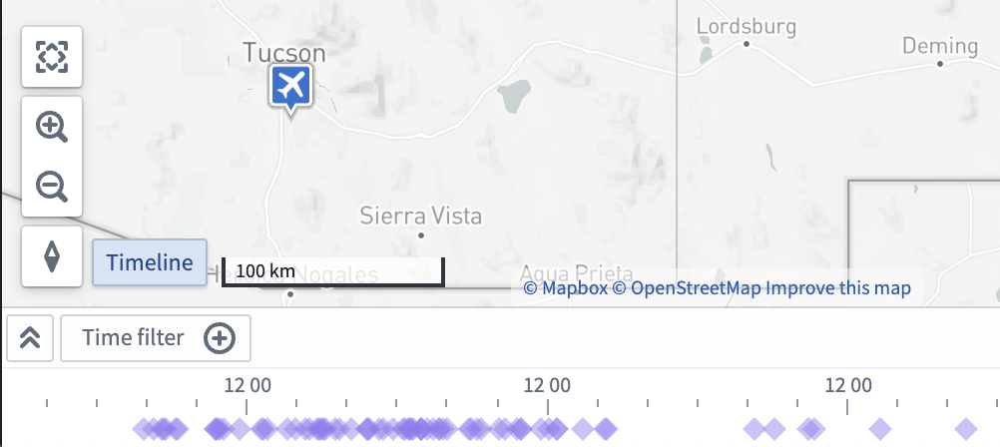

在 **时间轴** 样式器中选择 **颜色** 菜单，以配置时间轴上形状颜色的表示方式。

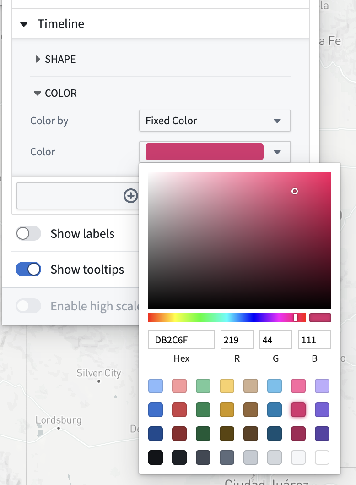

您还可以通过更改 **颜色依据** 下拉菜单中的选项，使用属性和度量来配置时间轴颜色样式。例如，下图配置为依据 `Arrival Latitude` 属性使用彩虹颜色光谱上色：

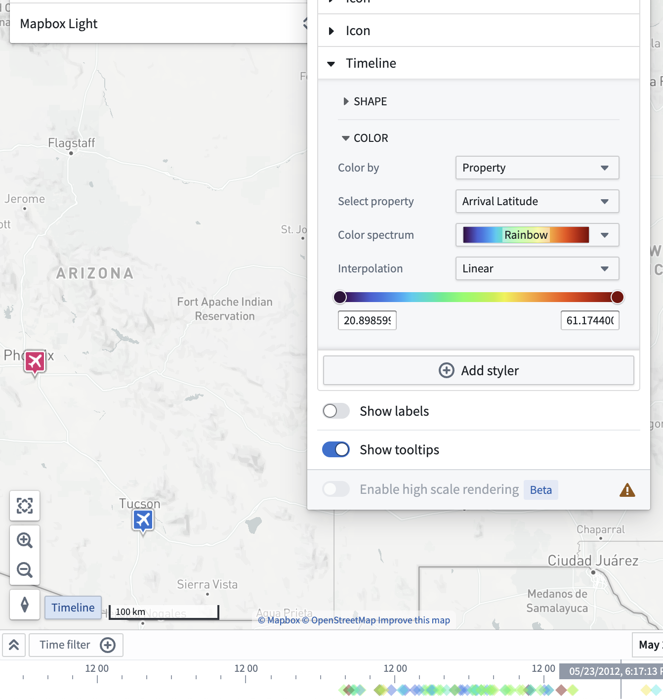

## 跟踪面包屑

带有面包屑样式器的轨迹也会显示在时间轴上。通过将光标移动到不同时点，可以为对象在其轨迹上的路径设置动画效果。

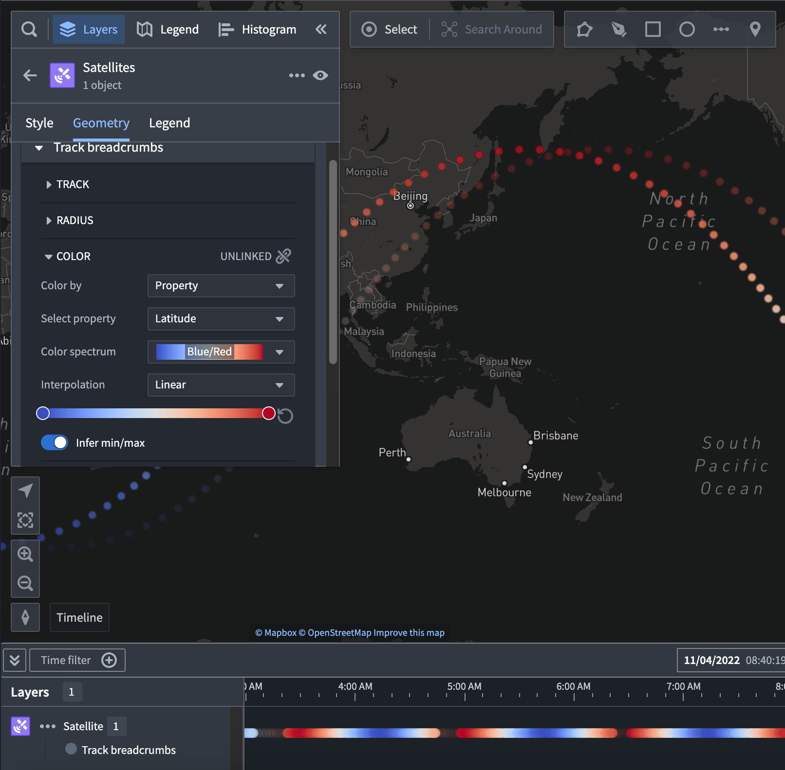

## 时间轴播放

您可以使用播放按钮 (⏵) 自动移动时间光标；播放速度可以通过速度预设（1x, 2x, 5x, 10x, 100x等）进行调整。

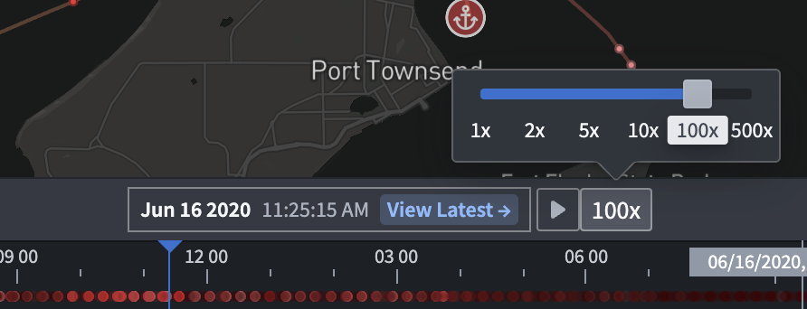

光标将自动循环时间轴上的时间窗口或时间筛选（如果存在）。

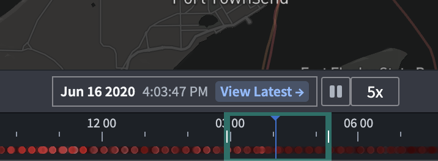
