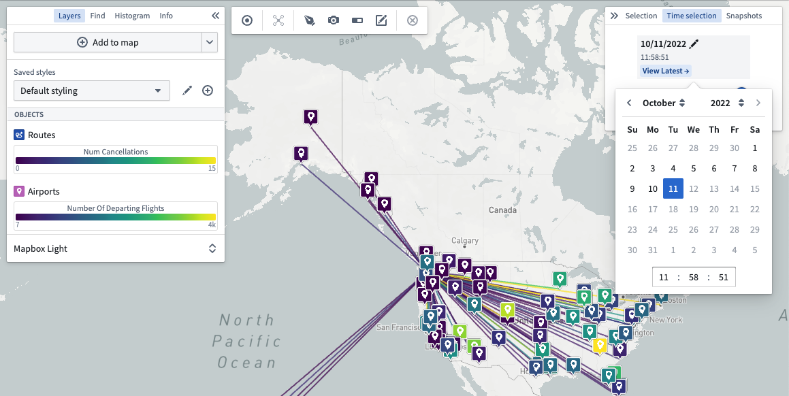
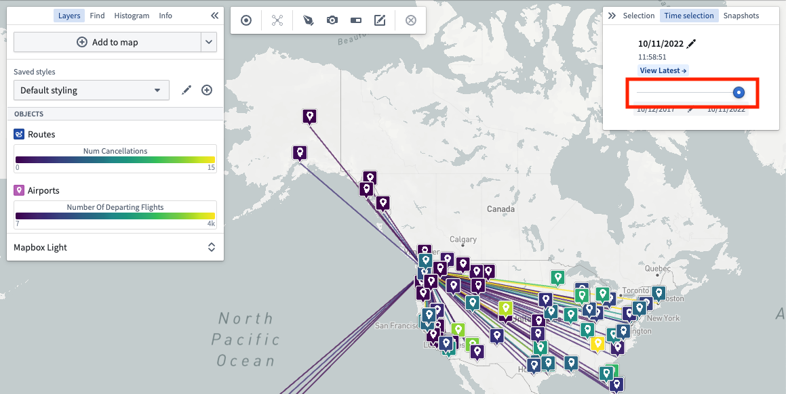
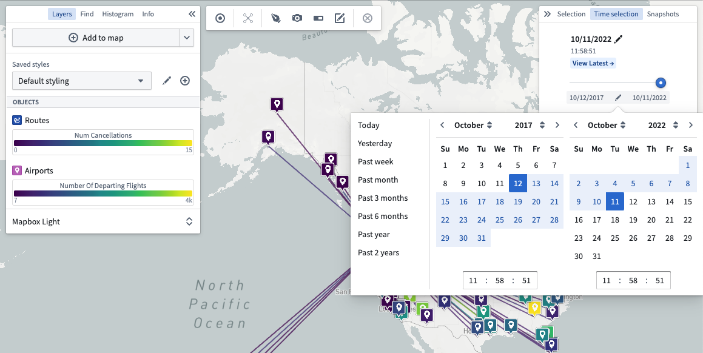

:::callout{theme="warning"}
注意：以下翻译的准确性尚未经过验证。这是使用 [AIP ↗](https://www.palantir.com/platforms/aip/) 从原始英文文本进行的机器翻译。
:::

# 时间选择

使用 **时间选择** 面板，您可以调整当前选择的时间和时间窗口。通过滚动时间窗口，您可以了解数据随时间的变化。

## 更改选择的时间

使用时间选择器调整您的地图，以在感兴趣的时间可视化数据。

:::callout{theme="neutral"}
时间选择器仅允许选择位于当前时间窗口内的时间。
:::

您也可以使用滑块滚动您的时间窗口：

### 查看最新数据

点击 **查看最新** 将所选时间设置为当前时间。在 **最新数据** 视图中，所选时间会自动更新以匹配当前时间。将最新数据模式与[流数据](https://www.palantir.com/docs/foundry/building-pipelines/pipeline-types/#streaming)结合使用，以在您的地图上可视化实时更新的数据。

## 更改时间窗口

使用时间滑块下的日期范围选择器调整时间窗口：

