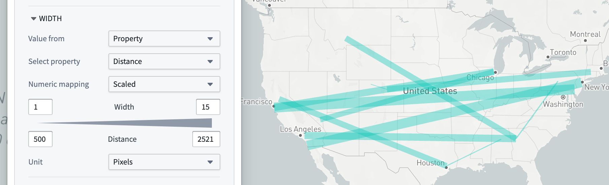
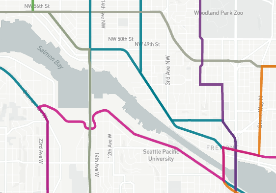
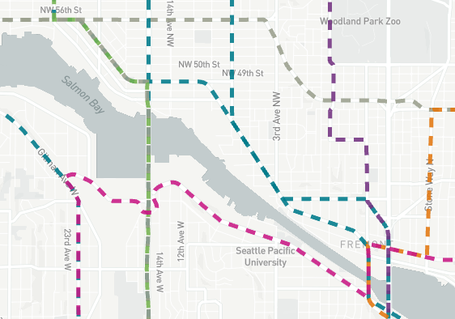
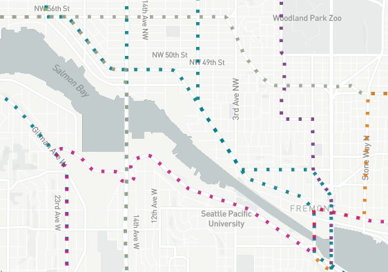
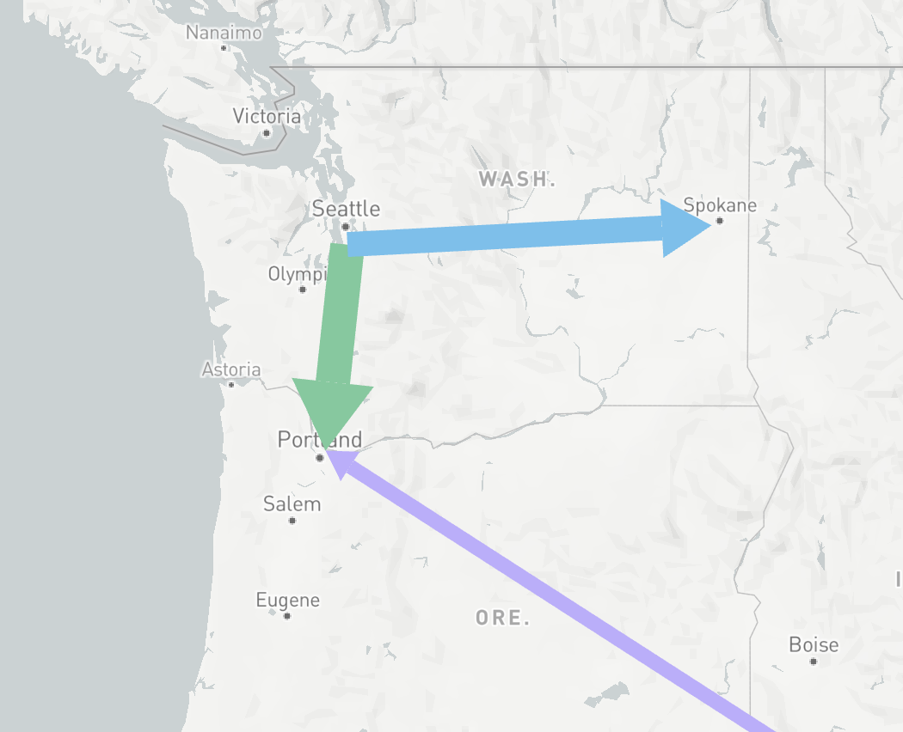
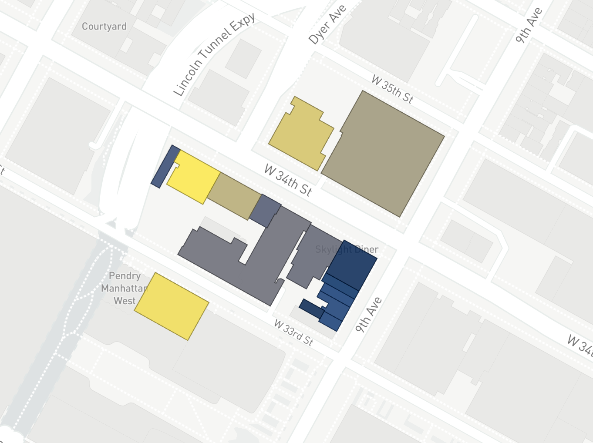
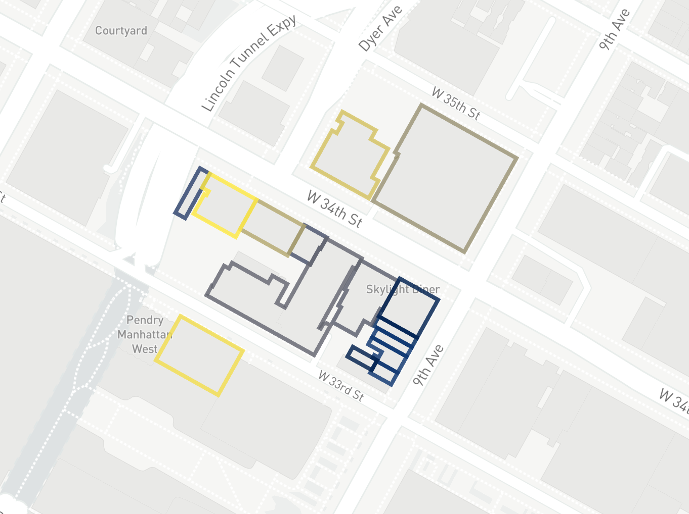

:::callout{theme="warning"}
注意：以下翻译的准确性尚未经过验证。这是使用 [AIP ↗](https://www.palantir.com/platforms/aip/) 从原始英文文本进行的机器翻译。
:::

# 多边形和线几何图形

地图可以根据您的Ontology Object渲染多边形和线条。指定线或多边形几何图形有两种方式：

* **地理形状属性：** 显示存储在Object上的[地理形状属性](../Integrate%20data%20for%20the%20map/Ontology%20Object.md#polygons-and-lines)中的GeoJSON线和多边形几何图形。
* **线段：** 显示Object上两个地理哈希属性之间的线条。

有关如何配置样式规则以及颜色和不透明度样式配置的更多信息，请参阅[基于值的样式](%E6%A6%82%E8%BF%B0.md#value-based-styling)。多边形和线条可以通过以下附加属性进行样式化。

## 笔触宽度

使用**笔触宽度**部分来控制渲染线条时使用的宽度，或未填充多边形的笔触。

## 笔触样式

使用**笔触样式**部分来控制渲染线条时使用的虚线模式，或未填充多边形的笔触。可用选项有：

| 实线                                           | 虚线                                            | 点线                                            |
| ----------------------------------------------- | ------------------------------------------------- | ------------------------------------------------- |
|  |  |  |

对于线段，您还可以配置箭头以指示线的方向。

## 填充多边形

当**填充多边形**启用时，多边形以最小的笔触渲染，其内部填充指定的颜色。禁用时，多边形仅使用**笔触宽度**和**笔触样式**中的样式配置进行描边。

| 填充启用                                        | 填充禁用                                         |
| --------------------------------------------------- | ----------------------------------------------------- |
|  |  |
