:::callout{theme="warning"}
注意：以下翻译的准确性尚未经过验证。这是使用 [AIP ↗](https://www.palantir.com/platforms/aip/) 从原始英文文本进行的机器翻译。
:::

# 概述

地图的主要功能是实现对来自您的Ontology的地理空间数据的可视化和分析。一旦您[将对象添加到地图](../Interact%20with%20maps/%E5%B0%86%E6%95%B0%E6%8D%AE%E6%B7%BB%E5%8A%A0%E5%88%B0%E5%9C%B0%E5%9B%BE.md)，您可以配置样式配置以表示对象的各种属性。从高层次上看，对象图层包含多个几何图形（例如，图标、线条、多边形），这些几何图形代表地图上的对象。每个几何图形可以根据对象的不同属性进行样式设置，例如颜色、大小和不透明度。

## 编辑图层样式

要编辑图层的样式，请从图层面板中选择一个图层条目。图层详细信息面板将打开，并包含多个部分作为选项卡：

* **样式：** 配置一个默认颜色和不透明度，可以应用于图层中的多个几何图形。
* **几何图形：** 添加几何图形并独立配置每个几何图形的样式。
* **图例：** 控制该图层的样式信息如何在图例面板中显示。

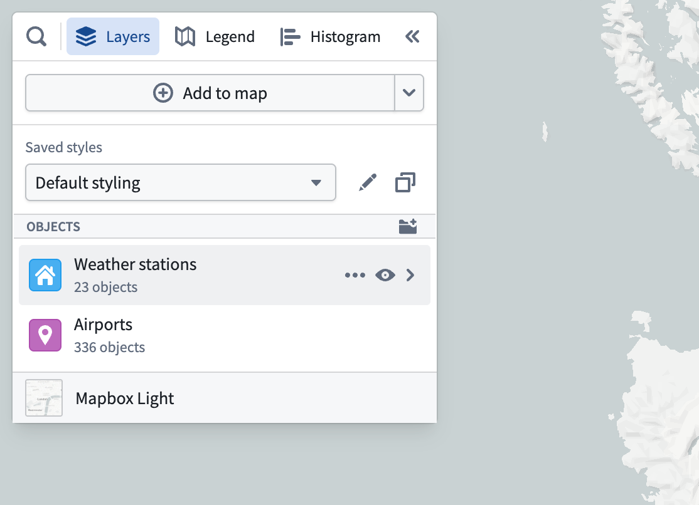

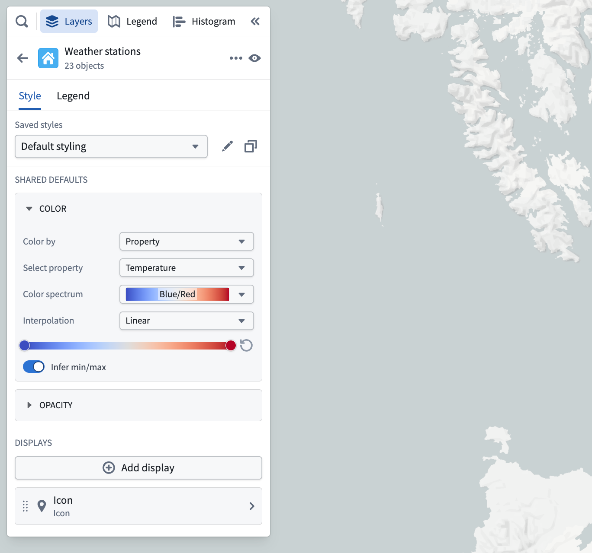

## 图层样式

**样式**部分允许您配置应用于图层中所有几何图形和对象的样式。可以在图层样式中控制的样式选项包括颜色、不透明度、标签和工具提示。有关如何配置颜色和不透明度的更多信息，请参见[基于值的样式](#value-based-styling)和[不透明度样式](#opacity-styling)部分。

### 标签和工具提示

有两个与标签和工具提示相关的非必填切换选项：

* **显示标签：** 控制是否在地图上为图层中的每个项目显示标签。
* **显示工具提示：** 控制图层中的项目在悬停时是否会显示带有上下文信息的弹出窗口。

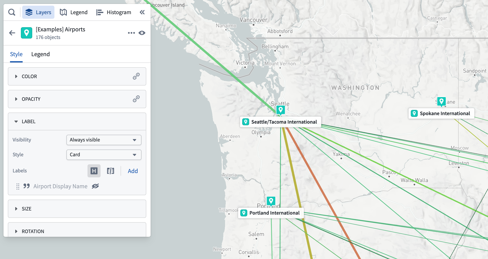

#### 对象图层的标签内容

对于基于对象的图层，标签和工具提示可能包含以下内容：

* 属性（包括[时间序列属性](../Integrate%20data%20for%20the%20map/Ontology%20Object.md#time-series-and-time-series-properties)）
* [派生属性](../Integrate%20data%20for%20the%20map/Ontology%20Object.md#derived-property-functions)
* [序列](https://www.palantir.com/docs/foundry/time-series/time-series-overview/)
* 链接的对象计数

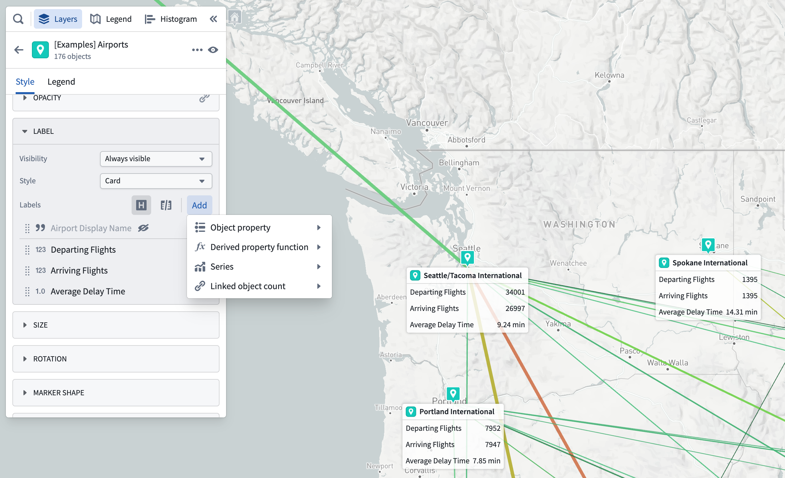

属性或序列也可以通过选择面板中的\*\*…\*\*菜单添加，该菜单在悬停于属性或序列时出现，如下图所示。

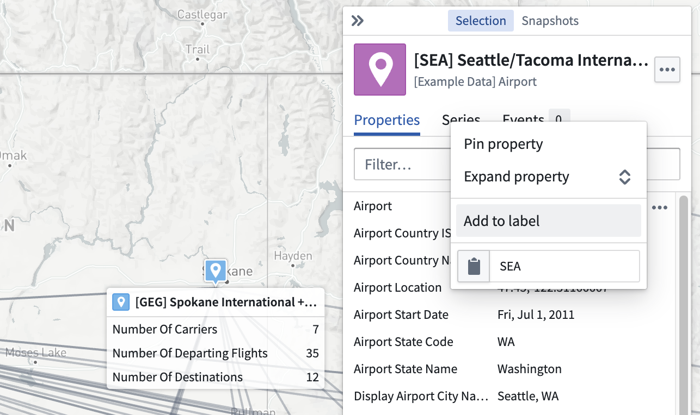

## 几何图形

一个对象图层可以包含多个**几何图形**，每个几何图形都是在地图或时间轴上表示图层对象的不同方式。通过组合多个几何图形，您可以创建复杂的可视化效果，以同时表示多个属性，并在放大时提供更详细的视图。可用的几何图形类型有：

* [**图标和圆圈：**](%E7%82%B9%E5%87%A0%E4%BD%95%E5%9B%BE%E5%BD%A2.md) 根据地理哈希属性放置。
* [**线条和多边形：**](%E5%A4%9A%E8%BE%B9%E5%BD%A2%E5%92%8C%E7%BA%BF%E5%87%A0%E4%BD%95%E5%9B%BE%E5%BD%A2.md) 基于地理形状属性或多个地理哈希属性。
* [**轨迹线、面包屑和热图：**](%E8%BD%A8%E8%BF%B9%E5%87%A0%E4%BD%95.md) 帮助可视化随时间移动的对象。

您可以使用**添加几何图形**选项在**几何图形**部分下方添加新的几何图形。

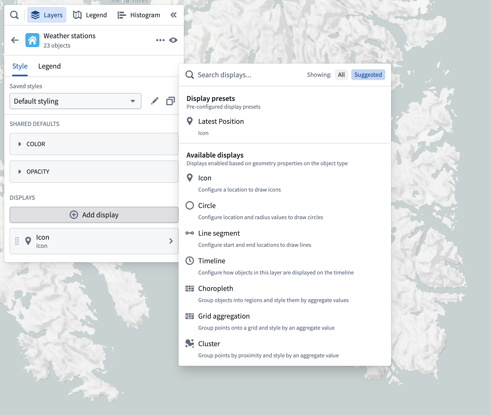

添加几何图形菜单有两个部分：

* **按对象属性：** 选择图层的对象类型上可用的属性，并添加一个配置为使用该属性的几何图形到地图。
* **按几何类型：** 从地图可以渲染的各种几何类型中选择。只有那些可以为图层的对象类型完全配置的几何图形才会启用。

每个几何图形包含许多可以设置样式的属性，这些属性在每个几何图形的相应页面上有详细介绍。几何图形上的大多数属性遵循在以下部分描述的基于值的样式范式。

## 图例

从图层详细信息面板中，使用**图例**选项卡预览和控制图层将在图例面板中如何表示。图层几何图形的样式信息默认包含在图例配置部分。标题开关决定此图层及其相关几何图形是否会出现在图例面板中。切换行级别的复选框以隐藏或显示单个条目。

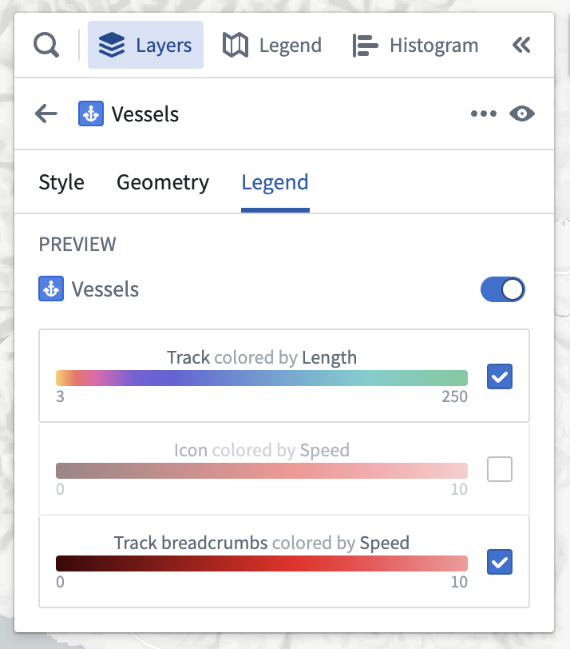

## 基于值的样式

使用**基于值的样式**通过与对象相关的值控制为对象渲染的几何图形的外观。例如，您可以配置图标的颜色来表示气象站的温度，或者配置圆的大小来表示公司员工的数量。使用基于值样式的最常见属性类型是颜色和数值属性（例如，线宽、图标大小、圆半径等）。

基本思想是，对于每个被渲染的对象，您指定一个**值来源**，该来源确定从每个被渲染对象中用于样式的值。然后，指定某种方式将值转换为样式属性（例如，颜色、大小、不透明度）。通常可用于每个可样式化属性的值来源有：

* **固定：** 明确选择一个将均匀应用于图层中所有对象的样式值。
* **属性：** 根据对象上的属性为每个对象设置样式。
* **函数：** 根据[派生属性函数](../Integrate%20data%20for%20the%20map/Ontology%20Object.md#derived-property-functions)计算的值为每个对象设置样式。
* **度量：** 根据[时间序列度量](../Integrate%20data%20for%20the%20map/Ontology%20Object.md#time-series-and-time-series-properties)为每个对象设置样式。

一旦选择了要使用的值，将其转换为样式值（颜色、线宽、圆半径等）的配置取决于您所设置样式的属性类型。

## 颜色样式

以下部分描述了每种属性类型可用的颜色样式选项。

### 固定

使用固定颜色样式时，通过使用颜色选择器选择一个将均匀应用于图层中所有对象的颜色。

### 基于值

当通过函数、属性或具有数值的时间序列进行着色时，使用渐变编辑器将值映射到输出颜色。可以通过选择渐变条上的点来编辑渐变中使用的颜色。颜色渐变的数值范围（最小/最大）是自动推断的，但可以关闭以手动设置范围。

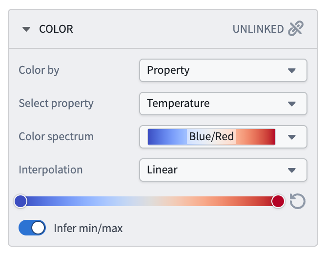

当通过具有字符串值的函数、属性或时间序列进行着色时，**颜色映射**下拉菜单包含用于将值映射到颜色的方法：

* **手动：** 明确指定每个值使用的颜色。
* **自动：** 从颜色方案中自动分配颜色，以区分不同的值，而无需配置特定值。
* **无：** 尝试将每个值直接应用为十六进制颜色。

## 数值样式

以下部分描述了每种属性类型可用的数值样式选项。

### 固定

使用固定数值样式时，通过使用滑块或在输入字段中输入确切的数字来指定数值。

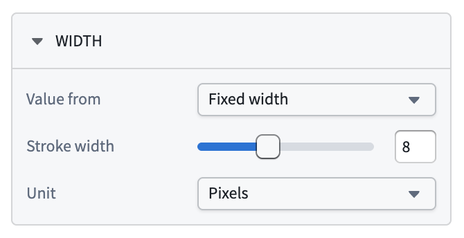

### 基于值

设置数值属性（例如线宽或图标大小）样式时，仅可将具有数值的属性用作值来源。通过选择**数值映射**选项配置从所选值来源到样式属性的映射：

* **缩放：** 定义线性比例，将对象的值转换为用于样式的数字。
  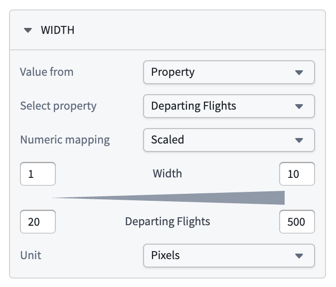
  * 顶行控制样式属性的最小值和最大值，而底行决定将对应于这些最小/最大值的值范围。
  * 在此示例中，当对象具有"每日航班数量"属性值为`3`时，线宽将为`3`，当属性值为`20`时，线宽将为`10`。
* **无：** 属性的值将直接用作样式属性，不进行任何缩放或变换。

## 不透明度样式

使用**不透明度**部分控制图层中对象的透明度。

**值来源**下拉菜单包含指定不透明度的各种方式：

* **固定：** 选择一个将均匀应用于图层中所有对象的不透明度。
* **按时间：** 渲染[轨迹](../Integrate%20data%20for%20the%20map/Ontology%20Object.md#tracks)或[事件](../Integrate%20data%20for%20the%20map/Ontology%20Object.md#events)对象时，根据全局[时间选择](../Time/%E6%97%B6%E9%97%B4%E9%80%89%E6%8B%A9.md)控制它们的不透明度。

  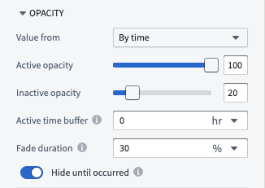

  * **活动不透明度：** 设置对象或点被视为活动时的不透明度。
  * **非活动不透明度：** 设置对象或点未被视为活动时的不透明度。
  * **活动时间缓冲：** 设置事件或轨迹点的时间戳与当前时间光标的时间接近程度，以便将其视为活动。
  * **淡出持续时间：** 设置对象的不透明度从活动淡出到非活动不透明度的时间段，一旦它变为非活动。
  * **隐藏直到发生：** 如果启用，对象将在时间光标经过事件或轨迹点的时间戳开始之前完全隐藏。

  :::callout{theme="neutral"}
  **值来源**下拉菜单和**按时间**不透明度选项仅在设置[轨迹](../Integrate%20data%20for%20the%20map/Ontology%20Object.md#tracks)或具有[事件数据](../Integrate%20data%20for%20the%20map/Ontology%20Object.md#events)的对象样式时出现。否则，不透明度部分将仅显示固定不透明度选项。
  :::

## 几何图形按缩放级别的可见性

使用**缩放级别**部分控制图层中对象的可见范围。插入符号指示您当前的缩放级别。

当视口处于活动范围内的缩放级别时，相应的几何图形将在地图上渲染。当超出范围时，相应的几何图形将被隐藏。

缩放级别配置仅适用于切换为[可见](../Interact%20with%20maps/%E5%9B%BE%E5%B1%82%E7%AE%A1%E7%90%86.md#toggle-layer-visibility)的图层。

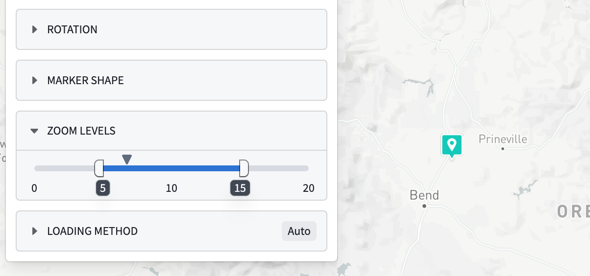
