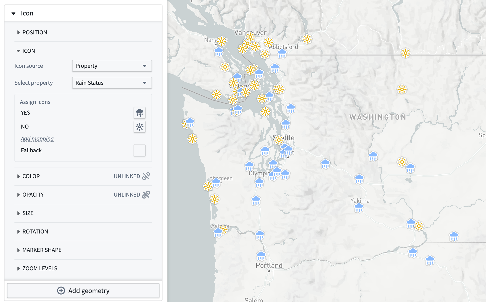
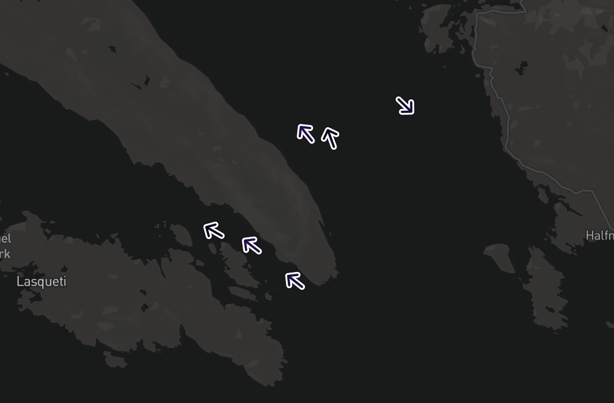
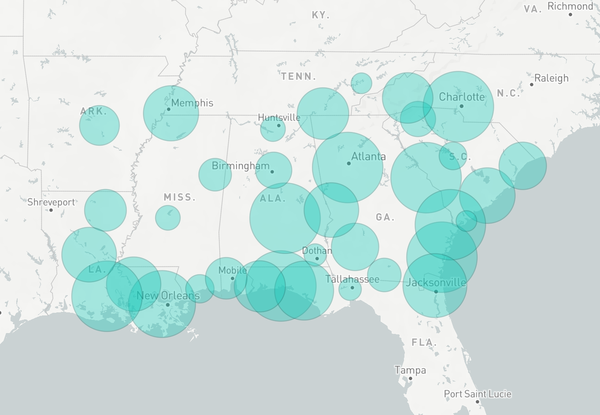

:::callout{theme="warning"}
注意：以下翻译的准确性尚未经过验证。这是使用 [AIP ↗](https://www.palantir.com/platforms/aip/) 从原始英文文本进行的机器翻译。
:::

# 点几何图形

地图包含两种可视化点几何图形的方法：图标和圆形。要显示图标或圆形，您需要一个为每个Object提供位置的几何源。支持的几何源包括[geohash属性](../Integrate%20data%20for%20the%20map/Ontology%20Object.md#points)和[轨迹](../Integrate%20data%20for%20the%20map/Ontology%20Object.md#tracks)。

当使用轨迹作为点几何源时，地图将从轨迹中提取与当前[选定时间](../Time/%E6%97%B6%E9%97%B4%E9%80%89%E6%8B%A9.md)对应的位置。有一些配置选项可以控制该位置的插值方式，这些选项在[轨迹](%E8%BD%A8%E8%BF%B9%E5%87%A0%E4%BD%95.md)页面中介绍。

## 图标配置

图标是可视化点数据的最常见方法之一。每个图标都放置在几何源提供的位置，并可以通过多种方式进行样式设计，以生成适合您工作流程的可视化效果。

### 图标

**图标**部分允许您控制将为每个Object显示的图标。指定图标的选项包括：

* **Object默认:** 图标将是Ontology Management应用程序中配置的Object类型的默认图标。
* **固定图标:** 为图层中的所有Object选择一个特定图标进行显示。
* **属性:** 每个Object显示的图标由Object上的一个属性决定。

下面的示例使用带有颜色和图标样式的降雨状态时间序列来可视化太平洋西北地区的天气站在选定日是否观测到降雨。

### 旋转

您可以通过任何[基于值的样式](%E6%A6%82%E8%BF%B0.md#value-based)选项来控制图标的旋转。对于轨迹几何源，还有一个**自动**选项，可以根据轨迹中Object的移动方向旋转图标。

下面的示例使用固定箭头图标和旋转样式来显示船舶Object的移动方向。

### 标记形状

您可以为图标配置三种样式的标记：

| 圆形                                                 | 大头针                                         | 无                                             |
| --------------------------------------------------- | --------------------------------------------- | --------------------------------------------- |
|      |  |    |

## 圆形配置

每个圆形都以提供的位置为中心，并绘制一个您可以在样式的**半径**部分中配置的半径值。

其他圆形样式选项与[多边形几何图形的选项](%E5%A4%9A%E8%BE%B9%E5%BD%A2%E5%92%8C%E7%BA%BF%E5%87%A0%E4%BD%95%E5%9B%BE%E5%BD%A2.md)相同。
