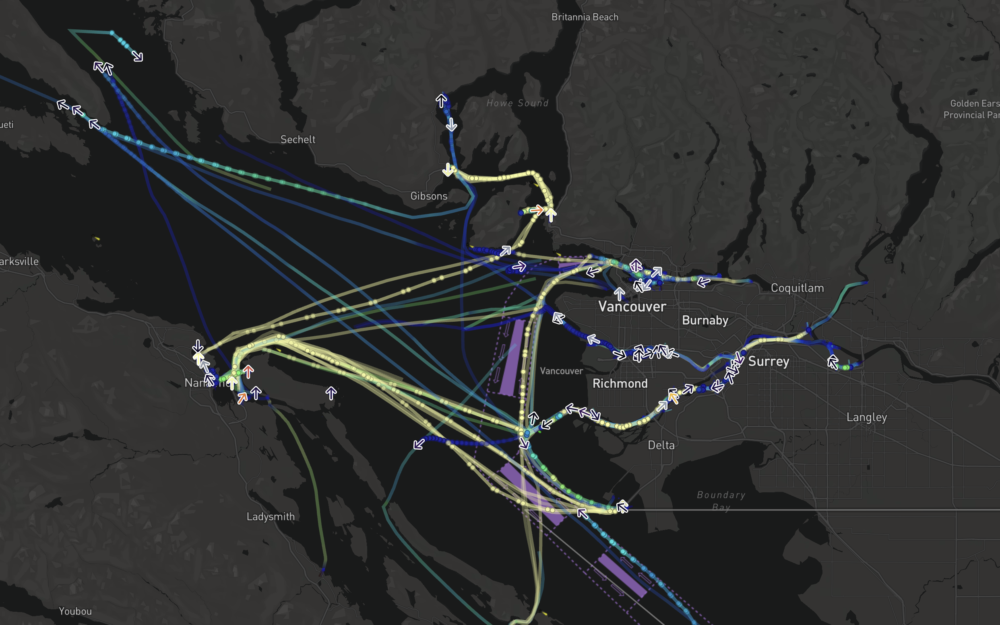
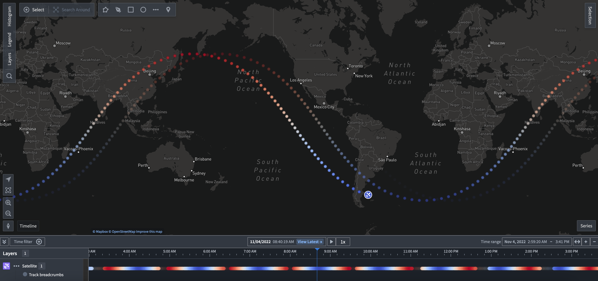

:::callout{theme="warning"}
注意：以下翻译的准确性尚未经过验证。这是使用 [AIP ↗](https://www.palantir.com/platforms/aip/) 从原始英文文本进行的机器翻译。
:::

# 轨迹几何

地图包含用于渲染随时间移动的Object的几何。这些几何旨在帮助您可视化Object所经过的路径以及随着Object在地图上移动而出现的模式。

所有轨迹几何都具有使用[基于时间的不透明度样式](%E6%A6%82%E8%BF%B0.md#opacity-styling)的能力。除了下述的轨迹几何外，您还可以使用轨迹几何源来定位[图标和圆形](%E7%82%B9%E5%87%A0%E4%BD%95%E5%9B%BE%E5%BD%A2.md)。

下面的示例使用轨迹几何源显示一条轨迹线、面包屑和在当前位置的图标，展示在温哥华市附近移动的船只Object：

#### 移动几何插值

当使用轨迹作为几何源时，您可以使用其他选项来配置地图如何从轨迹和[时间光标](../Time/%E6%97%B6%E9%97%B4%E9%80%89%E6%8B%A9.md)中解释点位置。

* **插值模式**
  * **线性：** 在轨迹中的已知点之间平滑插值。
  * **最后已知：** 在时间光标之前显示Object的最后记录位置。
* **最大时间间隙：** 当两个连续的轨迹点之间的时间差大于配置的值时，轨迹被视为在该时间段内没有数据。

## 轨迹线

轨迹线通过连接相邻的记录位置以可视化Object的路径。如果两个点之间的时间差大于配置的**最大时间间隙**，则不会在这些点之间绘制线。否则，轨迹线具有与[线](%E5%A4%9A%E8%BE%B9%E5%BD%A2%E5%92%8C%E7%BA%BF%E5%87%A0%E4%BD%95%E5%9B%BE%E5%BD%A2.md)相同的样式选项。

## 轨迹面包屑

轨迹面包屑是一种仅可视化Object的精确记录位置的方法。每个Object的轨迹显示为一系列小圆圈或面包屑，显示Object在不同时间的位置。否则，面包屑具有与[圆形](%E7%82%B9%E5%87%A0%E4%BD%95%E5%9B%BE%E5%BD%A2.md#circle-configuration)相同的样式选项。

轨迹面包屑还显示在时间线上，以便您查看记录Object位置的确切时间。此示例可视化了卫星的地面轨迹，并根据卫星在每个点的纬度为线条和面包屑着色。时间线中的面包屑也反映了该颜色样式配置。地图视口中不可见的面包屑会淡出，以帮助您理解Object在时间上的路径以及Object将在地图上可见的时间范围。

