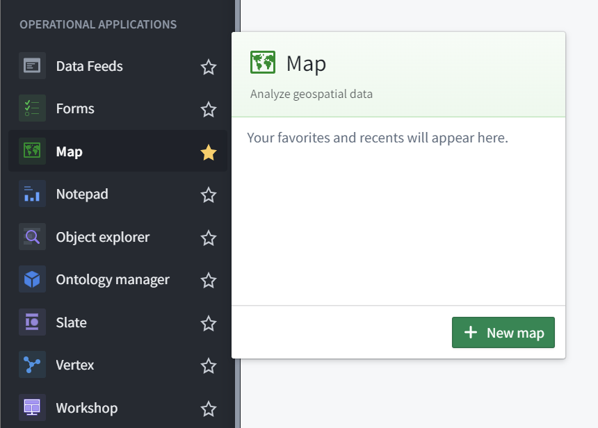
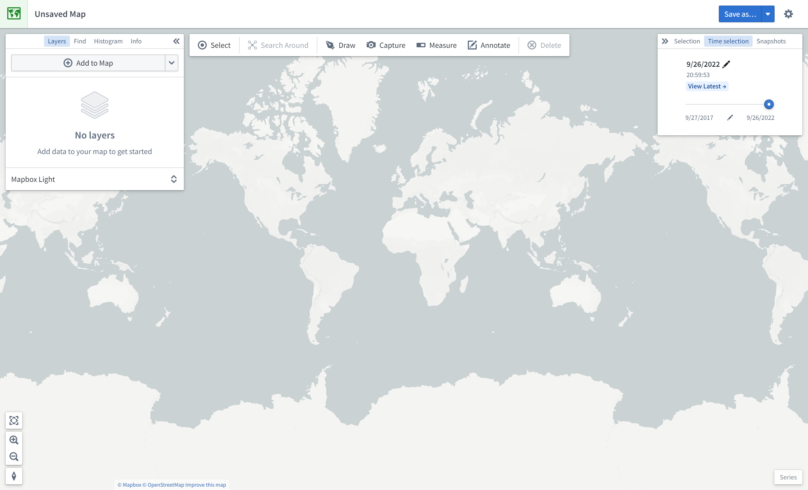
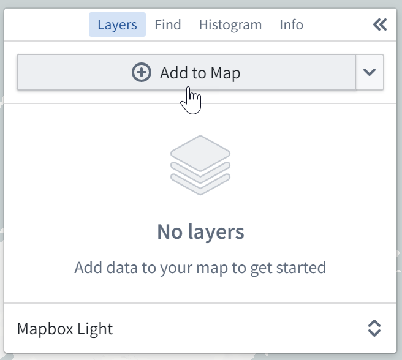
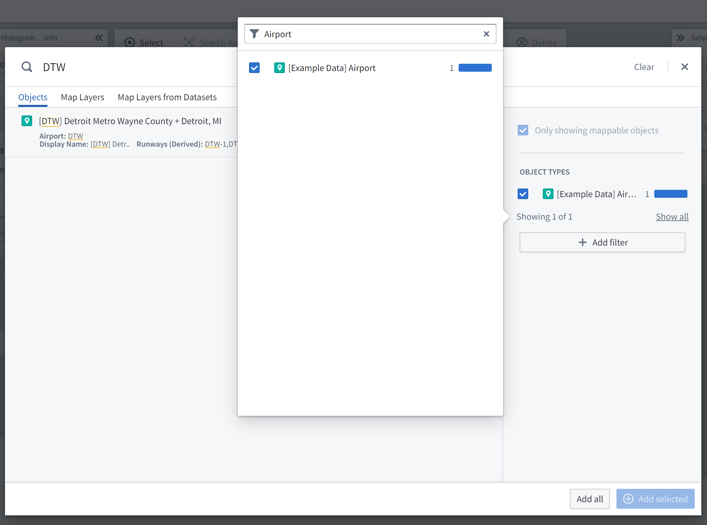
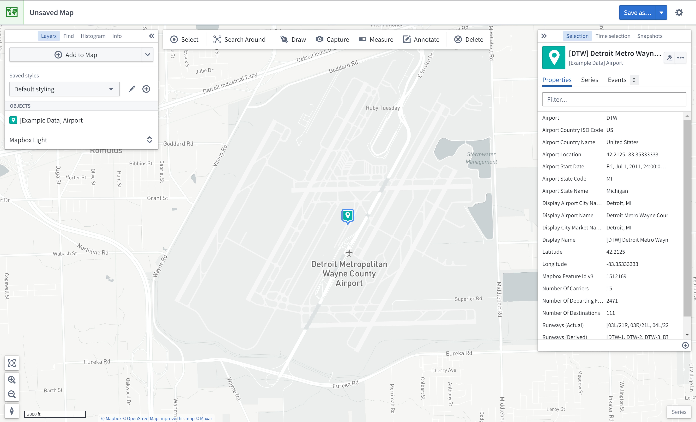
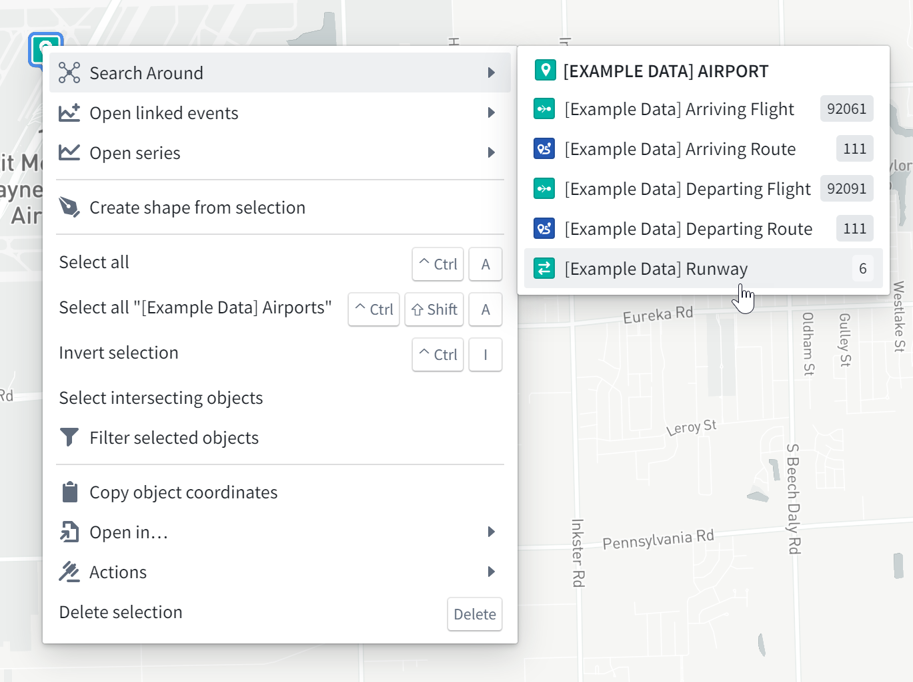
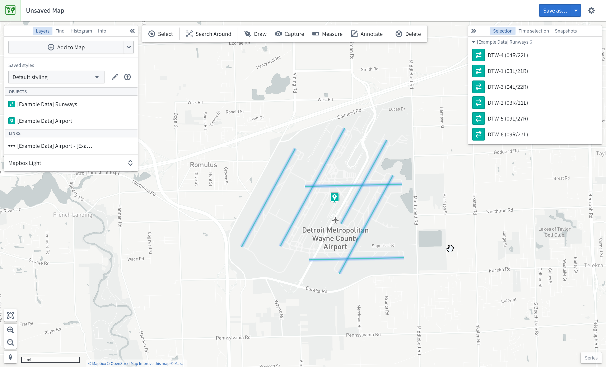
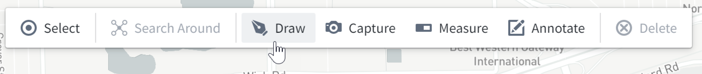
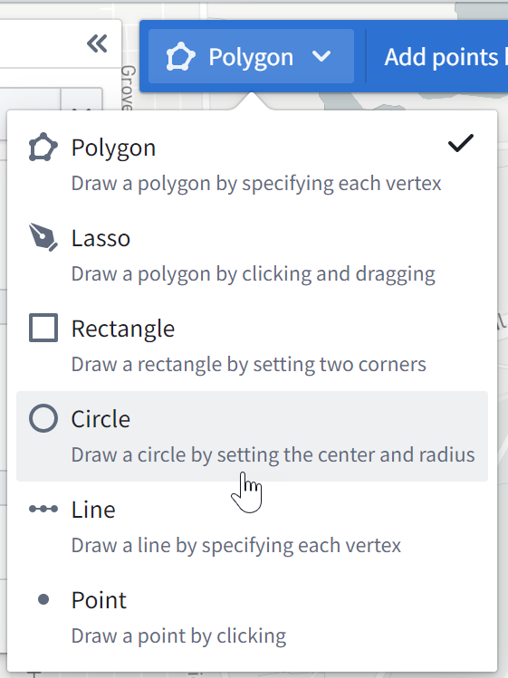

:::callout{theme="warning"}
注意：以下翻译的准确性尚未经过验证。这是使用 [AIP ↗](https://www.palantir.com/platforms/aip/) 从原始英文文本进行的机器翻译。
:::

# 入门指南

本指南演示如何使用**Foundry培训与资源**项目中的资源使用Map应用程序。在这个示例中，我们将对一些航空公司航线数据进行地理空间分析。

## 创建新地图

要创建地图，展开左侧Foundry导航栏，然后在应用程序部分点击**查看全部**。您将在**操作应用程序**部分找到**Map**应用程序。

## Map应用程序界面概览

当Map应用程序加载时，您会看到一张空白地图：

屏幕左侧有以下面板：

* **图层：** 添加、管理和设置Object和覆盖图层的样式；设置基础图层。
* **查找：** 查找Object和位置；导航到特定的地理空间坐标。
* **直方图：** 基于属性和时间序列值分析和筛选Object。
* **信息：** 显示地图的总体概述。

屏幕顶部有一个工具栏，提供以下功能：

* **选择：** 选择地图上的所有项目，反转选择，或选择与绘制形状相交的项目。
* **周边搜索：** 探索Object关系。
* **绘制：** 在地图上绘制并与形状交互，包括多边形、圆形、矩形、线条、点。
* **捕获：** 捕获当前地图状态的截图。
* **测量：** 测量地图上的物理距离。
* **注释：** 向地图添加文本或多边形注释。
* **删除：** 从地图中移除项目。

屏幕右侧有以下面板：

* **选择：** 分析详细信息并对选定项目进行操作。
* **时间选择：** 设置时间范围和当前时间戳以应用于地图和时间序列视图。
* **快照：** 查看捕获的快照，并使用快照跳转到捕获的地图状态。

屏幕右下角是**序列**面板，用于时间序列和事件数据的时间分析。

## 向地图添加Object

在这个示例中，我们将搜索底特律都会机场（DTW）并将其添加到地图中。

首先，点击**图层**面板中的**添加到地图**：

然后，搜索`DTW`以找到底特律都会机场；您可能需要在右侧列表中选择Object类型`[Example Data] Airport`。选择DTW机场Object并点击**添加已选**。

您现在应该看到地图已放大到DTW机场；Object的地理空间数据是一个点，因此该Object由表示坐标的地图图钉表示。左侧的**图层**面板现在显示您有一个`[Example Data] Airports`图层，右侧的**选择**面板显示所选Object的详细信息，如下所示。

尝试在地图上导航：

* 点击并拖动以平移地图
* 通过以下任一方式放大和缩小：
  * 滚动鼠标滚轮
  * 点击界面左下角的缩放按钮
  * 按键盘上的\*\*+**和**-\*\*键

## 周边搜索关联Object

在这个示例中，我们将对底特律都会机场（DTW）进行探索性分析。首先，通过右键点击地图上的DTW Object图标，选择**周边搜索**，然后选择`[Example Data] Runway`，将DTW的跑道添加到地图中。

然后，您应该会看到跑道Object也添加到了地图中。这些跑道Object在地图上由线条表示。您可以将鼠标悬停在跑道线上查看跑道ID。您还可以点击跑道以选择它，并在**选择**面板中查看更多详细信息。

## 地理空间搜索

在这个示例中，我们将查找位于底特律都会机场（DTW）200公里范围内的其他机场。

首先，点击**绘制**以调出形状绘制工具：

然后，选择**圆形**工具：

最后，在地图上点击DTW机场以选择中心点，输入“200”，并选择**公里**。

这将打开Object搜索对话框，筛选与该圆相交的Object。选择\*\*\[Example Data] Airports**从**Object类型**列表中，然后点击**添加全部\*\*。这将向地图添加六个额外的机场。
