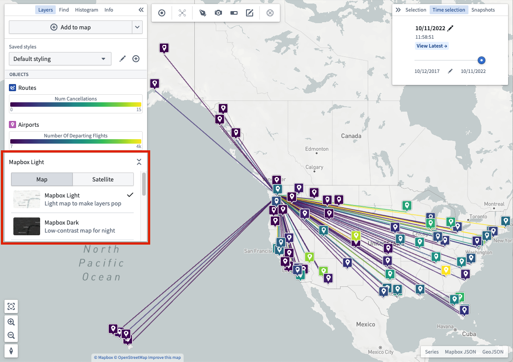

:::callout{theme="warning"}
注意：以下翻译的准确性尚未经过验证。这是使用 [AIP ↗](https://www.palantir.com/platforms/aip/) 从原始英文文本进行的机器翻译。
:::

# 核心概念

## 图层

**图层**是用于搭建地图的地理数据集合。Foundry Map应用支持多种图层，这些图层可以组合形成强大的地理空间可视化：

* **基础图层：**基础图层通过渲染包括道路、城市、边界、地名等世界地理特征，为地图提供基础。可用的基础图层包括浅色主题、深色主题和卫星图像等。使用**图层**面板中的选择器更改基础图层。

  

您还可以选择使用不同类型的图层，如下所示：

* \*\*Object图层：\*\*用于利用来自您的Ontology的[对象的地理空间数据](Integrate%20data%20for%20the%20map/Ontology%20Object.md)。
* \*\*链接图层：\*\*在执行周围搜索后显示对象之间的关系。
* \*\*覆盖图层：\*\*使用[地图图层编辑器](Integrate%20data%20for%20the%20map/%E5%9C%B0%E5%9B%BE%E5%9B%BE%E5%B1%82%E7%BC%96%E8%BE%91%E5%99%A8.md)创建高质量的可视化，只需创建一次即可导入一个或多个地图。
* \*\*注释图层：\*\*绘制形状以突出显示并提供有关地图特定区域的上下文信息。阅读更多关于[创建注释](Interact%20with%20maps/%E6%B3%A8%E9%87%8A.md)。

## Object样式

您应用于对象的[样式](Visualize%20Ontology%20data/%E6%A6%82%E8%BF%B0.md)定义了它们在地图上的外观。

## 时间选择

每个地图都有一个**选定时间**，该时间始终在当前选定的**时间窗口**内。时间窗口决定了地图加载和显示[时间序列](Time/%E6%97%B6%E9%97%B4%E5%BA%8F%E5%88%97.md)数据的时间段。[基于时间的样式](Visualize%20Ontology%20data/%E6%A6%82%E8%BF%B0.md#opacity-styling)可以使用时间选择来选择性地控制具有时间数据的对象的不透明度。阅读更多关于操作[时间选择](Time/%E6%97%B6%E9%97%B4%E9%80%89%E6%8B%A9.md)的信息。
