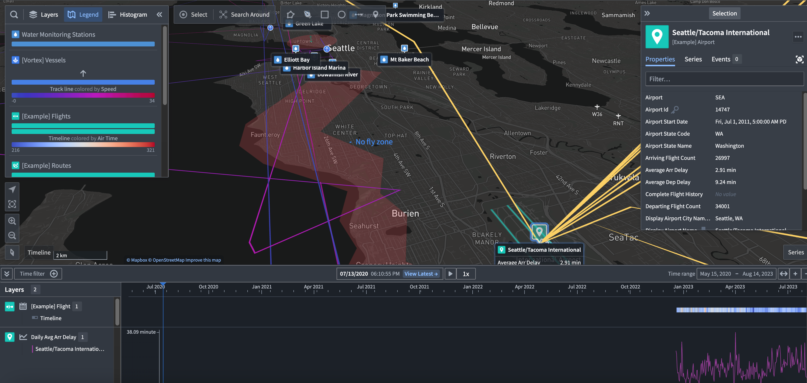

:::callout{theme="warning"}
注意：以下翻译的准确性尚未经过验证。这是使用 [AIP ↗](https://www.palantir.com/platforms/aip/) 从原始英文文本进行的机器翻译。
:::

# 概览

**Map** 应用程序提供强大的地理空间和时间分析及可视化能力，允许您将 Foundry 中的数据整合为一个连贯的地理空间体验：

* 探索地理空间Object之间的连接，遍历物理网络。
* 以地理空间方式搜索点和多边形数据，使用边界框和多边形相交查询。
* 可视化来自多种来源的上下文地理空间数据，包括高比例矢量数据和卫星图像，以及时间数据如Object随时间的移动路径和事件。
* 通过绘制形状和执行地理空间操作进行交互。
* 使用地图模板搭建地理空间应用程序。

## 地图上的地理空间数据

Map应用程序使用[Web Mercator Projection ↗](https://en.wikipedia.org/wiki/Web_Mercator_projection) (EPSG:3857) 渲染地图，并期望纬度/经度坐标以WGS 84度 (EPSG:4326) 表示。有关在Foundry中变换地理空间数据的更多信息，请参见[Foundry中的地理空间数据](https://www.palantir.com/docs/foundry/geospatial/overview/)。
