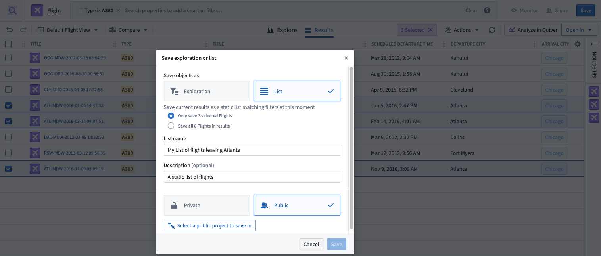
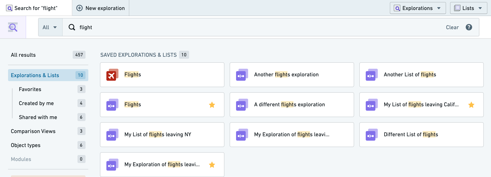
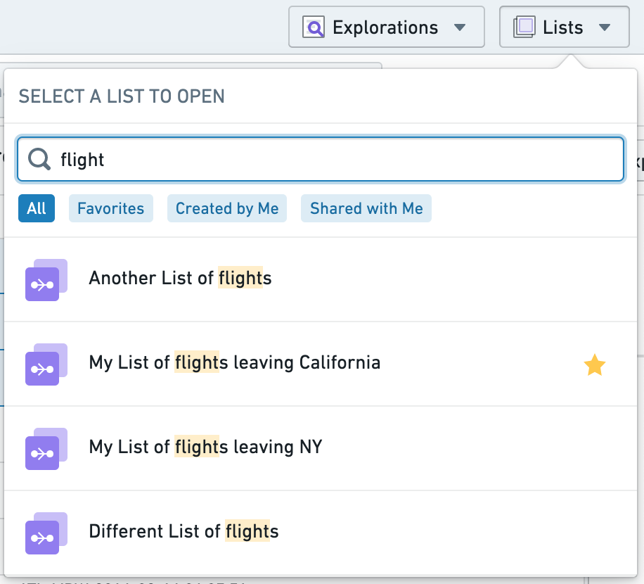
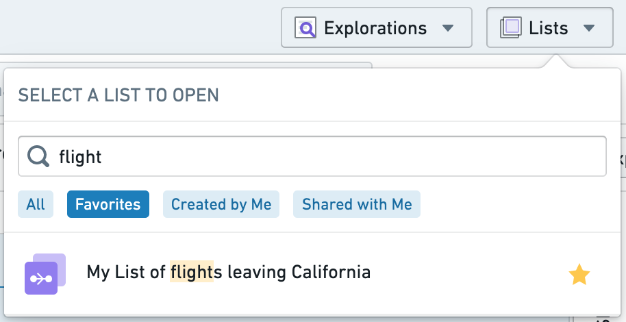

:::callout{theme="warning"}
注意：以下翻译的准确性尚未经过验证。这是使用 [AIP ↗](https://www.palantir.com/platforms/aip/) 从原始英文文本进行的机器翻译。
:::

# 保存列表

您可以在Object Explorer中以**列表**形式保存和共享您的探索结果。保存的列表允许您重新访问一组静态的Objects；除非手动更新，保存的列表不会更改。

### 保存列表

要保存列表，请选择屏幕右上角的蓝色**保存**按钮，然后在下拉菜单中选择**列表**。系统还会提示您保存一些元数据信息，例如列表的标题。您可以批量保存完整的Objects列表，或者通过在结果视图中手动勾选每一行来保存特定选择的Objects。

列表可以保存为**私有**或**公共**。

* 如果您选择**私有**，列表将保存到您的个人文件夹中的探索文件夹中，默认情况下，仅您可以访问。
* 如果您选择**公共**，系统会提示您选择一个保存列表的位置。然后，任何有权访问您保存列表位置的人都可以访问该列表。

:::callout{theme="neutral"}
您的注册配置可能会阻止在个人文件夹中保存文件。在这种情况下，保存私有列表的选项也将被禁用。
:::

共享您的列表不会共享对底层Objects的访问权限，因此任何给定的只读用户需要除了访问保存列表本身之外，还需要拥有相应的数据角色。

### 访问保存的列表

如果您在[Object Explorer主页](../%E5%85%A5%E9%97%A8.md)上使用全局搜索栏，保存的列表将显示在您的[搜索结果](../Search%20and%20explore%20objects/%E6%90%9C%E7%B4%A2Objects.md)中。

您还可以通过顶导航栏上的**列表**下拉菜单访问保存的列表。下拉菜单还具有内置文本搜索和常用筛选选项，以进一步缩小显示的列表范围。

        
