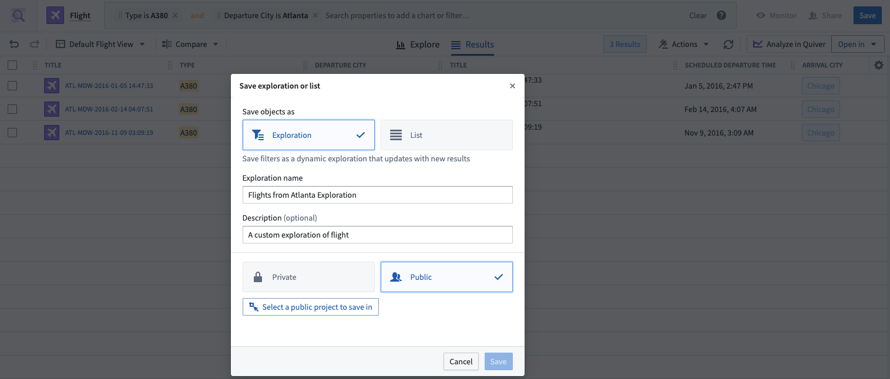
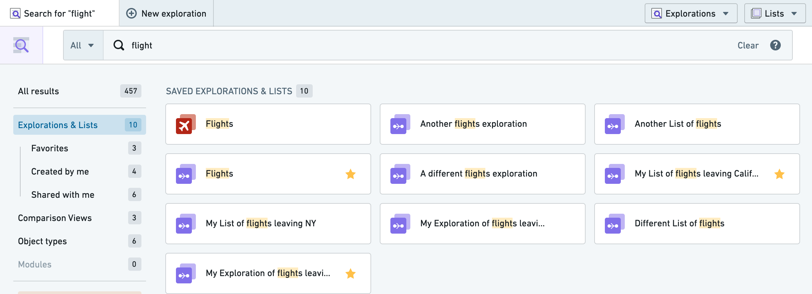
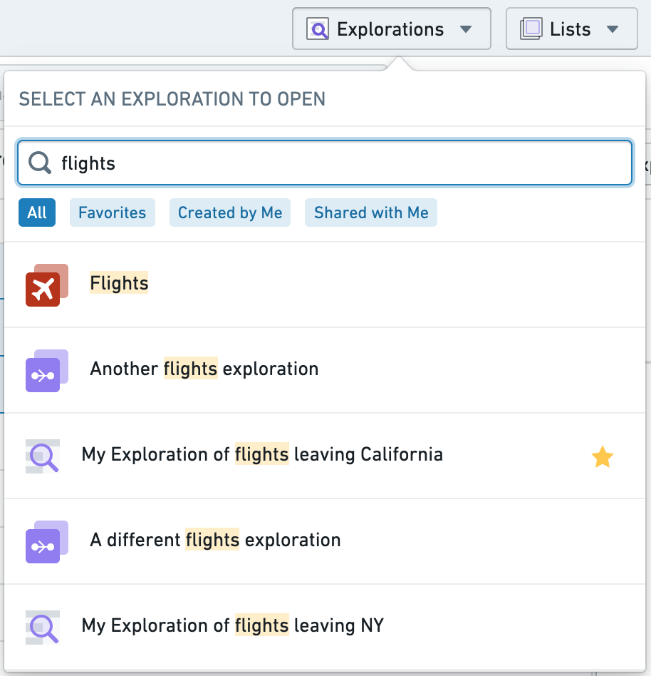
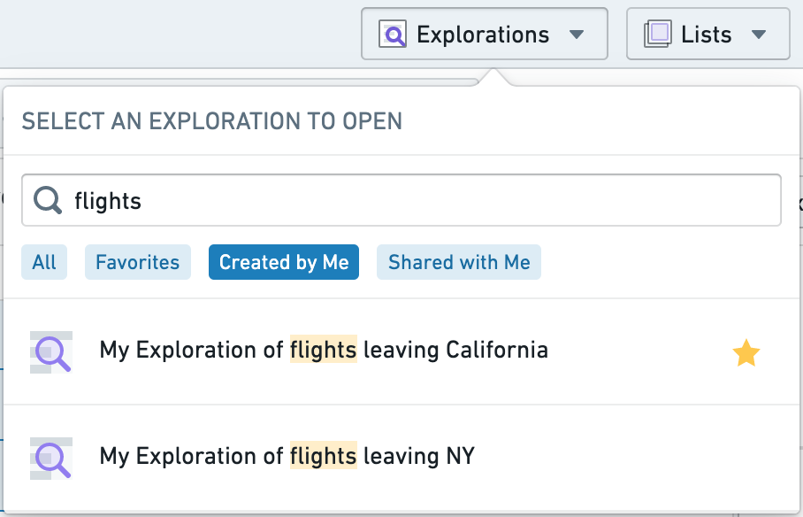

:::callout{theme="warning"}
注意：以下翻译的准确性尚未经过验证。这是使用 [AIP ↗](https://www.palantir.com/platforms/aip/) 从原始英文文本进行的机器翻译。
:::

# 保存探索

您可以在Object Explorer中将您的工作保存和分享为**探索**。保存的探索允许您在保留已应用的筛选和配置的设计的同时，重新访问相同的搜索参数集。

### 保存探索

要保存探索，请选择屏幕右上角的蓝色**保存**按钮。系统还会提示您输入一些元数据信息以进行保存，例如探索的标题。

探索可以保存为**私人**或**公共**。

* 如果您选择**私人**，探索将保存到您的主文件夹中的探索文件夹中，并且默认情况下只有您可以访问。
* 如果您选择**公共**，系统会提示您选择一个位置来保存探索。然后，任何有权访问您保存探索位置的人都可以访问该探索。

:::callout{theme="neutral"}
您的注册配置可能会阻止在主文件夹中保存文件。在这种情况下，保存私人探索的选项也会被禁用。
:::

分享您的探索不会分享对底层对象的访问权限，因此任何给定的只读用户除了对保存的探索本身的访问权限外，还需要具有适当的数据角色。

### 访问已保存的探索

如果您使用[Object Explorer主页](../%E5%85%A5%E9%97%A8.md)上的全局搜索栏，保存的探索将出现在您的[搜索结果](../Search%20and%20explore%20objects/%E6%90%9C%E7%B4%A2Objects.md)中。

您还可以通过顶部导航栏的**探索**下拉菜单访问已保存的探索。下拉菜单还具有内置的文本搜索和常用筛选选项，以进一步缩小显示的探索范围。

        
