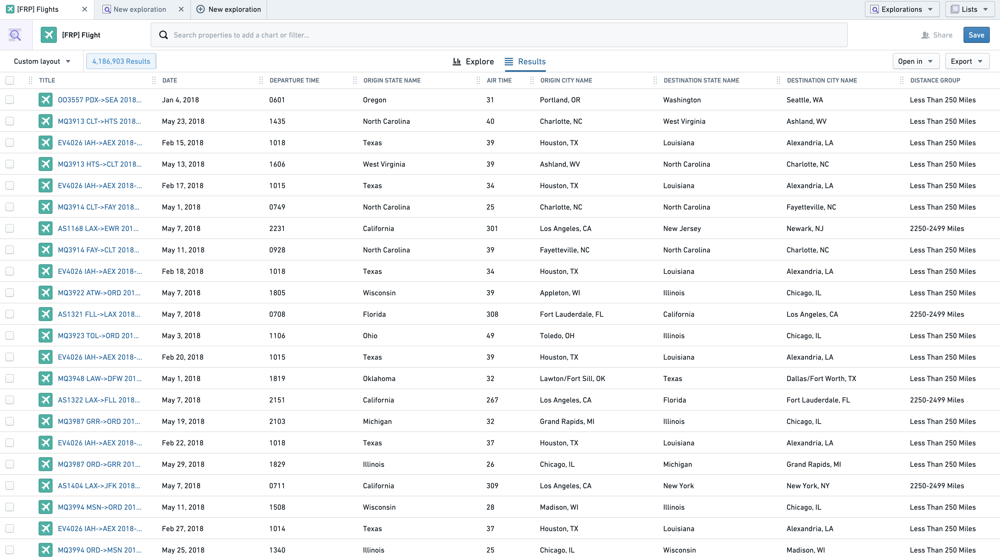
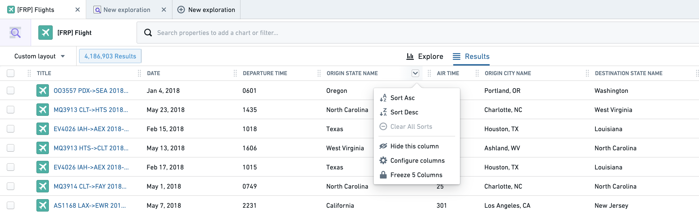
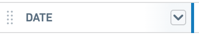
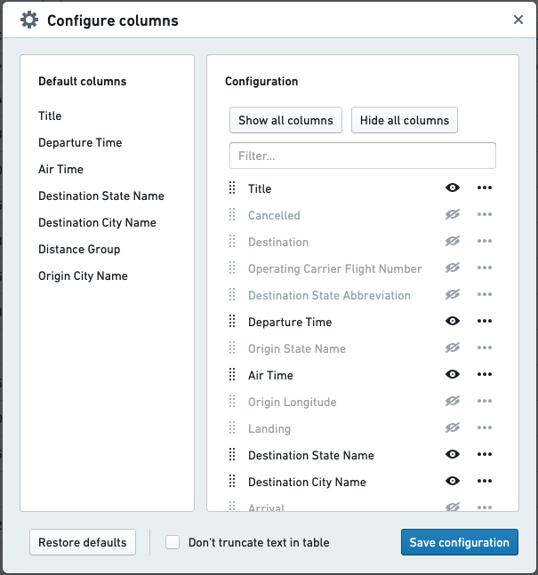
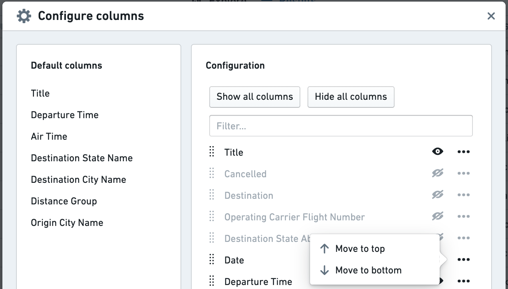
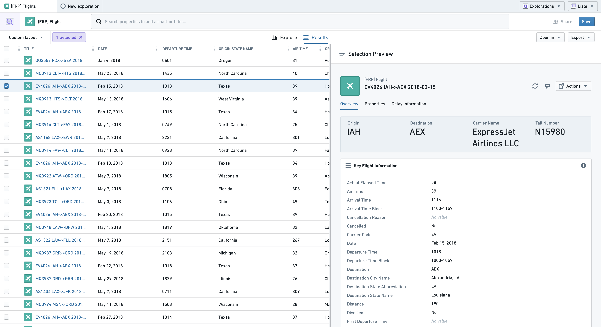
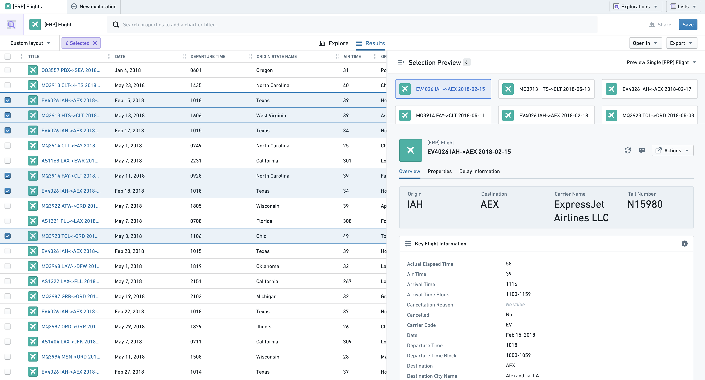
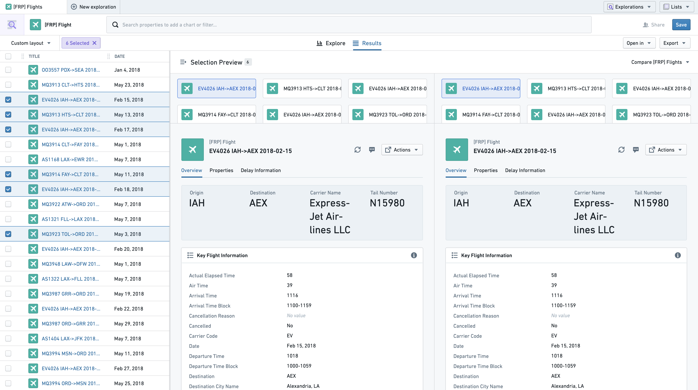
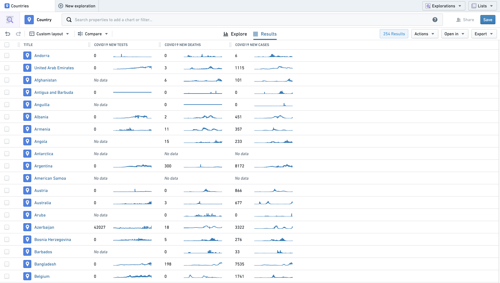
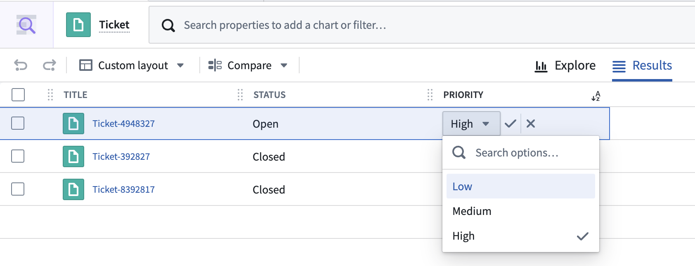

:::callout{theme="warning"}
注意：以下翻译的准确性尚未经过验证。这是使用 [AIP ↗](https://www.palantir.com/platforms/aip/) 从原始英文文本进行的机器翻译。
:::

# 查看结果

结果视图以表格形式显示来自您探索的Objects。向下滚动以加载更多Objects到表中。

## 按列排序表格

结果表可以通过应用了`Sortable` renderHint的属性进行排序。要按特定列排序，点击列标题中的下拉箭头。

一旦某列用于排序，其标题中将显示排序图标。如果选择了多个列进行排序，最后选择的列优先。之前的排序在其排序图标旁有一个数字以显示排序顺序，如下所示。

从下拉菜单中选择“清除所有排序”以重置您的排序至原始状态。

## 配置列

### 更改列顺序

可以通过拖动列标题上的手柄图标来重新排序列。

用户可以从列标题下拉菜单中选择“冻结X列”选项，以在结果表中向右滚动时保持X个最左列可见。复选框列包含在计数中。

### 调整列大小

要调整列的大小，拖动列标题右侧至所需宽度。这个边界以蓝色高亮显示，位于配置下拉菜单的右侧。

### 添加和删除列

要隐藏单个列，从列标题下拉菜单中选择“隐藏此列”选项。

要一次重新排序和配置多个列，选择“配置列”以打开以下菜单。

左侧面板显示表的默认列，而右侧面板显示所有可能列的当前顺序和可见性。使用快捷按钮隐藏或添加所有列，或使用顶部的搜索栏搜索特定列以切换可见性。

通过将列拖动到所需位置来更改列顺序，或使用下面的菜单将列移动到顶部或底部。

选择“不在此表中截断文本”将导致文本属性在无法显示于现有列宽度时换行。

使用右下角的按钮保存您的配置。管理员可以通过将当前视图保存为新的设计并将其设置为所有用户的默认值来更新此表的默认配置。[了解更多关于更新默认配置的信息。](../%E9%85%8D%E7%BD%AEObject%20Explorer.md#default-layout-administrative-users)

## 预览结果

要在新的Object Explorer标签中打开Object的对象视图，点击该Object行的标题列。要在您的结果标签中打开对象视图的预览，选择一个或多个Objects，方法是点击复选框或相应行中的任何其他列。

选择一个Object后，选择预览面板将从右侧打开。要关闭此面板以获得完整表格视图，请使用面板左上角的“折叠”图标 ()。

如果选择了多个Objects，前二十个Objects的对象视图可供预览，显示在对象视图上方的卡片列表中。

要同时比较两个Objects的对象视图，选择右上角的下拉菜单并选择“比较Objects”。

### 查看时间序列属性

时间序列属性可以与常规属性一起在结果视图中查看。时间序列属性是一个Object属性，用于存储时间戳值的历史。[了解更多关于时间序列属性的信息。](https://www.palantir.com/docs/foundry/time-series/time-series-concepts-glossary/#time-series-property-tsp)

在下面的示例中，结果视图显示了`Country` Object，其中包含三个时间序列属性：`COVID19 New Tests`、`COVID19 New Deaths`和`COVID19 New Cases`。每列显示时间序列中最近的观测值在左侧，并在右侧展示时间序列历史的折线图。

## 行内编辑

配置有行内编辑操作的属性可以在Object Explorer结果页面中直接编辑。当用户满足行内编辑操作的提交标准时，鼠标悬停时值旁会出现一个笔图标。点击值将启用一个可编辑字段，具体取决于属性的类型。要提交，需要再次通过提交标准，否则提交按钮不可选。
