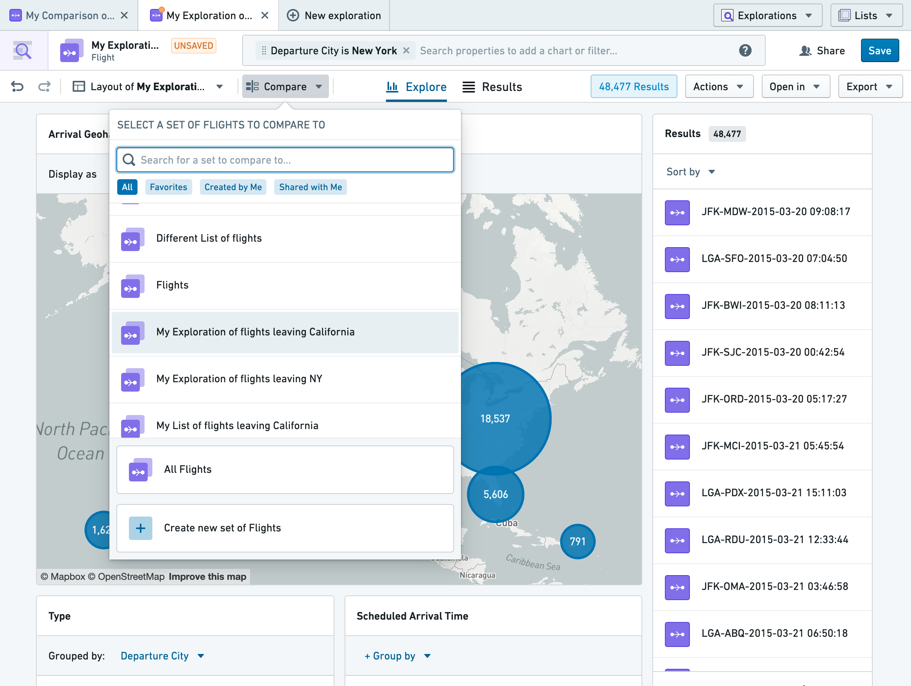
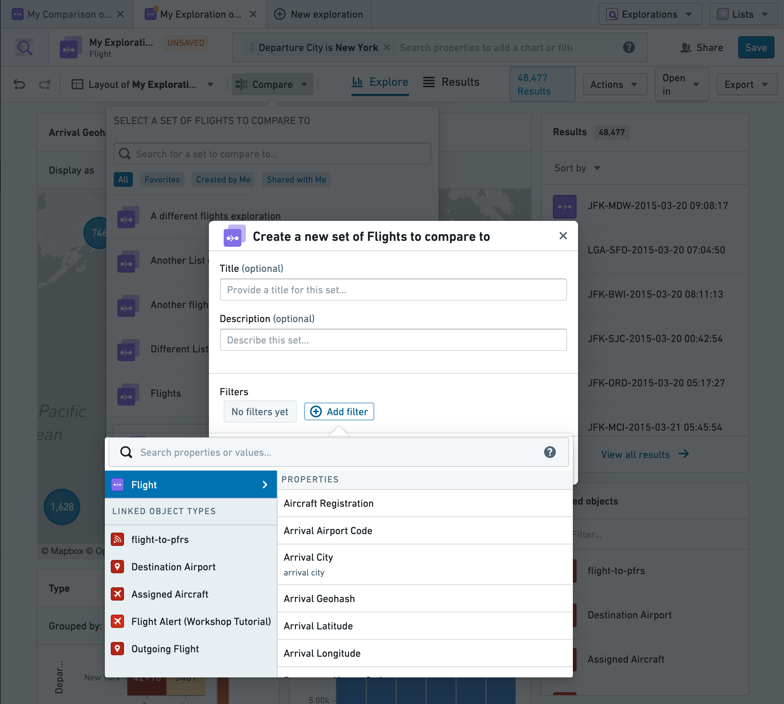
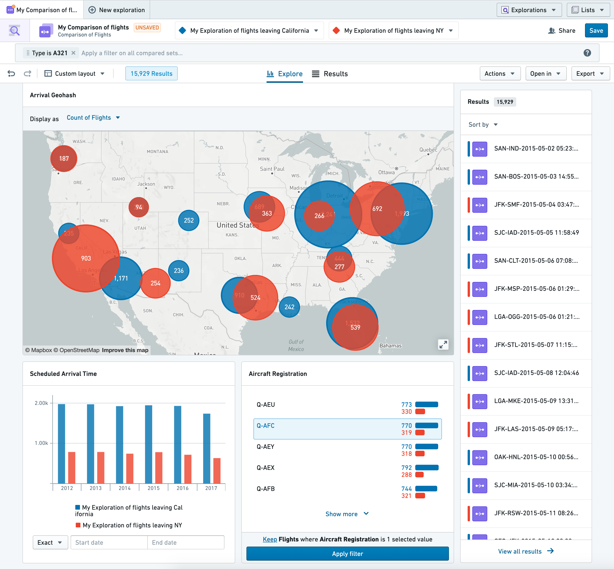
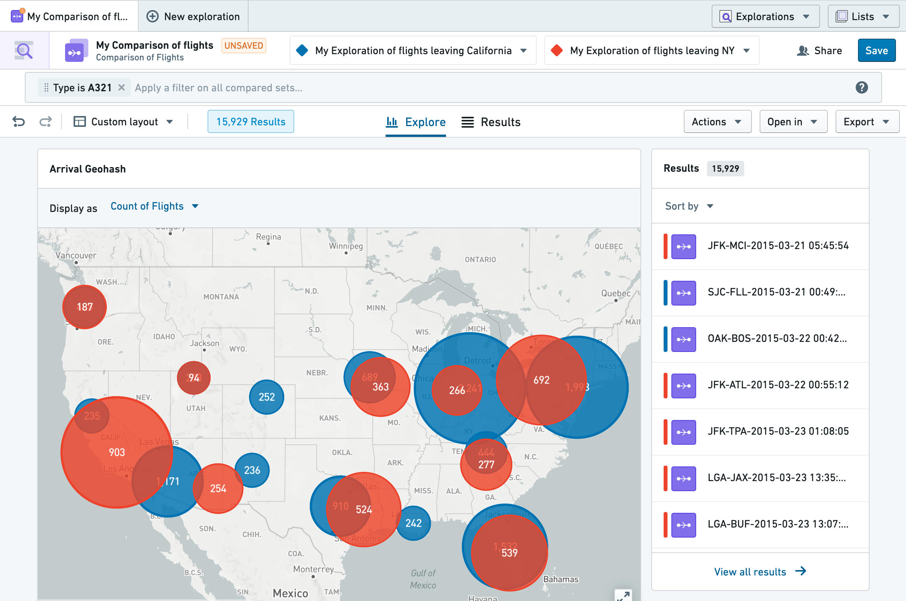
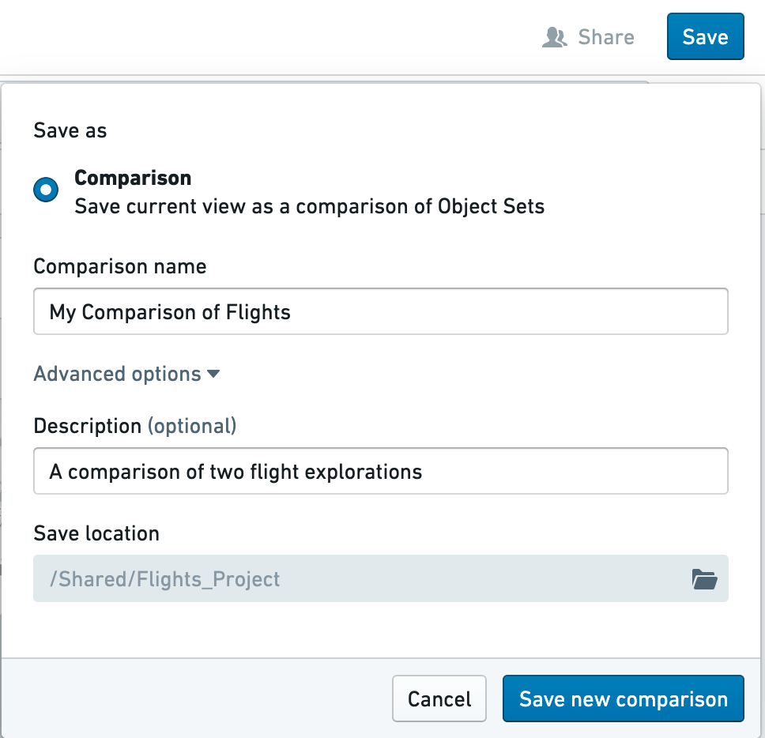
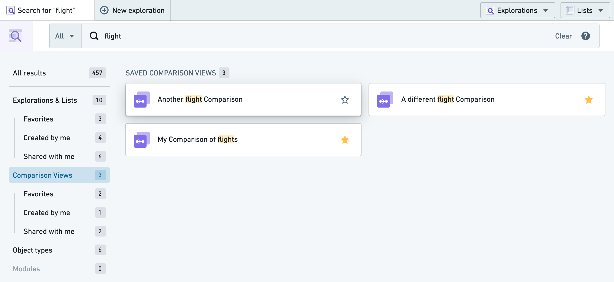

:::callout{theme="warning"}
注意：以下翻译的准确性尚未经过验证。这是使用 [AIP ↗](https://www.palantir.com/platforms/aip/) 从原始英文文本进行的机器翻译。
:::

# 比较对象集

比较视图为用户提供了比较两个已筛选对象集的选项。这些对象可以来源于动态筛选对象或之前保存的探索。

## 进入比较模式

要使用比较模式：

* 前往Object Explorer，打开一个对象类型，并筛选到您想要比较的该类型对象集。在下面的示例中，我们筛选了从纽约市出发的航班。
* 选择搜索栏下方的**比较**按钮。选择**比较**后，您可以选择一个对象的比较集，例如：
  * 一个已保存的探索，
  * 给定类型的所有对象（例如**所有航班**），或
  * 您可以定义一个新的对象集以进行比较。

在下方，我们正在将从纽约市出发的航班与一个现有的探索（所有从加州出发的航班）进行比较。

要即时定义一个新的对象集进行比较（称为“动态筛选”），在上图的比较下拉菜单中选择**创建新的航班集**。

这将显示一个视图，使我们可以定义和编辑对象集，或更改用于比较集的颜色：

一旦进入比较模式，设计中的所有图表将更改为并排显示每个比较集的结果。这使我们可以看到比较情况，例如从纽约市出发与从加州出发的航班的常见到达机场或飞机注册号。比较视图中保留了OE的所有功能，例如使用图表进行筛选、在表格视图中查看结果、操作、导出等。

## 筛选

如上所述，您可以在这些比较集上共同应用筛选，以缩小比较视图。例如，您可能只想在比较中查看A321飞机上的航班，以查看纽约的取消航班与加州的相比情况。这可以通过在OE中通常应用筛选的方式来完成，即从搜索栏（如下所示）或直接从图表中应用筛选。

## 协作

### 保存比较视图

这些比较视图可以像探索一样通过点击右上角的**保存**按钮进行保存和共享。保存视图时，系统会提示您输入一个名称，您还可以提供一个非必填描述和/或一个自定义保存位置。

### 共享比较视图

要共享您的比较，只需选择**保存**按钮左侧的**共享**按钮。系统会提示您决定要与哪些用户或组共享此比较，您希望授予他们什么访问级别，以及是否希望比较为所有用户设定一个默认角色。共享您的比较不会共享对链接探索和/或底层对象的访问，因此任何给定的只读用户都需要对数据具备适当的角色以及对已保存比较本身的访问权限。

### 搜索比较视图

这些已保存的比较可以通过主页上的OE主搜索栏进行搜索。

