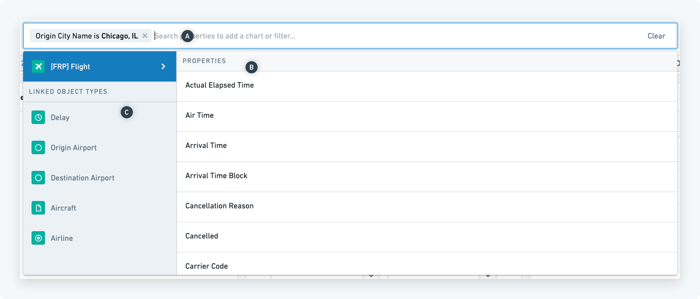
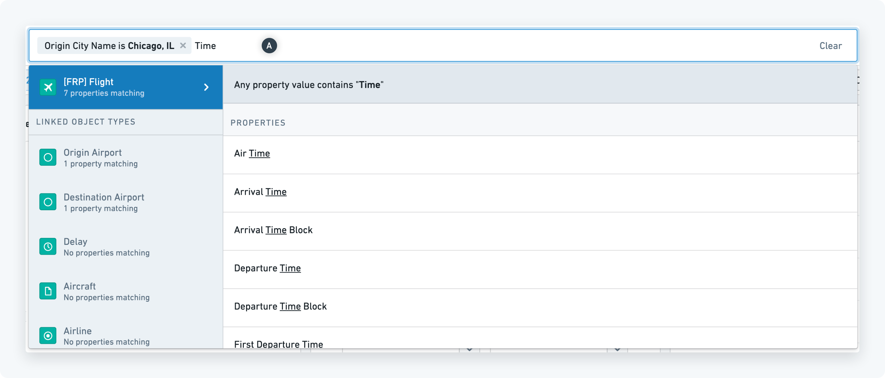
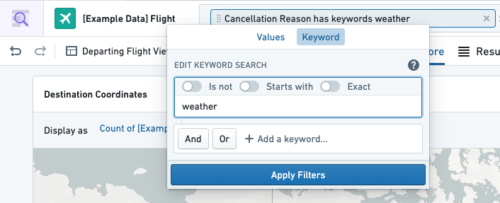
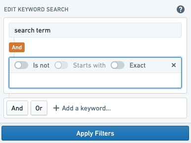
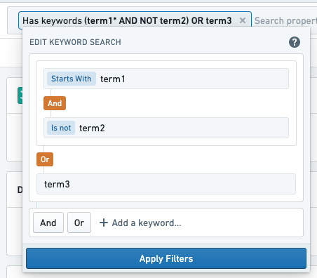
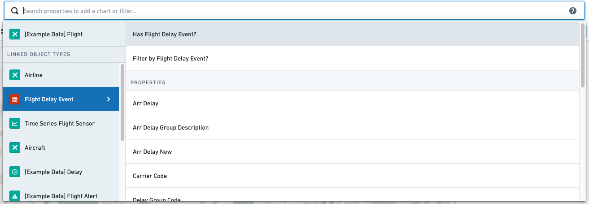
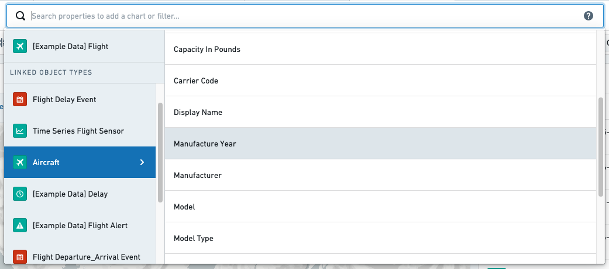
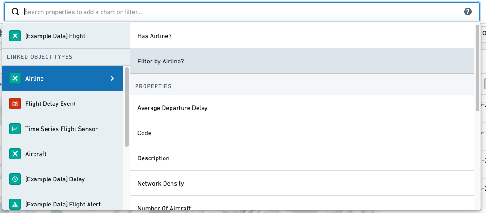

:::callout{theme="warning"}
注意：以下翻译的准确性尚未经过验证。这是使用 [AIP ↗](https://www.palantir.com/platforms/aip/) 从原始英文文本进行的机器翻译。
:::

# 筛选结果

一旦您开始[搜索](../Search%20and%20explore%20objects/%E6%90%9C%E7%B4%A2Objects.md)，您将进入一个探索视图，在此您可以进行进一步的筛选。

## 搜索栏

搜索栏是筛选当前对象集的中心枢纽。点击搜索栏以显示搜索菜单。在这里，有几种筛选选项可供选择：

### 以属性（主要对象类型）筛选

→ 您知道要筛选哪个属性吗？

> 示例：“我想筛选我的员工的语言”

在搜索菜单中，您可以找到按字母顺序排列的所有属性\*\*(B)\*\*（以及非必填的描述）列表。

在搜索栏\*\*(A)\*\*中输入以搜索特定属性类型。当选择所需的属性时，会弹出一个窗口，允许您选择筛选该属性的值。输入体验因属性类型（数字、文本、日期等）而异。对于文本属性（例如语言），可以通过在药丸中输入来筛选选项。

→ 您知道值但不知道它属于哪个属性？

> 示例：“我想筛选飞往洛杉矶的航班”

在搜索栏中输入值（例如“洛杉矶”）。如果该值存在于当前对象集中，右侧搜索菜单中将提供筛选“目的地城市名称等于洛杉矶”的选项。

### 以关键词筛选

关键词搜索支持对象类型的所有属性或特定属性。要在**任何**包含您的搜索词的属性中执行关键词搜索，请在搜索栏中输入并使用回车键。通过点击“具有关键词”筛选药丸来修改结果筛选。

要在属性上执行关键词搜索，选择一个文本属性，输入您的查询，并使用回车键或在筛选图表中切换到“关键词”选项卡。

默认情况下，关键词搜索匹配精确的单词或短语，不匹配前缀或后缀。要执行前缀搜索，请参见下方的\*\*“以...开始”\*\*修饰符。

#### 添加术语修饰符

对于给定的搜索词，有三个选项可以修改查询。为保持一致性，请使用切换开关来控制这些修饰符，而不是在下拉菜单中编辑术语。

* **“不等于”** - 否定当前搜索词，仅查找属性不包含它的对象。相当于输入`NOT term`。
* **“以...开始”** - 执行通配符搜索，查找属性以当前搜索词开始的对象。相当于输入`term*`，将匹配“term”和像“terminal”这样的词。通配符搜索仅支持单词搜索。例如，您可以搜索以“term”开头的属性，但不能搜索以“my search term”开头的属性。
* **“精确”** - 搜索整个搜索词，包括空格在其精确位置。执行“my search term”的精确搜索将仅查找短语“my search term”，而不是像“my search for a term”这样的短语。

#### 添加逻辑运算符（AND/OR）

选择“和”或“或”将为现有查询添加一个新搜索词，由相应的逻辑运算符连接。添加新术语后，点击术语以进行编辑。

搜索词和逻辑运算符可以嵌套以执行更复杂的查询。参见下面的嵌套AND在OR中的例子。还要注意，给定搜索词的修饰符在未编辑时显示为紧凑视图。

点击“和”/“或”标签以切换运算符。请注意，如果两个相邻级别的运算符相同，筛选将简化为单级嵌套。

### 以链接筛选

与直接在当前对象属性上应用筛选器相同，可以基于其关系筛选对象。要选择用于筛选的关系，请在搜索菜单的左侧面板中选择。

要搜索具有特定链接的对象，选择“具有链接”选项，下面突出显示为“具有航班延误事件”。此筛选器可用于显示具有相关链接的对象或不具有相关链接的对象。

> 示例：“具有相关延误事件的航班。”

要搜索其链接对象具有特定属性的对象，请在搜索菜单面板的左侧选择关系。从那里，选择属性类型进行筛选。

> 示例：“在2018年制造的飞机上的航班。”

也可以搜索与其他特定对象有链接的对象。例如，选择链接后选择“按航空公司筛选”选项。这将打开一个链接到特定对象的筛选器。链接的对象在结果列表图中按其标题显示。

> 示例：“由特定航空公司运营的航班。”

