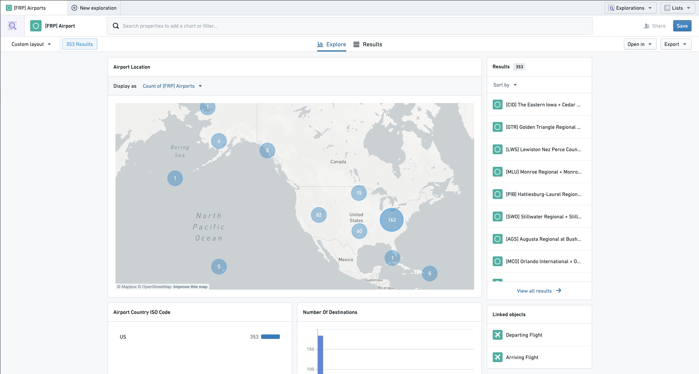
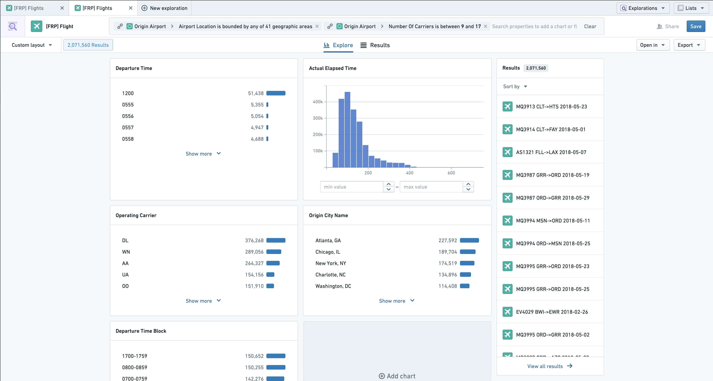

:::callout{theme="warning"}
注意：以下翻译的准确性尚未经过验证。这是使用 [AIP ↗](https://www.palantir.com/platforms/aip/) 从原始英文文本进行的机器翻译。
:::

# 通过旋转探索关联对象

在进行探索时，可以将探索的主要对象类型转移到任何关联对象类型。让我们通过下面的具体示例来看一下。

如何找到从美国东部大型机场出发的未来30天内的所有航班？

值得注意的是，可以通过探索**航班**并对其关联机场的属性进行筛选来实现这一点[筛选关联属性](%E4%BD%BF%E7%94%A8%E5%9B%BE%E8%A1%A8%E8%BF%9B%E8%A1%8C%E6%8E%A2%E7%B4%A2.md#charts-on-linked-objects)。也就是说，回答这个问题的另一种方法是从探索**机场**开始，并筛选这些机场，仅保留位于美国东部且拥有大量独特承运商的机场：

从这里，我们现在想要**旋转**到关联的**出发航班**。我们可以通过点击右下角“关联对象”部分中的此选项来实现。这样做将更改我们探索的主要对象类型为**航班**，并筛选出仅从我们之前筛选出的那些大型东部机场出发的航班：

我上面探索的**结果**现在不再是机场，而是航班（您可以从右侧的预览面板中看到）。可以通过多个链接进行旋转，从而允许您灵活地跨越Ontology进行探索。
