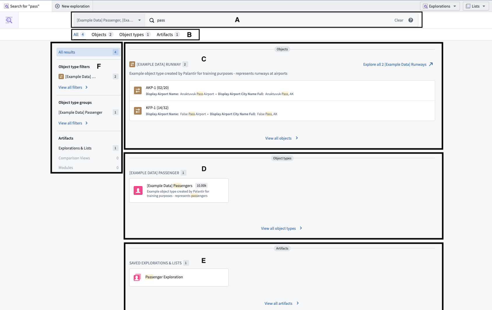
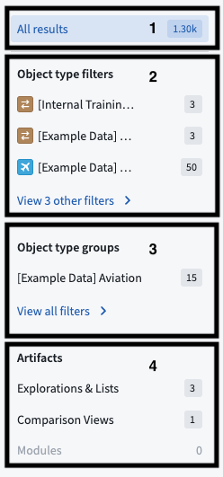
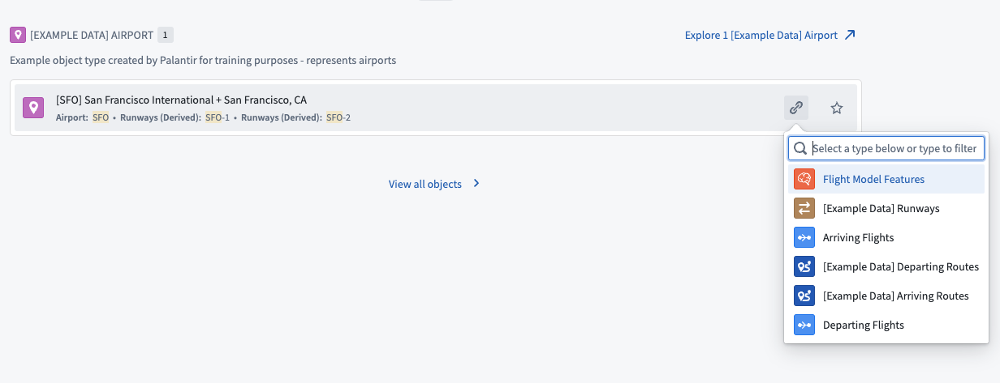

:::callout{theme="warning"}
注意：以下翻译的准确性尚未经过验证。这是使用 [AIP ↗](https://www.palantir.com/platforms/aip/) 从原始英文文本进行的机器翻译。
:::

# 搜索Objects

在Object Explorer [主页](../%E5%85%A5%E9%97%A8.md)上使用全局搜索栏进行搜索的结果将显示在搜索结果页面上：

您的查询在搜索栏中可见并可编辑（如下所示为A）。

页面分为多个标签 **(B)**：

* 默认显示的是**所有**标签，包含所有结果。
* 匹配的结果可以筛选到单独的标签中：
  * Objects **(C)**,
  * Object类型 **(D)**, 和
  * 工件 **(E)**。

此搜索结果页面还包含一个[侧边栏](#navigating-using-the-sidebar)（下图中为F）。

## 使用侧边栏导航

这些结果都按其类型分类。左侧的导航菜单（如上图中所示为F）可以帮助您浏览不同的类别。

选择任何部分的标题也会将您筛选到该类型的结果中。如果在**所有结果**视图中显示的默认数量超过时，这也会显示该类型的所有结果（如下图中的1所示）。

* 第一个项目，**所有结果**（如上图中的1所示），显示每个类别的匹配样本。默认情况下，进入页面时此项处于活动状态。
* 接下来是\*\*“Object类型筛选” (2)**。点击其中任何一个将显示该特定Object类型的更多匹配项。点击部分底部的**“查看X个其他筛选>”\*\*将把标签从“所有”切换到“Objects”，您可以在此处查看完整的Object结果和筛选列表。
* **“Object类型组” (3)** 按关联组筛选结果。点击部分底部的\*\*“查看所有筛选>”\*\*将把标签从“所有”切换到“Object类型”，您可以在此处查看完整的Object类型结果列表。
* 最后是\*\*“工件” (4)**的匹配，分为“探索与列表”、“比较视图”和“模块”。点击部分底部的**“查看所有筛选>”\*\*将把标签从“所有”切换到“工件”，您可以在此处查看完整的结果列表。

## 结果类型

Object Explorer搜索栏搜索平台中的所有Objects（顶部图像中的\*\*(C)\*\*），以及与Objects相关的资源，如Object类型 **(D)**，已保存的探索、列表、比较和模块 **(E)**。

### 排序结果

在单个Object结果部分中，结果的排序方式如下：

* 所有重要的Object类型在非重要的Object类型之前显示。
* 在重要和非重要结果中，Object类型按该类型的单个Object结果数量（升序）排序。换句话说，最少结果的重要Object类型将首先显示，然后是更多结果的重要Object类型，然后是最少结果的非重要Object类型（与其他非重要类型相比），以此类推。

:::callout{theme="neutral"}
在此或其他Object Explorer中，隐藏的Object或属性类型不会显示为搜索结果。
:::

### 探索链接到特定结果的Objects

对于单个Objects的匹配（上图中的2），将鼠标悬停在结果上可为您提供选项，以便起始通过特定链接探索与该单个结果相关的Objects。

示例：如果您搜索机场“SFO”，可以将鼠标悬停在结果上，并开始探索到达该机场的航班。

