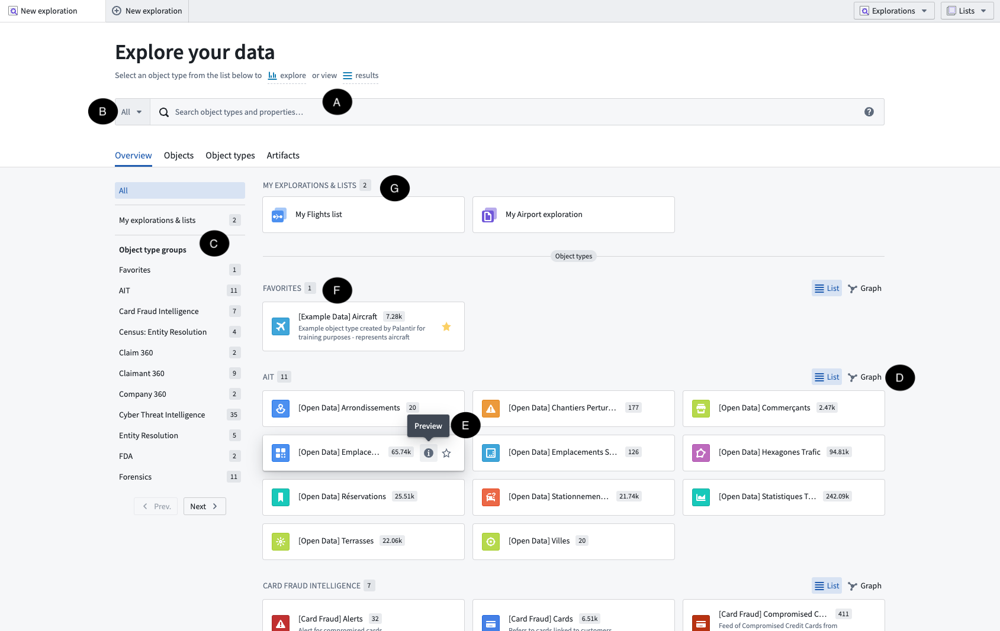
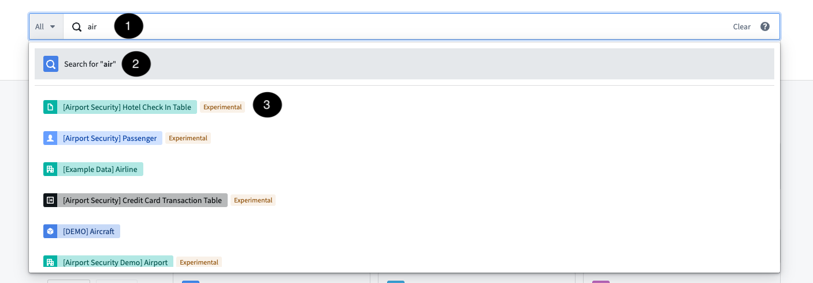
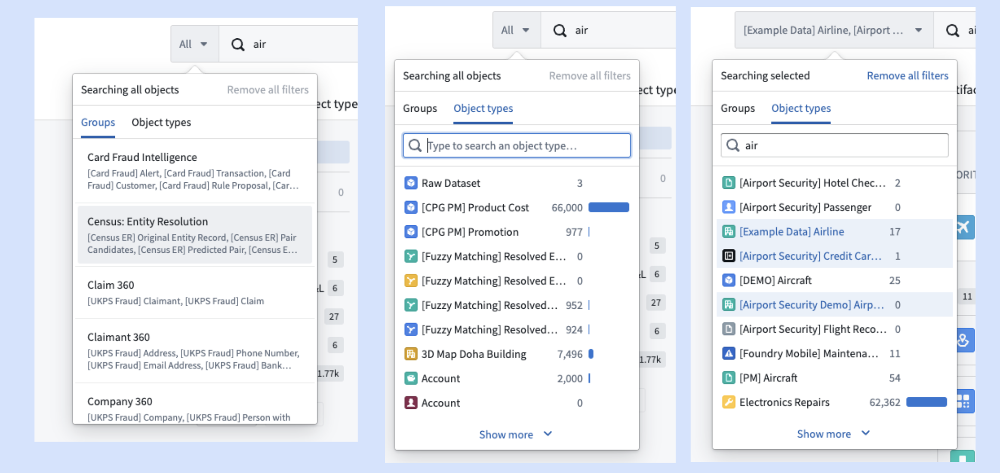
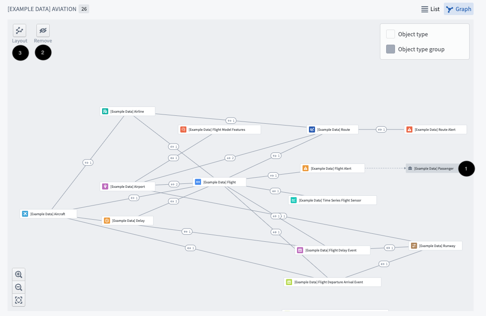
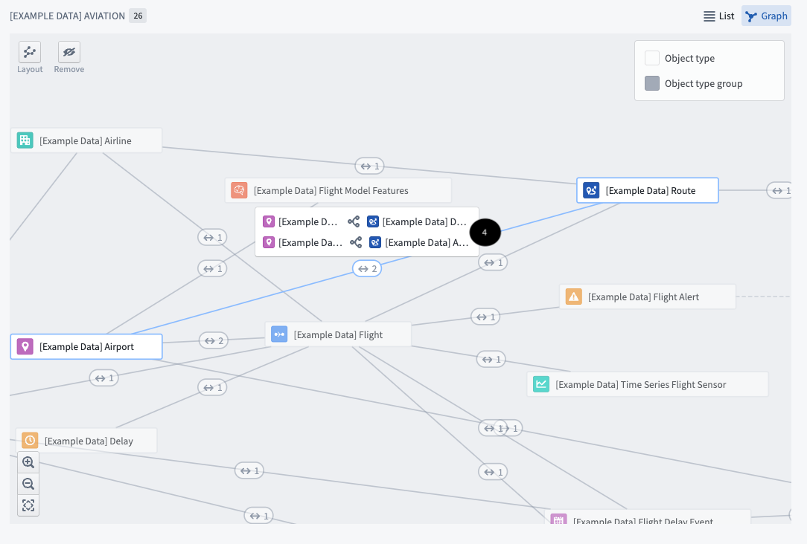
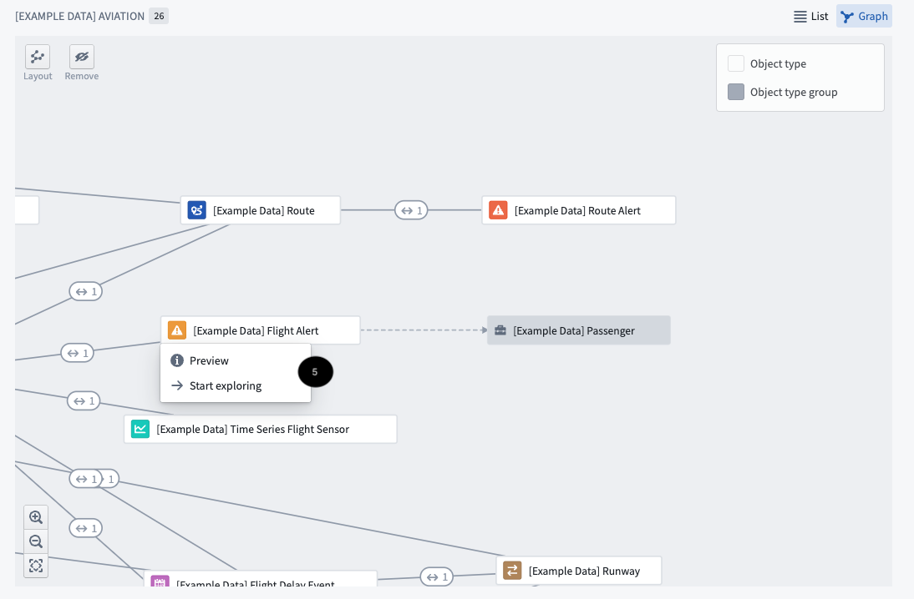
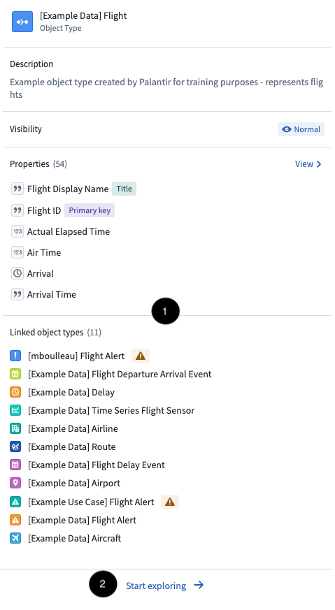

:::callout{theme="warning"}
注意：以下翻译的准确性尚未经过验证。这是使用 [AIP ↗](https://www.palantir.com/platforms/aip/) 从原始英文文本进行的机器翻译。
:::

# 入门

下面的主页是在打开 Object Explorer 时显示的。这是一个导向中心，用户可以从这里开始探索对象，可以带着特定问题进行探索，或者探索可能的对象类型。

在此视图中，用户可以执行以下主要操作：

* 从搜索栏 **(A)** 搜索平台中对象领域的所有内容。
* 探索一组对象类型 **(B, C, D)**。
* 预览特定对象类型 **(E)**。
* 选择特定对象类型进行探索 **(F)**。

## 全局搜索栏 (A)

全局搜索栏在整个 Ontology 中执行搜索。它可以被用于搜索单个对象、对象类型、已保存的探索或模块（对象支持的应用程序）。

:::callout{theme="warning"}
如果 Ontology 包含超过 250 个用户可能发现的对象类型，则关键词搜索将限制在前 250 个对象类型。要搜索特定对象类型或一组对象类型，您必须利用 [下面](#group-exploration-b-c-d) 描述的功能。
:::

这些搜索返回的结果中，搜索词 **(1)** 匹配以下内容：

* 对象类型、属性类型、已保存探索的标题和/或元数据（例如名称、描述等）。
* 单个对象的任何标题或属性。

某些匹配项，即对象类型和属性类型结果，将立即显示为输入建议结果 **(3)**。要查看所有匹配项，请点击第一个选项 **搜索...** **(2)** 以重定向到 [搜索结果页面](Search%20and%20explore%20objects/%E6%90%9C%E7%B4%A2Objects.md)。

您可以在 [搜索语法指南](Search%20and%20explore%20objects/%E6%90%9C%E7%B4%A2%E8%AF%AD%E6%B3%95.md) 中了解有关搜索栏语法的更多信息。

## 分组探索 (B, C, D)

用户可访问的所有对象类型都显示在搜索栏下方的[可配置对象组](%E9%85%8D%E7%BD%AEObject%20Explorer.md)中。使用侧边导航 **(C)** 选择并导航到一个组。

### 使用对象类型分组进行搜索 (B)

对象类型分组也反映在全局搜索栏中。预配置的组可在左侧选项卡中找到，自定义组可以在 **对象类型** 下快速配置。选择此处的对象类型组允许您在选择一个进行探索之前，在更精细的一组对象类型上执行搜索。

### 在图上探索对象类型组 (D)

该图旨在帮助用户探索 Ontology 并了解特定组内对象类型之间的连接。

点击 **图** 图标查看组图，显示组内对象类型之间的链接以及与其他对象类型组的链接 **(1)**。在此视图中，您还可以移除对象类型组 **(2)** 并更改图的设计 **(3)**。

点击链接符号 (<->) 显示对象类型之间的链接类型 **(4)**。

选择单个对象以查看菜单 **(5)**，允许您探索 [对象类型预览](#preview-object-types-e) 或开始探索。

## 预览对象类型 (E)

点击对象预览可以快速查看对象类型（无需进入更全面的探索页面）。在预览中，可以找到有关对象类型的信息 **(1)**，包括描述、属性和链接的对象类型。点击 **开始探索** **(2)** 以开始新的对象类型探索。

### 添加对象类型为收藏 (F)

对象类型可以通过点击其卡片上的星形图标 **(1)** 添加为收藏。收藏将在侧边导航顶部的专用组中显示。

:::callout
收藏也将在界面底部的“所有对象类型”完整列表中显示。
:::

### 探索与列表 (G)

已保存的探索与列表将显示在主页顶部以便于访问。它们也可以在 **Artifacts** 标签中找到。
