:::callout{theme="warning"}
注意：以下翻译的准确性尚未经过验证。这是使用 [AIP ↗](https://www.palantir.com/platforms/aip/) 从原始英文文本进行的机器翻译。
:::

# 配置Object Explorer

### 首页可自定义Object类型分组

要创建并将一个Object类型添加到一个分组，请访问Ontology Manager中的该Object类型的[元数据微件](../../%E5%AE%9A%E4%B9%89%E6%9C%AC%E4%BD%93/%E5%AF%B9%E8%B1%A1%E9%93%BE%E6%8E%A5%E7%B1%BB%E5%9E%8B/Object%20types/%E5%88%9B%E5%BB%BA%20Object%20%E7%B1%BB%E5%9E%8B.md#add-metadata-for-a-new-object-type)。请注意，您必须拥有Ontology的编辑权限才能创建和将Object类型添加到分组。

如果配置了自定义分组，任何不属于某个分组的非隐藏Object类型将被放置在页面底部名为“其他”的分组中。

### 从操作成功提示链接到Object视图

一旦操作成功应用，成功提示（弹出确认消息）可以配置为显示指向已创建或修改的Object实例的Object视图的超链接。这为新创建或修改的Object提供了快速访问Object视图的途径。

要以这种方式配置成功提示，您需要在相关*创建Object*操作的主键参数或相关*修改Object*操作的Object引用列表参数中添加一个新的类型类（见下面的代码）。可以使用Ontology Editor应用程序添加类型类，这需要您具有Ontology编辑权限。

```yaml
kind: "actions"
name: "view_object_with_type:<OBJECT_TYPE_ID>" # 视图对象与类型：<OBJECT_TYPE_ID>
```

让我们通过一个示例来演示如何添加一个成功通知，该通知链接到新创建的对象实例的对象视图。

1. Ontology操作“创建新飞机”允许我们创建一个新的Aircraft对象实例。

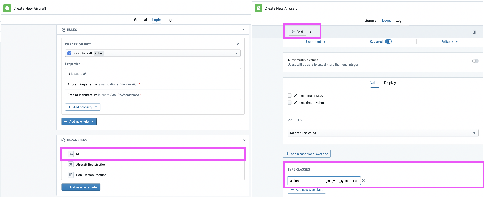

2. 在弹出的菜单中，输入相关信息，然后选择“提交”。在这个例子中，将创建一个Id为`187`和Aircraft Registration为`Q-AHE`的Aircraft对象实例。

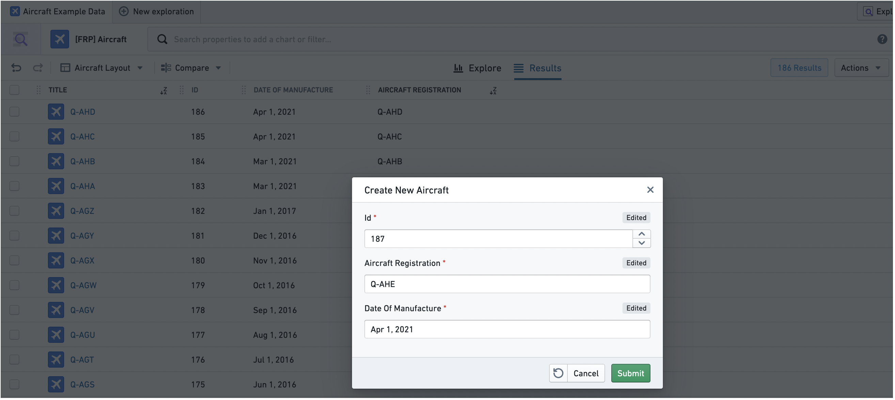

3. 现在我们已经在主键参数上添加了上述描述的类型类，成功通知将显示一个超链接，链接到新创建的对象实例`Q-AHE`。点击超链接将引导我们到该对象实例的对象视图。

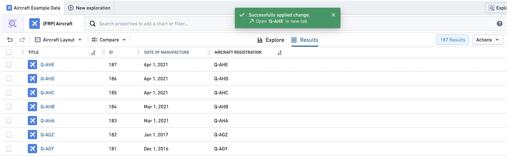

### 在Object Explorer中隐藏操作

操作将自动在Object Explorer中的三个位置显示，如[操作类型文档](../../%E5%AE%9A%E4%B9%89%E6%9C%AC%E4%BD%93/%E5%8A%A8%E4%BD%9C%E7%B1%BB%E5%9E%8B/%E5%9C%A8%E5%B9%B3%E5%8F%B0%E4%B8%AD%E4%BD%BF%E7%94%A8%E6%93%8D%E4%BD%9C.md)中所述。要隐藏某个对象类型的操作，请在Ontology Editor应用中的对象参考列表参数中添加`hubble-oe:hide-action`类型类。您需要有权限编辑ontology才能执行此操作。

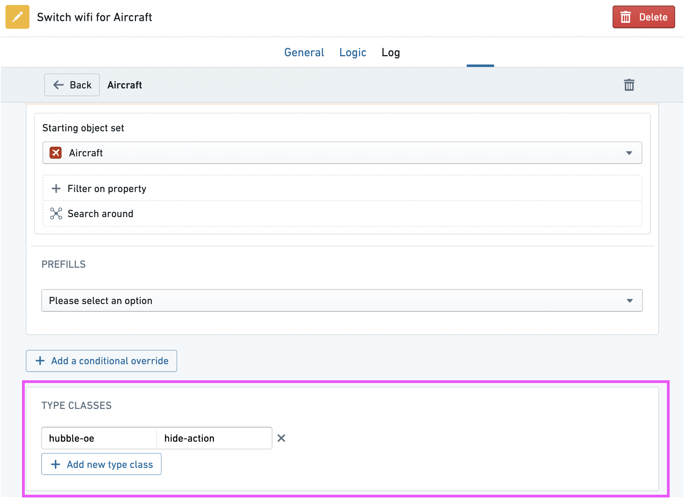

## 动态对象集上的操作

:::callout{theme="warning" title="警告"}
此功能仍在开发中，并且可能会*在没有*自动迁移的情况下被弃用。因此，使用它意味着您需要承担将来手动迁移操作的风险。如果您计划使用此特定功能，请在使用前联系您的Palantir代表。
:::

在某些情况下，您可能希望将探索的结果用作动态对象集，而不是静态对象集。动态对象集会保存为应用筛选的表示。因此，当新数据匹配（或不匹配）这些筛选时，对象集将会更新。

此功能最典型的应用案例是将动态对象集的引用添加为对象实例上的属性值。

让我们通过一个示例来演示如何创建一个操作，该操作允许我们根据飞机制造商的序列号（MSN）将一组动态的`Aircraft`对象指派给`Airline`对象。

1. 确保`Airline`对象类型具有一个`字符串`属性（在本例中为`Aircraft Set`），您可以将一组"Aircraft"对象的引用添加为值。启用此属性的值格式化，并从下拉菜单中选择**资源RID**。这样，指派给此属性的对象集RID将作为链接显示在Object Explorer中的对象集中。

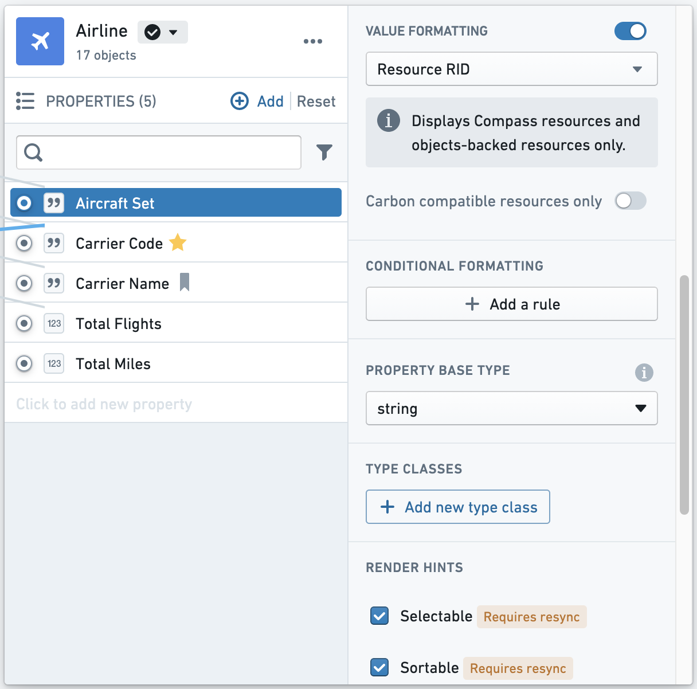

2. 现在您可以创建操作了。在操作中，添加一个**修改对象**规则到`Airline`对象类型的`Aircraft Set`属性上。

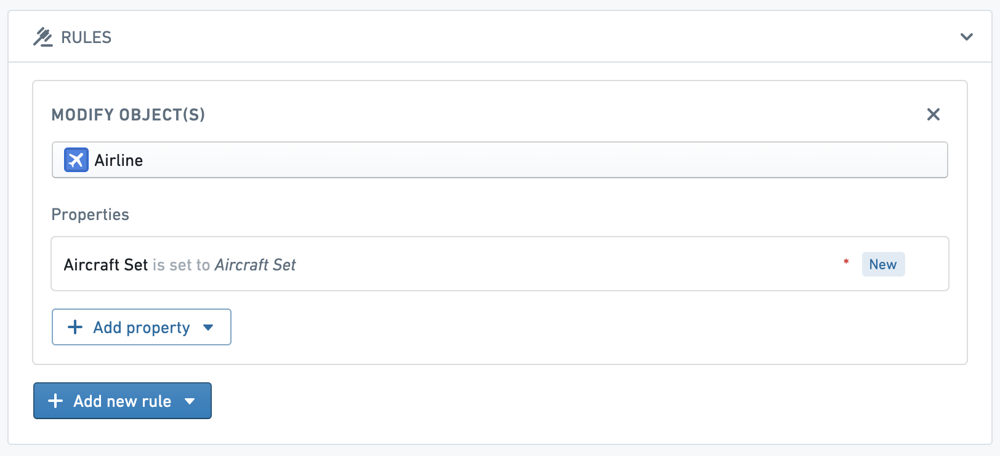

3. 在`Aircraft Set`参数上，添加以下类型类，其中`<OBJECT_TYPE_ID>`是您希望此操作在探索视图中作为选项出现的对象类型ID（在本例中为`Aircraft`对象类型）。

```yaml
kind: "hubble-oe-object-set-rid"
name: <OBJECT_TYPE_ID>  # 这是一个占位符，表示对象类型的唯一标识符
```

这段代码是YAML格式的配置片段，用于定义一个对象集的类型标识符。
4\. 同样在 `Aircraft Set` 参数上，添加以下类型类，其中 `<RESOURCE_RID>` 是包含您希望授予动态对象集的正确权限的文件夹的RID。注意，对象集不会在项目中公开，且不可搜索 - 此RID仅用于指定保存的对象集应获得哪些权限。

```yaml
kind: "hubble-oe-security-rid"
name: <RESOURCE_RID> # 资源的唯一标识符（RID），需要替换为具体的资源ID
```

5. 一旦操作创建完成，导航到 `Aircraft` 对象的探索。作为示例，我们可能希望将 MSN 在 5,025 到 5,050 之间的所有 `Aircraft` 指派给 Frontier Airlines。为此，筛选这些对象，并从操作下拉菜单中选择新创建的操作。

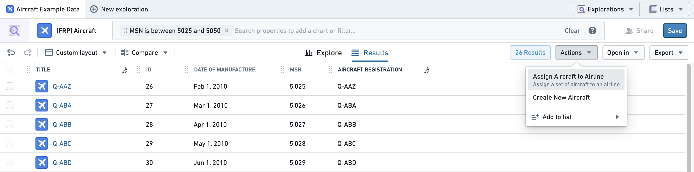

这将自动为您当前的探索创建一个动态对象集，并将其指派到您从下拉菜单中选择的 `Airline` 对象的 `Aircraft Set` 属性上。

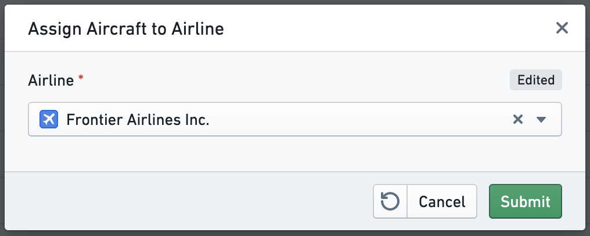

6. 现在，MSN 在 5,025 到 5,050 之间的 `Aircraft` 集的链接将出现在 "Frontier Airlines Inc." 对象的 `Aircraft Set` 属性中。如果在该范围内有任何新的 `Aircraft` 添加到Ontology中，或者当前集合中的任何 `Aircraft` 从Ontology中移除，集合将自动更新。

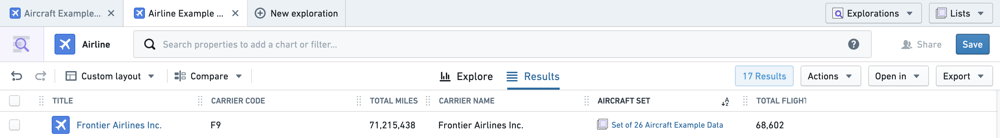

7. 使用一个链接对象探索微件，您可以通过访问 "Frontier Airlines Inc." 的 Object View 来查看这个动态对象集的内容：

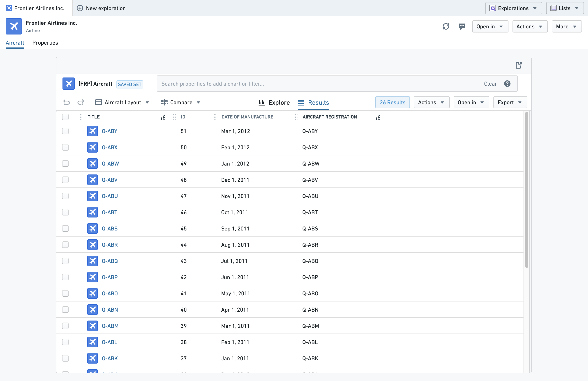

配置此微件时，将 `Initial Exploration` 设置为 **From Object Set RID Property**，并将 `Object Set RID Property` 设置为 **Aircraft Set**。

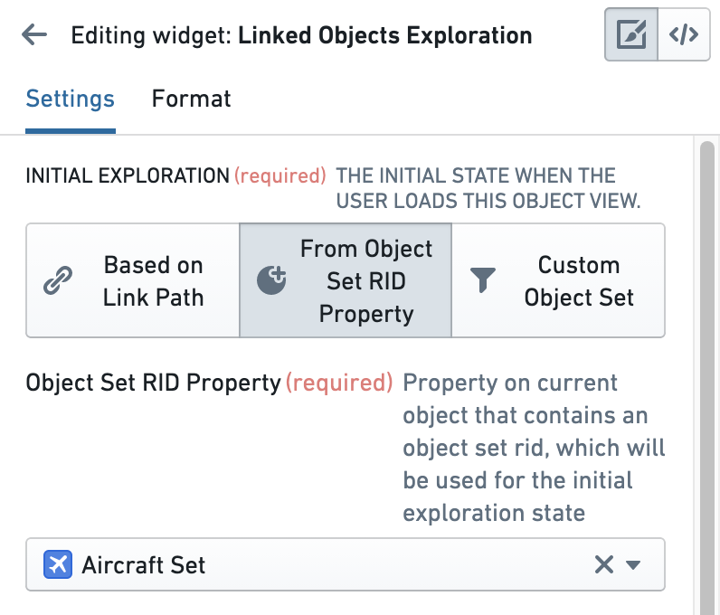

### 默认设计管理用户

属于 `hubble-exploration-admins` multipass 组的用户，或者在控制面板中具有 `Object Exploration Admin` 应用权限的用户，可以重命名、删除或保存对象类型的默认设计。设计包括对结果表配置所做的任何更改。如果您是管理员用户并希望将设计设置为所有用户的默认设计，在保存设计时，在 **设置为默认设计** 下勾选 **所有用户** 复选框，如下图所示。

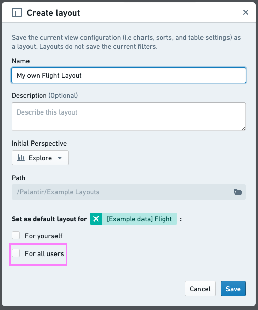
