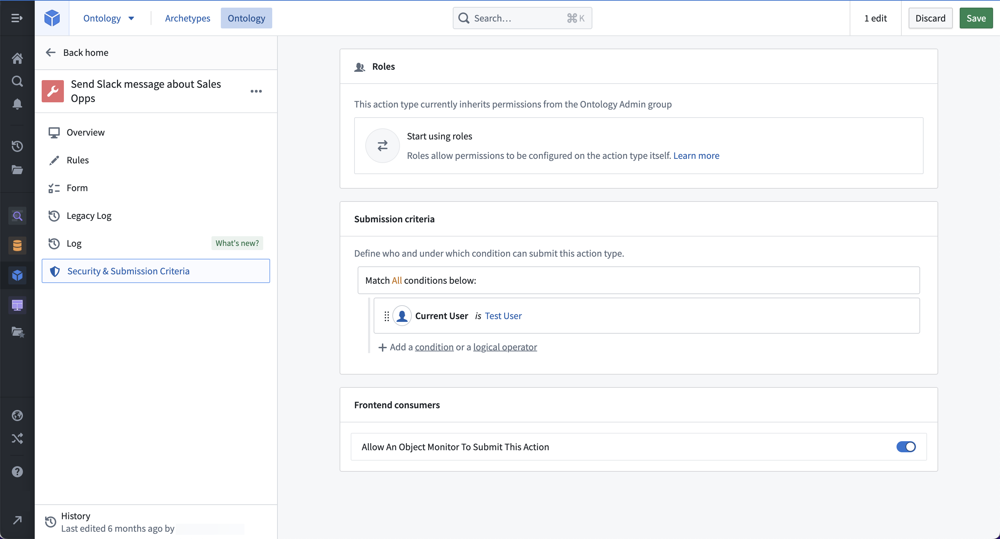
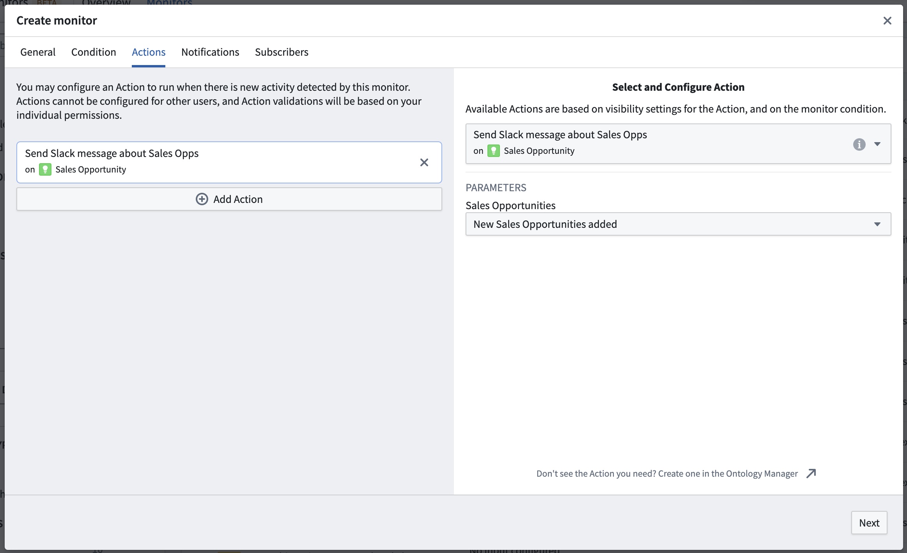

:::callout{theme="warning"}
注意：以下翻译的准确性尚未经过验证。这是使用 [AIP ↗](https://www.palantir.com/platforms/aip/) 从原始英文文本进行的机器翻译。
:::

# 操作

:::callout{theme="warning"}
Object监控已被[Automate](https://www.palantir.com/docs/foundry/automate/overview/)取代。Automate是一个完全向后兼容的产品，提供了平台上所有业务自动化的单一入口。
:::

[操作](../../../%E5%AE%9A%E4%B9%89%E6%9C%AC%E4%BD%93/%E5%8A%A8%E4%BD%9C%E7%B1%BB%E5%9E%8B/%E6%A6%82%E8%BF%B0.md)可以在Object监控触发或恢复时自动运行。

## 配置操作

订阅者可以配置操作，以便在有新的[监控触发](%E6%B4%BB%E5%8A%A8.md#monitor-triggered)活动事件时运行。监控器将在评估完成后自动提交操作。如果多个用户配置了操作，操作将分别为每个用户运行。

## 受影响的对象

对于事件条件，监控器检测到的对象集可以作为对象集参数传递到操作中。在[监控配置](../%E5%88%9B%E5%BB%BA%E4%B8%80%E4%B8%AA%E6%96%B0Object%E7%9B%91%E8%A7%86%E5%99%A8.md#create-from-object-monitors-application)页面的**操作**选项卡中，参数应配置为接受与正在监控的相同对象类型的`ObjectSet<>`。将提供选择对象集的选项。

:::callout{theme="warning"}
此对象集不能用作操作通知的输入；只有配置了操作效果的用户才能访问该监控执行的受影响对象集。
:::

## 操作可见性设置

并非所有操作都适合与Object监控一起使用。您可以在Ontology管理器中配置操作类型后禁用操作在Object监控中的出现。在创建操作类型后，通过点击**操作类型**列表中的操作类型查看其详细信息，然后点击左侧面板中的**安全性和提交标准**选项卡。然后，在**前端消费者**部分中找到开关，关闭“允许Object监控提交此操作”。

## 权限

操作与订阅监控的特定用户相关联。这意味着配置操作的订阅者必须通过该操作的[提交标准](../../../%E5%AE%9A%E4%B9%89%E6%9C%AC%E4%BD%93/%E5%8A%A8%E4%BD%9C%E7%B1%BB%E5%9E%8B/%E6%8F%90%E4%BA%A4%E6%A0%87%E5%87%86.md)。

操作不能代表其他订阅者进行配置。

:::callout{theme="warning"}
由于操作是代表特定用户运行的，因此如果该用户取消订阅或该用户账户被禁用或删除，操作将不再运行。
:::
