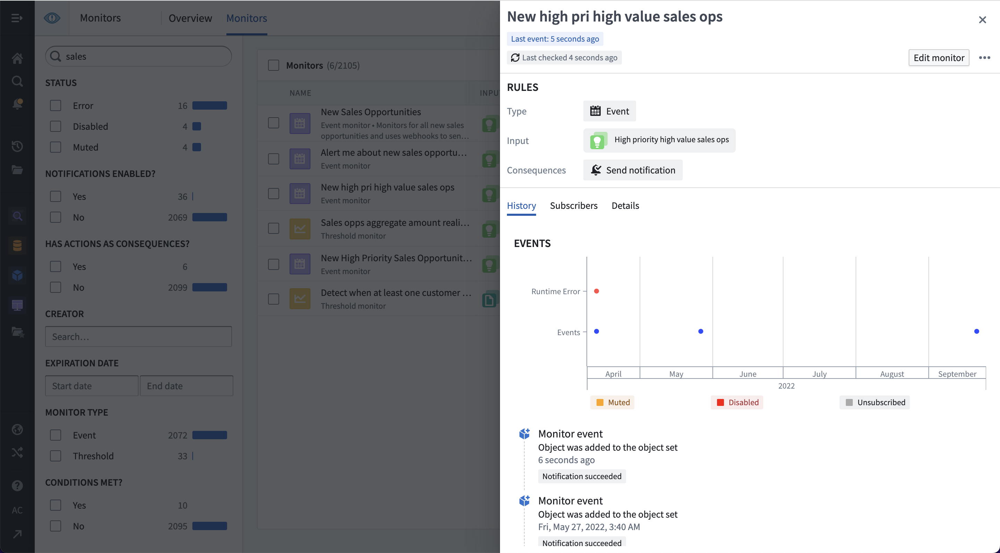
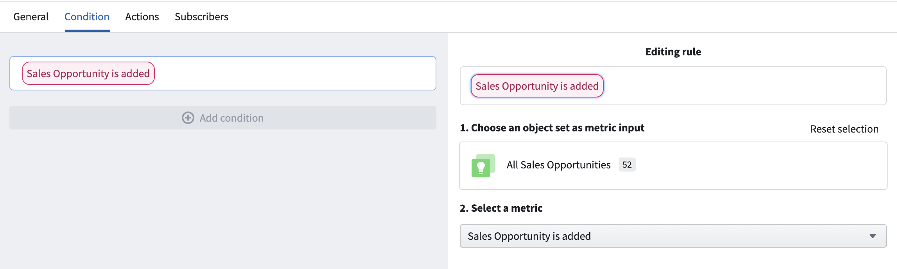
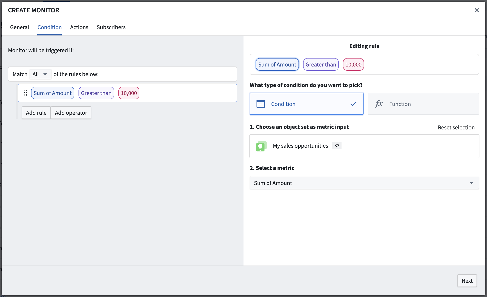
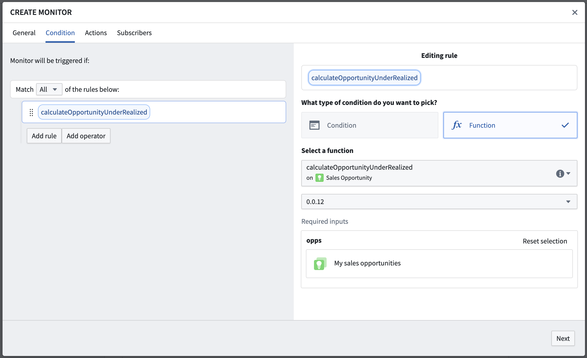

:::callout{theme="warning"}
注意：以下翻译的准确性尚未经过验证。这是使用 [AIP ↗](https://www.palantir.com/platforms/aip/) 从原始英文文本进行的机器翻译。
:::

# 条件

:::callout{theme="warning"}
Object监控已被[Automate](https://www.palantir.com/docs/foundry/automate/overview/)取代。Automate是一个完全向后兼容的产品，提供了一个用于平台中所有业务自动化的单一入口点。
:::

Object监控条件定义了何时会检测到并记录新的监控活动。**阈值**条件会导致一个连续的true或false状态，而**事件**条件会产生离散的事件。条件可能包括几个子条件，并可能引用多个[输入](%E8%BE%93%E5%85%A5.md)对象集。Object监控支持以下条件类型：

## 事件

事件条件是最常见的条件类型。事件条件包括从输入中添加或移除对象以及指标增加或减少条件。每个事件发生在特定时间并是一个离散事件。因此，它们在活动图中显示为点：



在下面的示例中，事件条件使用一个输入探索并检查何时在该探索中使用新对象。对象可能是因为它们新创建或更改为匹配用于定义输入的筛选而被添加。



某些事件条件可能需要一个阈值子条件。在这些情况下，只有当主条件和子条件都为true时，才能检测到事件。例如，阈值子条件可以用于检测输入对象数量增加，但仅当输入集中已经至少有`N`个对象的主条件得到满足时。

## 阈值

阈值条件在输入上运行，以随时间产生`true`或`false`的状态。活动在阈值被跨越时记录。使用阈值的条件可以包括任意数量的嵌套子条件。

Object监控应用中的一个阈值条件示例如下所示。在此示例中，条件检查销售机会自定义群体中的`amount`总和是否大于`10,000`。



:::callout{theme="neutral"}
阈值条件不支持[实时评估](%E8%AF%84%E4%BC%B0.md#realtime-evaluation)。
:::

## 函数支持

函数支持的条件旨在允许更复杂的条件定义，包括事件或阈值规则选项不支持的任何内容。函数支持的条件通过定义和发布一个返回Boolean值`true`或`false`的函数来工作。当监控被评估时，将调用该函数，响应必须表明该执行的结果。如果状态发生了更改，将记录一个事件。

函数应接受正在监控的对象类型的`ObjectSet<>`，并返回一个Boolean值，指示条件是否满足。了解更多关于[编写一个用于Object监控的函数](../../../%E5%AE%9A%E4%B9%89%E6%9C%AC%E4%BD%93/%E5%87%BD%E6%95%B0/%E5%9C%A8%E5%B9%B3%E5%8F%B0%E4%B8%AD%E4%BD%BF%E7%94%A8%E5%87%BD%E6%95%B0.md)。

下面的示例使用一个函数来计算销售机会对象的输入集中，当`realized_amount`总和小于`expected_amount`总和时。



```typescript
@Function()
/**
 * 该函数计算一组销售机会的实际实现金额是否小于所有机会金额的总和。
 */
public async calculateOpportunityUnderRealized(opportunities: ObjectSet<SalesOpportunity>): Promise<boolean> {
    // 计算所有机会金额的总和
    let amount = await opportunities.sum(o => o.amount)
    // 计算所有机会实际实现金额的总和
    let amountRealized = await opportunities.sum(o => o.amountRealized)
    // 判断实际实现金额是否小于总机会金额
    if (amount !== null && amountRealized !== null && amountRealized < amount) {
        return true
    } else {
        return false
    }
}
```

:::callout{theme="neutral"}
基于函数的条件不支持[实时评估](%E8%AF%84%E4%BC%B0.md#realtime-evaluation)。此外，基于函数的条件只能与阈值条件一起使用，并且只能输出单个布尔值。
:::
