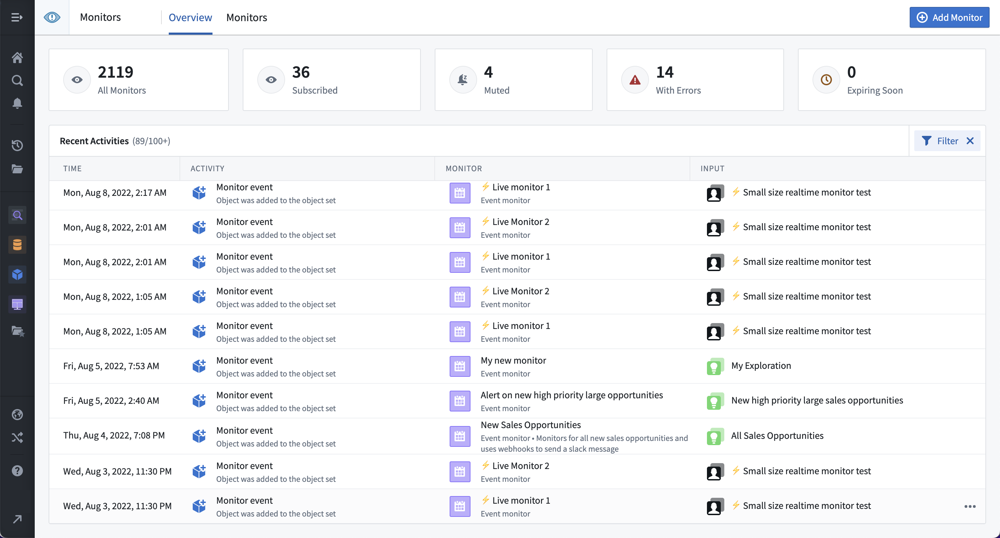
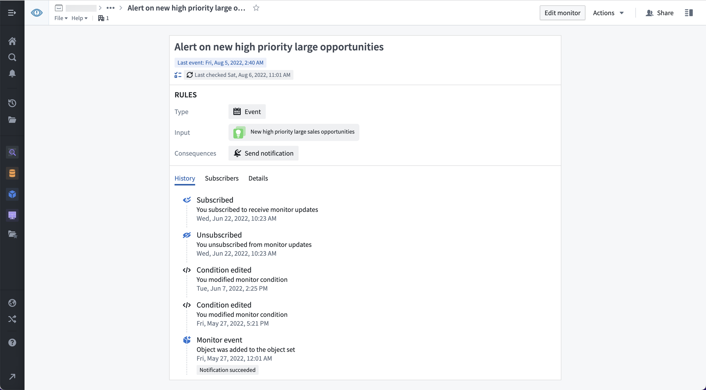

:::callout{theme="warning"}
注意：以下翻译的准确性尚未经过验证。这是使用 [AIP ↗](https://www.palantir.com/platforms/aip/) 从原始英文文本进行的机器翻译。
:::

# 活动

:::callout{theme="warning"}
Object监视器已被[Automate](https://www.palantir.com/docs/foundry/automate/overview/)取代。Automate是一个完全向后兼容的产品，提供了平台中所有业务自动化的单一入口点。
:::

Object监视器活动基于条件以及某些元数据属性更改或更新时记录。

用户订阅的所有监视器的活动时间线显示在Object监视器应用程序的**概览**页面上。

单个监视器的活动时间线显示在单个监视器概览面板的**历史记录**选项卡下。

## 活动事件类型

### `监视器触发`

当阈值条件状态从`false`变为`true`时，以及当检测到事件条件的事件时，记录`监视器触发`。

### `监视器恢复`

当阈值条件状态从`true`变为`false`时，记录`监视器恢复`。事件条件不会导致`监视器恢复`活动。

### `条件编辑`

当监视器条件由任何用户更新时，记录`条件编辑`。

### `已订阅`

当您订阅监视器时，记录`已订阅`。在您未订阅期间的活动将不会被记录或显示。

### `已取消订阅`

当您取消订阅监视器时，记录`已取消订阅`。在您未订阅期间的活动将不会被记录或显示。

### `评估失败`

当监视器因任何原因无法评估时，记录`评估失败`。可以从该监视器的活动**历史记录**视图中查看有关失败的详细信息。在监视器条件成功评估但通知或操作失败的情况下，也可能显示`评估失败`。

### `静音`

当监视器被任何用户静音时，记录`静音`。静音适用于所有订阅者。静音的监视器仍将被评估，但不会触发任何副作用（例如通知或操作）。

### `取消静音`

当监视器停止静音时，记录`取消静音`。静音适用于所有订阅者，并且在静音时间段到期后，监视器将自动取消静音。

### `禁用`

当监视器被任何用户禁用或由于活动过多而自动禁用时，记录`禁用`。禁用适用于所有订阅者。禁用的监视器不被评估。

### `启用`

当监视器停止禁用时，记录`启用`。启用适用于所有订阅者，并且在禁用时间段到期后，监视器将重新启用。
