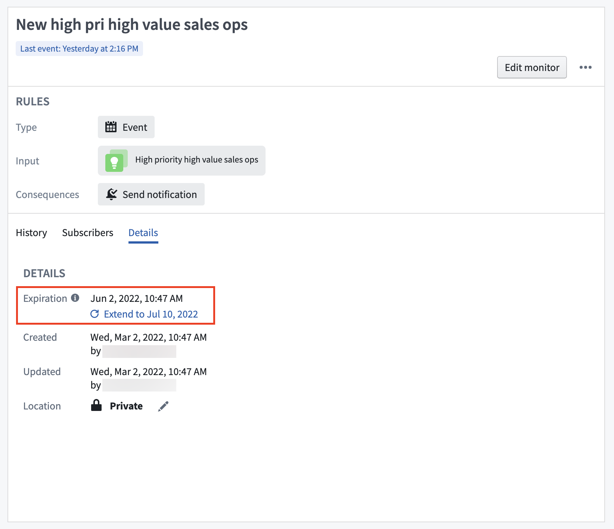

:::callout{theme="warning"}
注意：以下翻译的准确性尚未经过验证。这是使用 [AIP ↗](https://www.palantir.com/platforms/aip/) 从原始英文文本进行的机器翻译。
:::

# 监控

:::callout{theme="warning"}
Object监控已被[Automate](https://www.palantir.com/docs/foundry/automate/overview/)取代。Automate是一个完全向后兼容的产品，提供平台中所有业务自动化的单一入口点。
:::

监控是一个资源，用于定义一个或多个输入条件以及当输入条件满足时应该触发的任何结果操作或通知。

## 存储

Object监控保存在Foundry项目层级中，并且支持标准资源操作，如保存、共享、移动、删除和基于角色的访问。

了解[Foundry文件系统](https://www.palantir.com/docs/foundry/projects/overview/)。

Object监控通过格式唯一资源标识符进行识别：

```
ri.object-sentinel.main.monitor.0cabb748-cf89-4404-be3c-c8f198cb2a0b
```

这段代码看起来像是一个资源标识符（Resource Identifier），常用于标识云服务中的某个对象或资源。具体含义需要结合上下文来理解。

## 保留

Object监控器的历史活动保留六个月，之后将被永久删除。如果必须在此日期之后存储历史活动，您可以使用操作将数据存储在一个长久存在的Object中，该Object像任何其他用户创建的Object一样被管理和控制在[Foundry Ontology](../../../Ontology%E6%90%AD%E5%BB%BA.md)中。

当数据被删除时，它也会从Object监控应用程序中的监控活动**历史记录**选项卡中移除。您可以通过首先点击一个监控器以展开概览面板，然后点击**历史记录**来找到此选项卡。

## 过期

Object监控器总是有一个过期日期。最长允许的过期日期是未来三个月，并且可以由具有监控器`Editor`角色的用户在任何时间更新。

过期日期可以在Object监控器应用程序界面中查看和延长。点击一个监控器以查看屏幕右侧的监控器概览面板。然后，点击**详细信息**选项卡。



了解如何在[Object Explorer](../%E5%88%9B%E5%BB%BA%E4%B8%80%E4%B8%AA%E6%96%B0Object%E7%9B%91%E8%A7%86%E5%99%A8.md#create-from-object-explorer)或[Object Monitors](../%E5%88%9B%E5%BB%BA%E4%B8%80%E4%B8%AA%E6%96%B0Object%E7%9B%91%E8%A7%86%E5%99%A8.md#create-from-object-monitors-application)应用程序中创建新的Object监控器。
