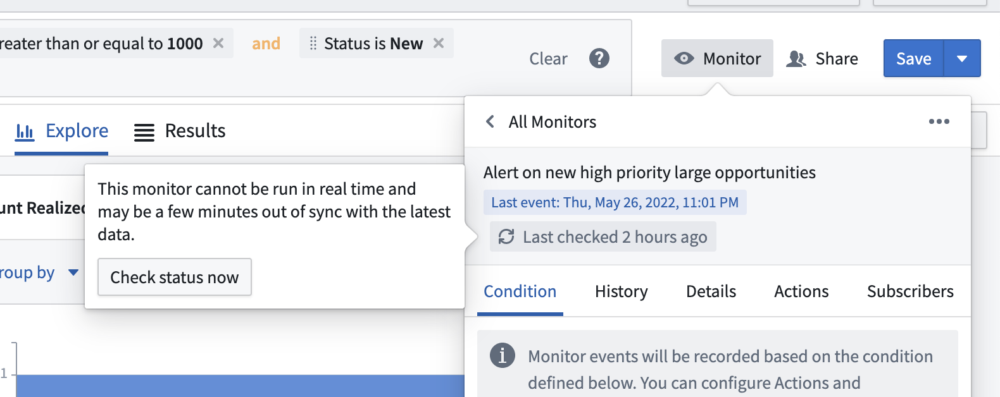

:::callout{theme="warning"}
注意：以下翻译的准确性尚未经过验证。这是使用 [AIP ↗](https://www.palantir.com/platforms/aip/) 从原始英文文本进行的机器翻译。
:::

# 评估

:::callout{theme="warning"}
Object Monitors 已被 [Automate](https://www.palantir.com/docs/foundry/automate/overview/) 取代。Automate 是一个完全向后兼容的产品，为平台中的所有业务自动化提供了一个单一的入口点。
:::

Object monitors 由订阅者单独评估，操作效果也由订阅者单独执行。这确保了依赖于用户属性的数据访问权限和操作验证得到遵守，同时允许用户为其个人工作流程配置 object monitors。

### 实时评估

某些输入和条件组合支持实时评估。支持实时评估的 object monitors 将被持续评估。通常在检测到更改后的几分钟内执行通知或操作。如果从管道搭建中同步了大量更改，使用这些对象作为输入的监控器的评估及其后续操作或通知可能需要更长的时间来执行。

要支持实时评估，必须满足以下所有条件：

* 在 Ontology 配置中，输入 Object 类型已迁移至 [Object Storage v2](../../../%E6%9C%AC%E4%BD%93%E6%9E%B6%E6%9E%84/%E5%AF%B9%E8%B1%A1%E5%90%8E%E7%AB%AF/%E6%A6%82%E8%BF%B0.md#evolution-of-foundry-ontology-backend)。
* 输入 Object 类型的实例少于 1000 万个。如果条件正在实时评估，并且由于新对象的添加导致对象类型超过此限制，监控器将无法评估。
* 输入对象集定义仅使用字符串、数值范围或布尔属性的精确匹配筛选。
* 输入对象集定义不包含链接的对象属性或数组属性。
* 规则使用 [事件条件](%E6%9D%A1%E4%BB%B6.md#event) 来处理从输入中添加或删除的对象。

#### 调度监控器

:::callout{theme="neutral"}
实时评估仅适用于来自管道搭建的更改。通过操作进行的更改可能需要长达七个小时才能被 Object Monitors 检测到。为了缩短此时间，请在任何需要立即通知的操作中包含一个[通知规则](../../../%E5%AE%9A%E4%B9%89%E6%9C%AC%E4%BD%93/%E5%8A%A8%E4%BD%9C%E7%B1%BB%E5%9E%8B/Side%20effects/%E8%AE%BE%E7%BD%AE%E9%80%9A%E7%9F%A5.md#add-a-notification)。
:::

虽然实时评估目前不支持调度监控器，但可以配置一个基于函数的操作，以便在 object monitor 检测到某个时段内的事件时运行，使用 TypeScript 检测当前时间/日期。以下代码片段展示了一个示例：

```typescript
@Edits(ObjectType)
@OntologyEditFunction()
public someEditFunction(): void {
    const currentTime = Timestamp.now() // 获取当前时间戳
    const currentHour = currentTimestamp.getHours(); // 获取当前小时
    if (currentHour >= 0 && currentHour < 12) {
      // 执行编辑操作
    }
}
```

### 非实时评估

无法实时评估的Object监视器通过轮询机制进行评估。监视器保证在前次评估后的24小时内进行评估。为了分配大量监视器评估的负载，基于轮询的评估发生的具体时间无法明确安排。基于轮询的监视器的上次评估时间将存储并显示在Object监视器应用界面的监视器概览面板中。

### 手动评估

非实时Object监视器也可以从Object Explorer界面手动评估。此选项主要用于设置非实时监视器时进行测试。


