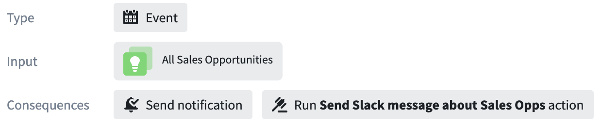
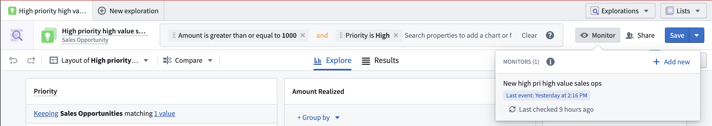

:::callout{theme="warning"}
注意：以下翻译的准确性尚未经过验证。这是使用 [AIP ↗](https://www.palantir.com/platforms/aip/) 从原始英文文本进行的机器翻译。
:::

# 输入

:::callout{theme="warning"}
Object Monitors 已被 [Automate](https://www.palantir.com/docs/foundry/automate/overview/) 取代。Automate 是一个完全向后兼容的产品，提供了平台中所有业务自动化的单一入口。
:::

监控输入是使用[对象集](https://www.palantir.com/docs/foundry/analytics/datasets-object-sets/#object-sets)定义的。然后，监控[条件](%E6%9D%A1%E4%BB%B6.md)可以引用输入的属性。输入可以用于计算指标，如聚合，或者监控何时在该输入中添加或移除Object。

输入对象集是通过在[Object Explorer](../../%E5%AF%B9%E8%B1%A1%E6%B5%8F%E8%A7%88%E5%99%A8/Analyze%20and%20compare/%E4%BF%9D%E5%AD%98%E6%8E%A2%E7%B4%A2.md)中搭建一个**已保存的探索**创建的。您可以在[Object Explorer 中直接添加已保存的探索作为监控输入](../%E5%88%9B%E5%BB%BA%E4%B8%80%E4%B8%AA%E6%96%B0Object%E7%9B%91%E8%A7%86%E5%99%A8.md#create-from-object-explorer)，或者在[Object Monitors 应用程序中配置新监控时](../%E5%88%9B%E5%BB%BA%E4%B8%80%E4%B8%AA%E6%96%B0Object%E7%9B%91%E8%A7%86%E5%99%A8.md#create-from-object-monitors-application)添加。

在Object Monitors应用程序中查看Object监控时，监控输入显示在概览部分。点击一个监控以打开概览面板。

在Object Explorer中查看特定已保存的探索时，使用此探索作为输入的Object监控会显示在屏幕右上角的**监控**弹出框中。

