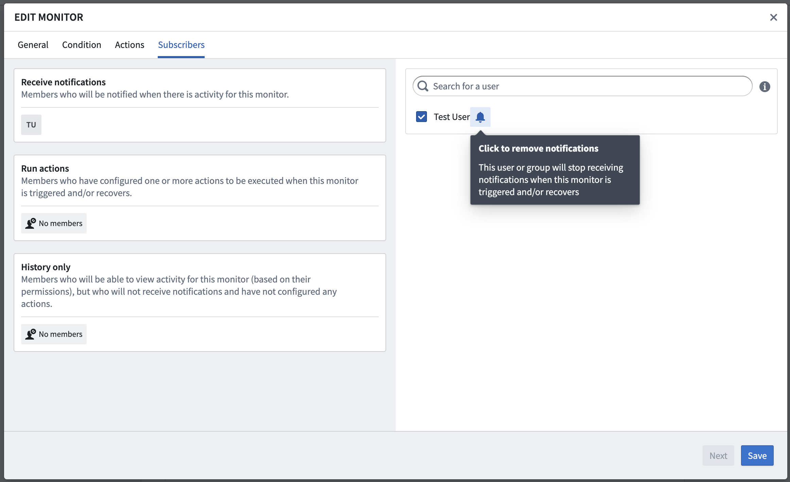
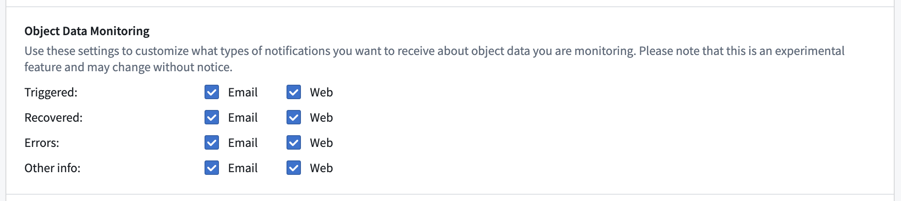
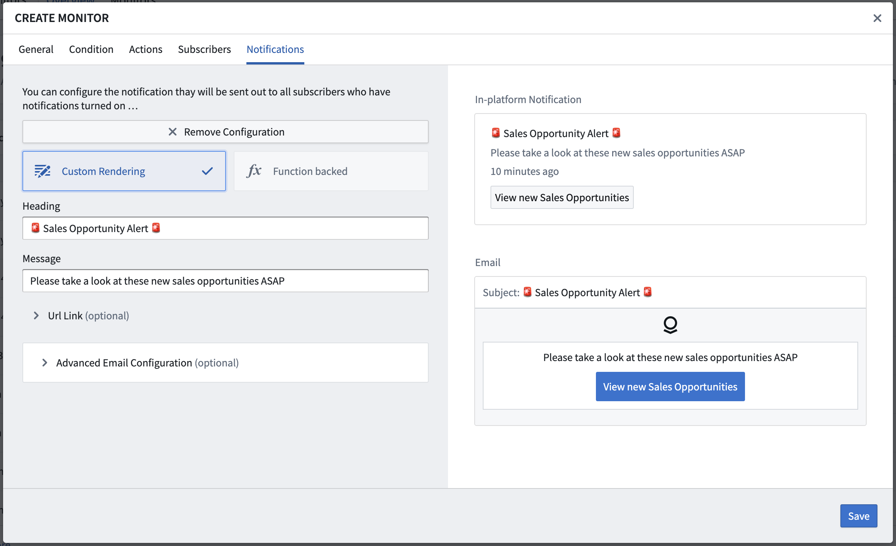

:::callout{theme="warning"}
注意：以下翻译的准确性尚未经过验证。这是使用 [AIP ↗](https://www.palantir.com/platforms/aip/) 从原始英文文本进行的机器翻译。
:::

# 通知

Object监视器的订阅者可以选择在监视器有新活动时接收通知。

默认情况下，所有订阅者都启用通知，但可以为个别订阅者禁用通知。要禁用通知，请在Object监视器应用中配置或编辑监视器时，点击**订阅者**选项卡中的铃铛图标。

个人用户还可以配置他们希望如何接收来自Object监视器的通知。您可以在监视器配置模式的**通知**选项卡中配置通知，偏好设置适用于该用户订阅的任何监视器的全局设置。

| 类别          | 活动类型                |
| ------------- | ----------------------- |
| `触发`        | [监视器触发](%E6%B4%BB%E5%8A%A8.md#monitor-triggered) |
| `恢复`        | [监视器恢复](%E6%B4%BB%E5%8A%A8.md#monitor-recovered) |
| `错误`        | [评估失败](%E6%B4%BB%E5%8A%A8.md#evaluation-failed) |
| `其他信息`    | [条件编辑](%E6%B4%BB%E5%8A%A8.md#condition-edited), [已订阅](%E6%B4%BB%E5%8A%A8.md#subscribed), [取消订阅](%E6%B4%BB%E5%8A%A8.md#unsubscribed), [静音](%E6%B4%BB%E5%8A%A8.md#muted), [取消静音](%E6%B4%BB%E5%8A%A8.md#unmuted), [禁用](%E6%B4%BB%E5%8A%A8.md#disabled), 或 [启用](%E6%B4%BB%E5%8A%A8.md#enabled) |

## 自定义通知内容

针对[监视器触发](%E6%B4%BB%E5%8A%A8.md#monitor-triggered)和[监视器恢复](%E6%B4%BB%E5%8A%A8.md#monitor-recovered)活动发出的通知可以自定义。您可以在Object监视器应用中配置或编辑监视器时，在**通知**选项卡中提供自定义通知配置。

### 模板化渲染

使用模板化渲染时，自定义内容（包括主题、正文、链接标签和链接目的地）直接显示在提供的表单中。如果需要，还可以在高级电子邮件配置中使用HTML。平台内和电子邮件通知的预览可以在表单的右侧看到。

### 函数支持渲染

使用函数支持渲染时，自定义内容从函数中返回，使用提供的通知返回类型。对于具有事件条件的监视器，函数可以接受被监视的Object类型的`ObjectSet<>`，从而可以直接在通知内容中提取和渲染监视器检测到的对象的数据。
