:::callout{theme="warning"}
注意：以下翻译的准确性尚未经过验证。这是使用 [AIP ↗](https://www.palantir.com/platforms/aip/) 从原始英文文本进行的机器翻译。
:::

# 创建一个新Object监视器

:::callout{theme="warning"}
Object监视器已被[Automate](https://www.palantir.com/docs/foundry/automate/overview/)取代。Automate是一个完全向后兼容的产品，提供了平台中所有业务自动化的单一入口。
:::

:::callout{theme="neutral"}
本教程假设您已经将数据集成到您的Foundry Ontology中。如果您需要首先执行此操作，请在文档中了解如何[创建您的Ontology](../../Ontology%E6%90%AD%E5%BB%BA.md)。
:::

## 从Object Explorer创建

在Object Explorer中保存一次探索后，可以通过点击屏幕右上角的**监视器**来创建监视器。可以通过在探索视图中点击**保存**并选择一个项目或文件夹目的地来保存探索。

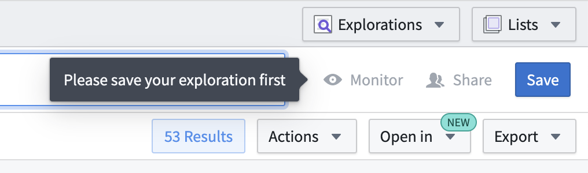

### 创建一个Object监视器

保存探索后，点击**监视器**打开一个视图，显示使用此探索作为输入的所有Object监视器。在新创建的探索中，此列表为空。

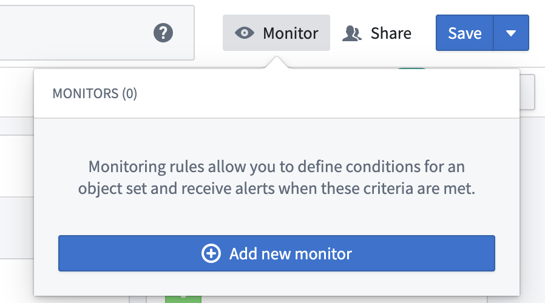

点击**添加新监视器**以打开一个简化的监视器设置视图。

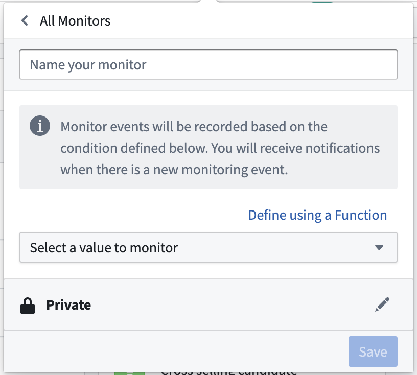

添加监视器名称、非必填描述和监视器[条件](Core%20concepts/%E6%9D%A1%E4%BB%B6.md)。

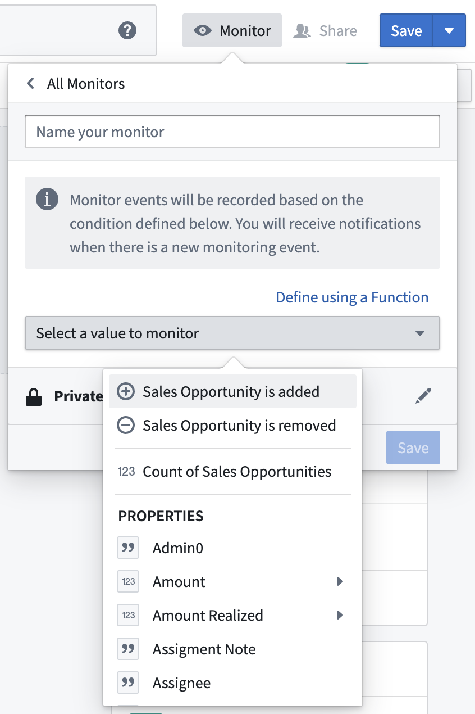

:::callout{theme="neutral"}
包含嵌套子条件的高级条件无法从此视图配置。相反，它们必须从Object监视器应用程序中创建和修改。
:::

您还可以选择性地将默认保存位置从**私有**更改为公共项目。如果计划有额外的订阅者，我们建议将保存的探索和监视器存储在共享项目中。

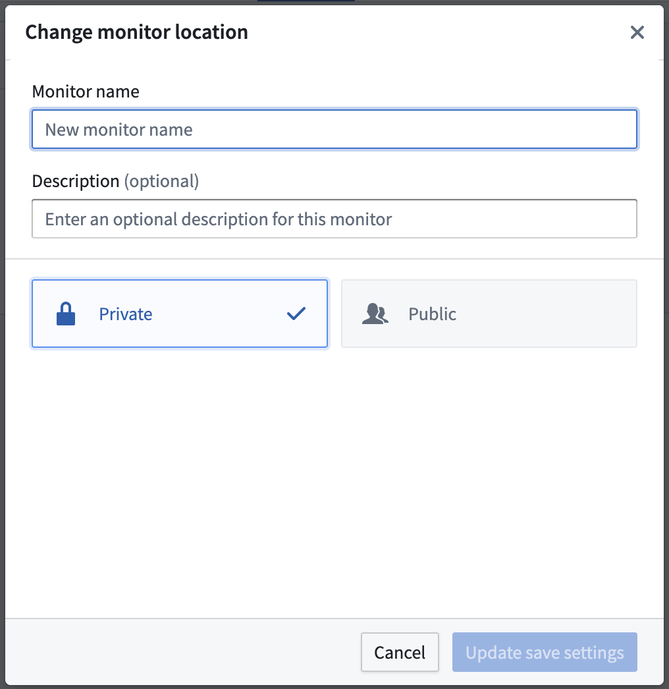

输入所需信息并点击保存后，您将返回到探索的监视器列表。此列表现在将包含新创建的监视器。

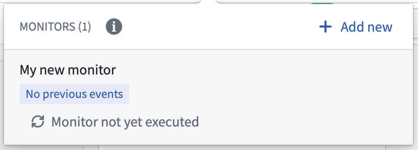

### 保存后

保存监视器后，可以使用其他选项。

监视器的元数据，包括其保存位置、创建时间和最后更新时间，显示在**详细信息**选项卡中。此选项卡还显示[过期日期](Core%20concepts/%E7%9B%91%E6%8E%A7.md#expiration)并允许您将过期日期延长三个月。

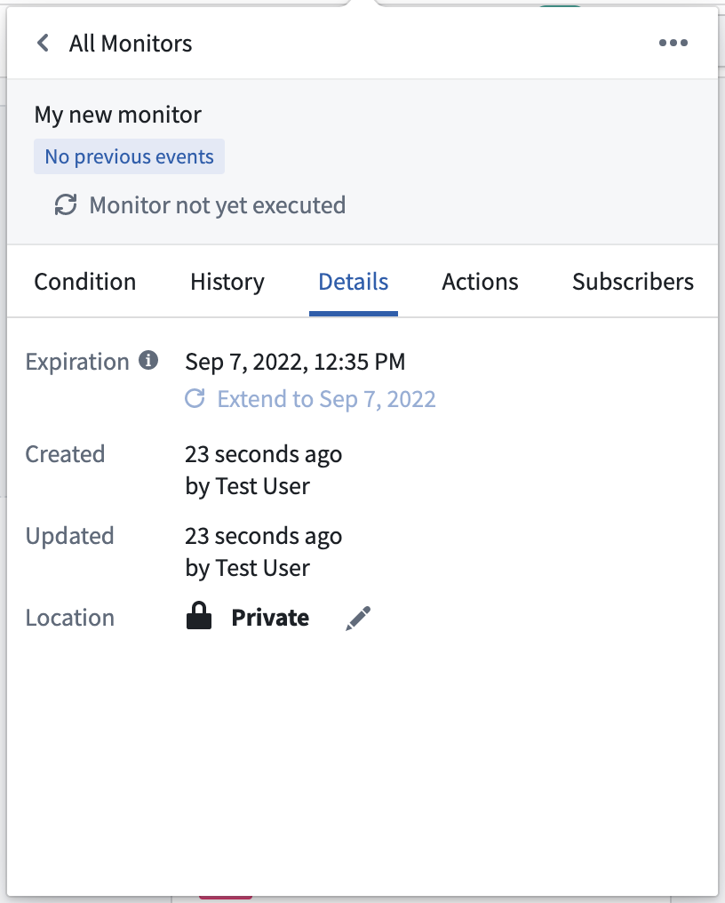

可以在**订阅者**选项卡中添加或移除订阅者，并且可以为每个订阅者启用或禁用通知。

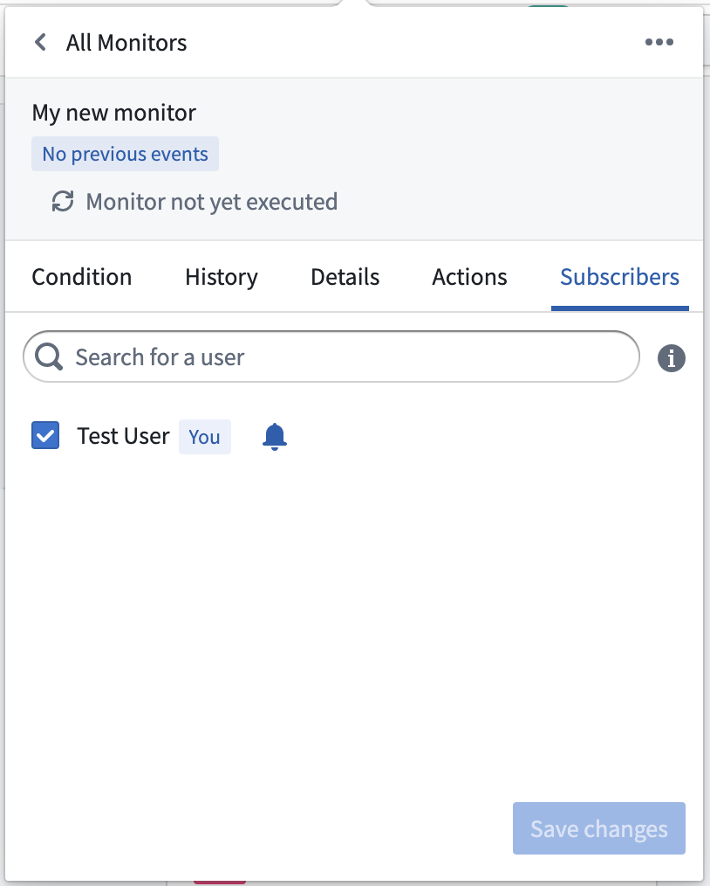

可以选择性地在**操作**选项卡中配置操作。

了解更多关于使用Object监视器[配置操作](Core%20concepts/%E6%93%8D%E4%BD%9C.md)的信息。

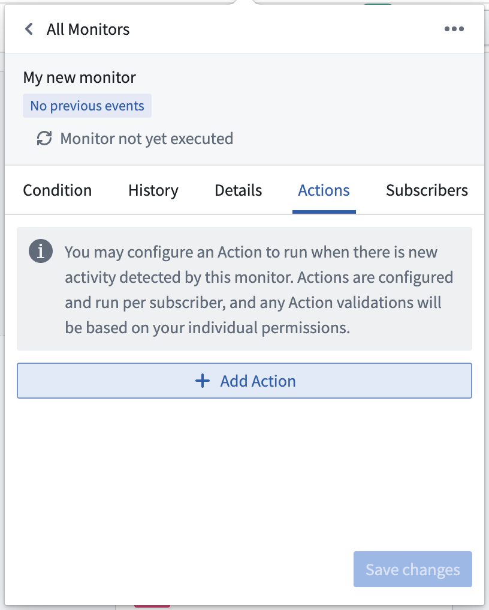

快速操作下拉菜单提供禁用或静音监视器的选项，以及通过将监视器移动到回收站来删除监视器的选项。

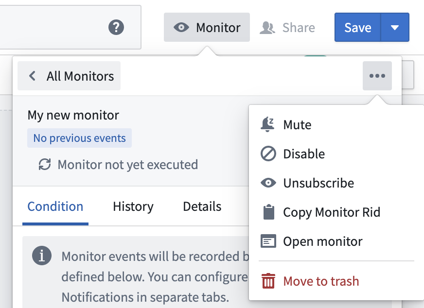

## 从Object监视器应用程序创建

Object监视器应用程序显示给定用户在所有项目中的所有可用监视器的[概览](https://www.palantir.com/docs/workspace/object-monitoring)。按照以下步骤在应用程序界面中创建新的监视器。

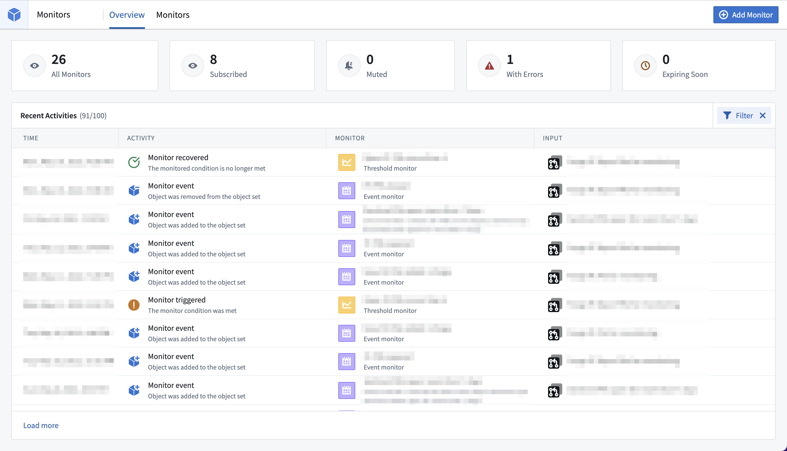

1. 通过点击右上角的**添加监视器**创建新监视器。

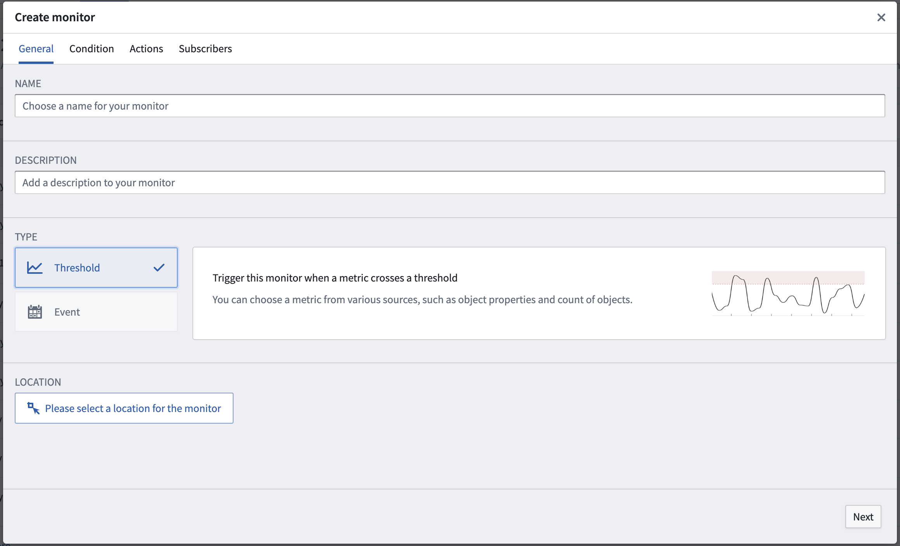

2. 为新监视器选择保存位置。对于将有多个订阅者的监视器，我们建议将其存储在共享项目中。

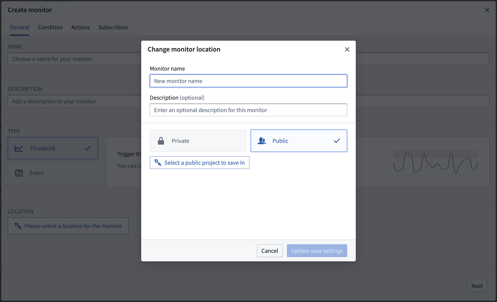

3. 提供完整的条件配置。配置选项根据您选择使用[事件](Core%20concepts/%E6%9D%A1%E4%BB%B6.md#event)或[阈值](Core%20concepts/%E6%9D%A1%E4%BB%B6.md#threshold)条件而有所不同。监视器[输入](Core%20concepts/%E8%BE%93%E5%85%A5.md)必须使用在Object Explorer中创建的现有保存探索。如果所需的输入探索不存在，请在Object Explorer中[创建它](../%E5%AF%B9%E8%B1%A1%E6%B5%8F%E8%A7%88%E5%99%A8/Analyze%20and%20compare/%E4%BF%9D%E5%AD%98%E6%8E%A2%E7%B4%A2.md)，然后返回此步骤。

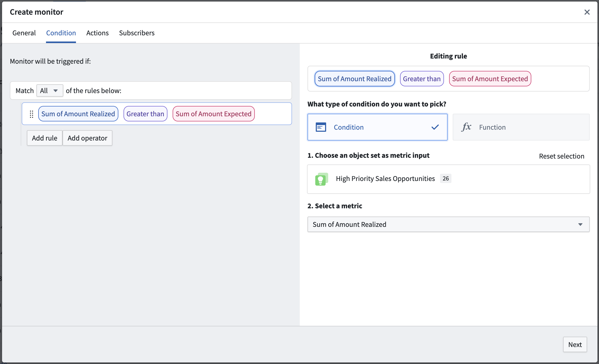

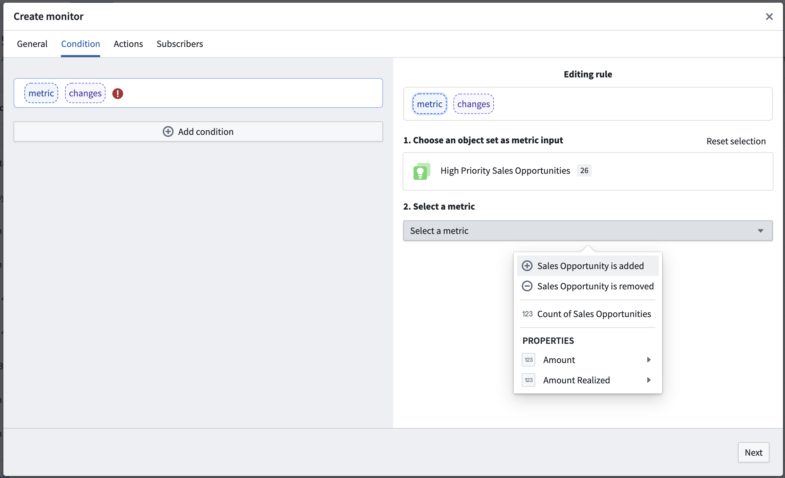

可以从**订阅者**选项卡中添加额外的订阅者。

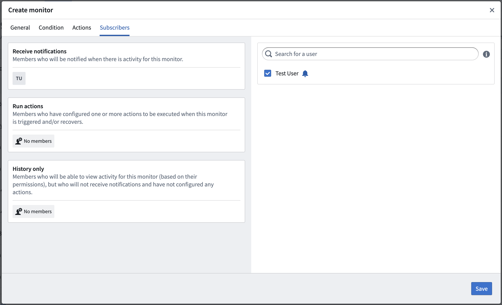

4. 点击**保存**以存储并启用您的新监视器。
