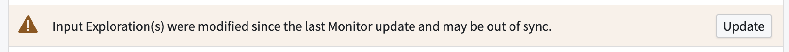

:::callout{theme="warning"}
注意：以下翻译的准确性尚未经过验证。这是使用 [AIP ↗](https://www.palantir.com/platforms/aip/) 从原始英文文本进行的机器翻译。
:::

# 错误参考

:::callout{theme="warning"}
Object监控器已被[Automate](https://www.palantir.com/docs/foundry/automate/overview/)取代。Automate是一个完全向后兼容的产品，提供了平台中所有业务自动化的单一入口点。
:::

本页面描述了在使用Object监控器应用程序或Object Explorer中的**监控器**视图时可能遇到的一些常见错误类别。

## 评估错误

由于底层数据的问题，监控器可能无法评估。监控器会自动重试，但某些错误可能需要手动干预。例如，如果正在监控的Object类型被删除，使用包含该类型Object的输入的监控器将无法评估。

### 监控器不同步

Object监控器使用对[已保存探索](../%E5%AF%B9%E8%B1%A1%E6%B5%8F%E8%A7%88%E5%99%A8/Analyze%20and%20compare/%E4%BF%9D%E5%AD%98%E6%8E%A2%E7%B4%A2.md)的引用来定义输入。此引用不是动态的，而是根据保存监控器时探索的存在状态进行存储。如果探索发生更改，监控器将继续使用探索的旧状态进行评估，除非监控器更新。在这种情况下，监控器上会显示一个警告横幅：

## 通知效果错误

在成功的监控器评估之后，通知可能无法发送。如果发生这种情况，历史事件将显示一个标签，指示该事件的通知未发送给订阅者，并提供其他详细信息，例如错误标识符和错误消息。

## 操作效果错误

在成功的监控器评估之后，操作效果可能无法执行。这种失败可能由于多种原因，包括使操作逻辑与监控器上的已保存输入配置不兼容的更改，或因为操作的[提交标准](../../%E5%AE%9A%E4%B9%89%E6%9C%AC%E4%BD%93/%E5%8A%A8%E4%BD%9C%E7%B1%BB%E5%9E%8B/%E6%8F%90%E4%BA%A4%E6%A0%87%E5%87%86.md)未满足。如果发生这种失败，历史事件时间线将显示一个标签，指示一个或多个操作未能为该事件执行，并提供相关的错误详细信息。

## 权限

监控器评估使用单个订阅者的权限。这是为了确保监控器评估和任何后续的操作或通知效果始终反映用户在评估监控器时可以访问的数据。如果用户缺少查看输入Object类型、已保存探索和/或Object监控器的权限，他们可能会看到与权限相关的错误消息，而不是成功评估。我们强烈建议将监控器及其输入存储在共享的[项目](https://www.palantir.com/docs/foundry/security/projects-and-roles/)中。
